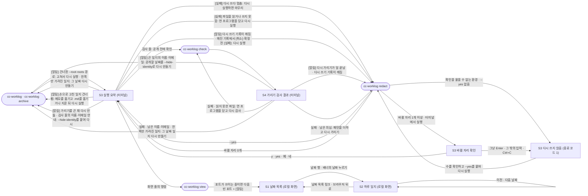

# DESIGN — cc-worklog

> 상태: 작성됨
> 기준 PRD: 상태 `확정`, 마지막 수정 2026-10-22 (A23 남은 이름·이메일을 세는 단위와 그에 맞춘 F2·S4·A19까지 들어간 판)
> 개선 회차: `docs/IMPROVEMENT.md`의 디자인·둘 다 항목. 1회차 I-01~I-05·I-09~I-12·I-17(우선순위 확정판 2026-10-21, 2026-10-21~22), 2회차 정리 회차 I-29·I-31·I-32(사용자 결정 2026-10-22) 반영 (맨 끝 "5. 개선 반영")

<!-- 상태: 미작성 → 작성됨(디자인 에이전트가 씀). PRD가 확정된 뒤에만 작성해요. -->

## 1. 화면 흐름

S1·S2는 브라우저로 여는 로컬 화면이고, S3·S4는 터미널 출력이에요. 둥근 상자는 화면이 아니라 사용자가 터미널에서 실행하는 명령이에요. 명령 이름은 DEV.md를 따라요(일지 만들기 `cc-worklog`, 보관 `cc-worklog archive`, 보관본 다시 가리기 `cc-worklog redact`, 검사 `cc-worklog check`, 화면 열기 `cc-worklog view`).



| 출발 화면 | 동작 | 도착 화면 |
|---|---|---|
| (터미널) | `cc-worklog`(일지 만들기) 또는 `cc-worklog archive`(보관) 실행. 일지 만들기는 날짜 옵션 없이(오늘과 빠진 날짜·그날이 끝나기 전에 만든 일지), `--date <날짜>`(하루), `--from <날짜> [--to <날짜>]`(기간) 셋 중 하나예요(PRD A18) | S3 |
| (터미널) | `cc-worklog redact` 실행, 바뀔 자리 1개 이상, 입력·출력이 모두 터미널, `--yes` 없음 | S3 (바뀔 자리 확인) |
| (터미널) | `cc-worklog redact --yes` 실행 | S3 (바뀔 자리 목록 → 다시 가리기 결과, 묻지 않음) |
| (터미널) | `cc-worklog redact` 실행, 바뀔 자리 0개 | S3 (바뀔 자리 없음, 종료 코드 0) |
| (터미널) | `cc-worklog redact`를 파이프·리디렉션·CI 등 확인을 물을 수 없는 곳에서 `--yes` 없이 실행 | S3 (바뀔 자리 목록 + 다시 쓰지 않음, 종료 코드 1) |
| S3 (바뀔 자리 확인) | `y`·`yes`·`예`·`네` 입력 | S3 (다시 가리기 결과) |
| S3 (바뀔 자리 확인) | 그냥 Enter, 그 밖의 입력, 또는 질문 중 Ctrl+C | S3 (다시 쓰지 않음, 종료 코드 1) |
| S3 (다시 쓰지 않음 · 확인 불가) | 수를 확인한 뒤 `--yes`를 붙여 다시 실행 | S3 (다시 가리기 결과) |
| S3 (`[실패]` 다시 쓰다 멈춤) | 원인을 고친 뒤 `cc-worklog redact`(또는 `cc-worklog`·`cc-worklog archive`)를 다시 실행 | S3 (확정 전에 멈췄으면 그 자리에서 되돌려서 보통 출력 그대로, 확정 뒤에 멈췄으면 마저 끝냈다는 `[알림]`이 붙은 출력. 깨진 기록에서 시작한 다시 가리기가 확정 전에 멈췄으면 깨진 기록 `[알림]`이 붙은 출력이고, 다시 가리기면 바뀔 자리 확인으로 가요) |
| S3 (깨진 기록에서 시작한 다시 가리기를 확인한 뒤 확정 전에 프로그램이 갑자기 꺼짐, 그 뒤 출력 없음) | `cc-worklog`·`cc-worklog archive`·`cc-worklog redact` 중 하나를 실행 | S3 (되돌림 `[알림]` 바로 다음에 깨진 기록 `[알림]`. 다시 가리기면 이어서 바뀔 자리 확인) |
| S3 (다시 가리기 `[실패]` 보관본·일지 파일을 읽거나 쓰지 못함) | 그 파일을 연 프로그램(편집기·화면·백신 등)을 닫거나 권한을 고친 뒤 `cc-worklog redact`를 다시 실행 | S3 (바뀔 자리 확인. 바뀔 자리를 처음부터 다시 세요) |
| S3 (다시 가리기 `[알림]` 한쪽만 가려진 일지) | 안내에 적힌 다시 만드는 명령(`cc-worklog --date <날짜>`와 그 일지를 만든 설정의 옵션) 실행. 만들 때 `--root`나 `--claude-dir`를 줬으면 같은 값을 붙여서 | S3 (일지 만들기) |
| S3 (일지 만들기 `[알림]` `--root`·`roots` 경로를 건너뜀) | 경로를 고친 뒤 다시 실행 (`[알림] config.json의 roots …`면 `config.json`을, `[알림] --root …`면 명령의 옵션을 고쳐요) | S3 |
| S3 (일지 만들기 `읽음` 칸의 세션 없던 저장소 안내) | `config.json`의 `roots`에 저장소가 든 폴더를 넣거나 `--root`를 붙여 다시 실행. 이미 있는 지난 일지에도 넣으려면 `--from <날짜>`로 다시 만들어요(기본 실행은 그날이 끝난 뒤 만든 일지를 그대로 둬요, PRD A18) | S3 (안내 없음, `저장소` 수에 그 저장소가 들어요) |
| S3 (일지 만들기 `[알림]` 손으로 고친 일지를 건너뜀) | 메모를 다른 곳에 옮긴 뒤 그 날짜의 `.md` 파일을 옮기거나 지우고 같은 명령을 다시 실행. 다시 가리기·검사가 보여 준 다시 만드는 명령도 손으로 고친 일지면 여기로 와요(PRD A21) | S3 (그 날짜가 새로 만듦) |
| S3 (일지 만들기 `[알림]` 이름·이메일 가리기를 끈 채 다시 만듦) | `[알림]`에 적힌 명령(이번 명령에 `--hide-identity`를 붙인 것) 실행 | S3 |
| S3 (일지 만들기 `검사` 줄의 이름·이메일 안내) | 공개할 날짜를 `--hide-identity`를 붙여 다시 만든 뒤 `cc-worklog check` | S3 → S4 |
| (터미널) | `cc-worklog check` 실행 | S4 |
| (터미널) | `cc-worklog view` 실행 → 브라우저가 열려요 | S1 |
| (터미널) | `cc-worklog view` 실행, 요청한 포트(기본 포트 포함)가 쓰이는 중 | S1 (다음 빈 포트로 열리고, 터미널에 바뀐 포트 `[알림]`) |
| S3 | `화면` 줄에 적힌 `cc-worklog view` 실행 | S1 |
| S3 | `검사` 줄 안내대로 공개 전에 `cc-worklog check` 실행 | S4 |
| S4 | 실패 · 읽지 못한 파일(`읽지 못함` 줄): 그 파일을 연 프로그램(편집기·화면·백신 등)을 닫거나 파일 권한을 확인한 뒤 `cc-worklog check` 다시 실행 | S4 |
| S4 | 실패 · 남은 의심: 필요하면 사용자 패턴을 더하고 `cc-worklog redact` 실행 | S3 (바뀔 자리 확인) |
| S4 | 실패 · 사용자 패턴 시험 값 놓침: `patterns.json`을 고치고 다시 검사 | S4 |
| S4 | 실패 · 남은 이름·이메일: 안내에 적힌 다시 만드는 명령(`cc-worklog --date <날짜> --hide-identity`와 그 일지의 나머지 옵션) 실행 후 다시 검사. 만들 때 `--root`나 `--claude-dir`를 줬으면 같은 값을 붙여서 | S3 → S4 |
| S4 | 통과·실패와 관계없이 `[알림]` 끈 일지에 이름·이메일이 남음(PRD A19): 공개할 날짜의 일지를 `[알림]`의 명령 모양(`cc-worklog --date <날짜> --hide-identity`)대로 다시 만든 뒤 다시 검사 | S3 → S4 |
| S4 | 실패 · 한쪽만 가려진 일지: (필요하면 `cc-worklog redact` 뒤) 안내에 적힌 다시 만드는 명령(`cc-worklog --date <날짜>`와 그 일지의 옵션, 이름·이메일 안내에도 걸린 날짜는 `--hide-identity`까지) 실행 후 다시 검사 | S3 → S4 |
| S4 | `[알림]` 지난번 다시 가리기가 덜 끝남: `cc-worklog`·`cc-worklog archive`·`cc-worklog redact` 중 하나를 실행한 뒤 다시 검사 | S3 (`[알림] 지난번에 멈춘 보관본 다시 가리기를 마저 끝냈어요 …`) → S4 |
| S4 | `[알림]` 다시 쓰기 기록이 깨짐: `cc-worklog redact`를 다시 실행한 뒤 다시 검사 | S3 (바뀔 자리 확인, 깨진 기록 `[알림]`) → S4 |
| S3 (일지 만들기·보관, 깨진 기록 `[알림]`) | `cc-worklog redact`를 다시 실행 | S3 (바뀔 자리 확인, 깨진 기록 `[알림]`. 바뀔 자리 0개면 묻지 않고 지워 정리했다는 `[알림]`) |
| S3 (다시 가리기, 깨진 기록에서 거절·Ctrl+C·확인 불가) | `cc-worklog redact`를 다시 실행 (확인을 물을 수 없었으면 `--yes`를 붙여서) | S3 (다시 가리기 결과 + 깨진 기록을 지웠다는 `[알림]`) |
| S1 | 날짜 행 누르기 (Tab으로 옮겨 Enter도 같아요) | S2 (그 날짜) |
| S1 | 보관 실패 배너 안의 날짜 링크 누르기 | S2 (그 날짜) |
| S2 | 맨 위 "← 날짜 목록" 링크 또는 브라우저 뒤로 가기 | S1 |
| S2 | "‹ 이전 날짜" / "다음 날짜 ›" 누르기 (일지가 있는 날짜끼리만) | S2 (다른 날짜) |
| S2 | 프로젝트 목차의 프로젝트 이름 누르기 | S2 (같은 화면 안 그 프로젝트 위치) |
| S1·S2 (다시 가리기 배너) | 배너에 적힌 명령을 터미널에서 실행한 뒤 페이지를 새로 열기 | S1·S2 (배너 없음) |
| S1·S2 (기준 줄) | 기준 줄 안내대로 터미널에서 `cc-worklog`를 다시 실행한 뒤 브라우저에서 새로 고침 | S1·S2 (새 실행 기준. 열어 둔 화면은 새로 고침 전까지 바뀌지 않아요) |
| S1·S2 | 화면 서버가 꺼진 뒤 새로 고침·이동 | 브라우저 기본 오류 화면 (이 도구의 화면이 아니에요. 터미널에서 `cc-worklog view`를 다시 실행하면 돼요) |

- "S3 (바뀔 자리 확인)", "S3 (다시 쓰지 않음)", "S3 (`[실패]` 다시 쓰다 멈춤)"은 새 화면이 아니라 S3의 상태예요. 다시 가리기는 한 명령 안에서 바뀔 자리 수 → 확인 → 결과로 이어져요(PRD 4장 참고).
- 다시 가리기가 확정 뒤에 멈추거나 다시 쓰는 중에 프로그램이 갑자기 꺼지면, 다음 `cc-worklog`·`cc-worklog archive`·`cc-worklog redact` 중 무엇을 실행해도 먼저 마무리해요(DEV.md). 그래서 멈춘 뒤 갈 곳은 따로 정하지 않고, 마무리 결과(마저 끝냄 / 되돌림)를 그 명령의 S3 `[알림]`으로 알려요.
  - 마무리 전까지 읽기만 하는 S4는 `[알림]`, S1·S2는 다시 가리기 배너로 "일부 파일만 바뀐 상태일 수 있어요"를 알려요(PRD S1·S2·S4·A16). 확정 뒤에 멈춘 기록(파일을 바꾸기 시작한 뒤)만 알리고, 확정 전에 멈춘 기록은 바뀐 파일이 없어서 알리지 않아요. 다만 깨진 기록에서 시작한 다시 가리기는 예외예요(아래 셋째 항목).
  - 다시 쓰기 기록이 깨져 읽을 수 없으면 어느 명령도 마무리하지 못해요. 이때는 S1·S2·S3·S4 모두 "다시 쓰기 기록이 깨져 자동으로 마저 끝낼 수 없어요"와 함께 `cc-worklog redact`로 보내요. 일지 만들기·보관은 멈추지 않고 하던 일을 끝내요(종료 코드 그대로). 깨진 기록은 다시 가리기만 정리해요(PRD A16).
  - 깨진 기록에서 시작한 다시 가리기가 확인 뒤 확정 전에 멈추거나 되돌려지면 "깨짐" 표시를 다시 남겨서, 바로 위 "기록이 깨짐" 상태로 돌아가요(PRD S3·A16, 제안 17 정해짐). 이번 실행이 바꾼 파일은 없지만, 그 전 다시 가리기가 일부만 바꿨을 수 있는 상태는 그대로이기 때문이에요.
    - 그 자리에서 되돌릴 때(Ctrl+C·쓰기 오류): `[실패]` 문구는 보통 때와 같아요. 그 뒤 S1·S2는 `다시 가리기 기록 깨짐` 배너, S4는 깨진 기록 `[알림]`, 다음 `cc-worklog`·`cc-worklog archive`·`cc-worklog redact`는 깨진 기록 `[알림]`을 계속 보여 줘요.
    - 갑자기 꺼져 다음 실행이 되돌릴 때: 다음 실행의 S3에 되돌림 `[알림]` 바로 다음에 깨진 기록 `[알림]`(`cc-worklog redact` 안내 포함)이 이어져요. 다음 실행이 되돌리기 전에도 S1·S2·S4는 이 기록을 깨진 기록과 같게 알려요(PRD A16).
    - 확정 뒤에 멈추면 보통 때처럼 다음 실행이 마저 끝내요.
- 날짜마다 주소가 따로 있어야 해요(`/day/YYYY-MM-DD`). 그래야 브라우저 뒤로 가기·새로 고침·즐겨찾기가 그대로 동작해요.
- 화면은 읽기 전용이라 S1·S2에서 터미널 쪽으로 가는 버튼은 없어요. 해야 할 일이 있으면 화면은 실행할 명령을 글로만 알려 줘요.

## 2. 톤앤매너

- 키워드 3개:
  - **담백함** — 장식 없는 기록장이에요. 큰 숫자 카드·그래프·그라데이션·일러스트를 쓰지 않아요. "보는 대시보드"가 아니라 "읽는 일지"예요.
  - **촘촘함** — 하루가 한두 화면에 들어오는 정보 밀도예요. 시각·해시·숫자는 고정폭 글꼴과 같은 폭 숫자로 줄을 맞춰 훑기 쉽게 해요.
  - **안심** — 가려진 자리와 보관 상태가 숨지 않고 분명히 보여요. "읽기 전용 · 이 컴퓨터에서만"을 늘 같은 자리에 적어 둬요. 되돌릴 수 없는 동작(보관본 다시 가리기)은 수를 먼저 보여 주고 확인받아요.
- 참고할 느낌:
  - `git log --oneline`과 GitHub 커밋 목록처럼 시각·짧은 해시·메시지가 한 줄에 줄 맞춰 놓인 모양
  - 종이 업무일지·엔지니어링 노트처럼 날짜 머리글 아래 항목이 시간순으로 내려가는 구성
  - 공문서에서 먹줄로 가린 자리처럼 "여기 무언가 있었고 가렸다"가 보이는 표시. 다만 경고가 아니라 안전하게 처리됐다는 뜻이라 빨강 대신 보라 점선 칩으로 해요.
  - 피할 것: 사용량 도구식 대시보드, AI 제품 느낌의 반짝임·그라데이션
- 색 쓰는 원칙: 바탕과 글자는 거의 무채색이고, 색은 뜻이 있을 때만 써요. 파랑 = 링크·현재 위치·포커스, 초록 = 보관됨·추가 줄, 노랑(호박색) = 곧 손봐야 하는 위험(삭제 임박, 덜 끝난 보관본 다시 가리기), 빨강 = 오류·삭제 줄, 보라 = 가린 자리. 색만으로 뜻을 전하지 않고 늘 글자와 모양을 함께 둬요(색을 구분하기 어려운 사람도 읽을 수 있게).

### 디자인 토큰

취합 에이전트가 이 표를 그대로 `app/src/styles/tokens.css`로 옮겨요. 이름은 유지하고 값만 채우세요. 필요한 토큰은 추가해도 돼요.

아래 첫 표는 라이트 모드 값이고 `:root`에 넣어요. 둘째 표는 다크 모드에서 바뀌는 값만 모은 것이고 `@media (prefers-color-scheme: dark) { :root { … } }` 안에 넣어요. 둘째 표에 없는 토큰은 두 모드에서 같아요. 모든 색은 네트워크 없이 쓰는 값이고, 글꼴도 사용자 컴퓨터에 깔린 시스템 글꼴만 써요(외부 글꼴·CDN 없음).

| 토큰 | 값 | 쓰임 |
|---|---|---|
| `--color-bg` | `#F6F6F4` | 화면 배경 |
| `--color-surface` | `#FFFFFF` | 카드·입력창 배경 (날짜 목록 묶음, 세션 카드, 경로 상자) |
| `--color-text` | `#1F2328` | 본문 글자 |
| `--color-muted` | `#5E6672` | 보조 글자 (시각, 경로, 개수 이름, "세션 없음") |
| `--color-primary` | `#2F5BB7` | 주요 버튼·강조 (이 도구에서는 링크, 세션 카드 왼쪽 줄, 포커스 테두리) |
| `--color-danger` | `#B42318` | 오류·삭제 (오류 배너 글자, 삭제 줄 수) |
| `--font-body` | `system-ui, -apple-system, "Segoe UI", "Apple SD Gothic Neo", "Malgun Gothic", "Noto Sans KR", "Noto Sans CJK KR", sans-serif` | 본문 글꼴 |
| `--radius` | `6px` | 모서리 둥글기 (카드·배너·경로 상자) |
| `--space` | `8px` | 기본 간격. 모든 간격은 이 값의 0.5·1·1.5·2·3배로만 써요 |
| `--color-border` | `#E2E2DE` | 카드 테두리, 목록 행 사이 구분선, 시간 줄 |
| `--color-surface-hover` | `#EEF2FA` | 날짜 행에 마우스를 올리거나 포커스가 갔을 때 배경 |
| `--color-neutral-bg` | `#EEEEEA` | "보관본만 남음" 배지 배경, 저장소 없음 묶음 머리글 배경 |
| `--color-success` | `#17702F` | 보관됨 배지 글자 |
| `--color-success-bg` | `#E8F5EC` | 보관됨 배지 배경 |
| `--color-warning` | `#8A5300` | 삭제 임박 배지·배너 글자, 다시 가리기 배너 글자 |
| `--color-warning-bg` | `#FFF4DE` | 삭제 임박 배지·배너 배경, 다시 가리기 배너 배경 |
| `--color-danger-bg` | `#FDECEA` | 오류 배너 배경 |
| `--color-diff-add` | `var(--color-success)` | 추가 줄 수 (`+420`) |
| `--color-diff-del` | `var(--color-danger)` | 삭제 줄 수 (`−88`) |
| `--color-redacted-text` | `#5B3FA6` | 가린 자리 칩 글자 |
| `--color-redacted-bg` | `#EFEAFB` | 가린 자리 칩 배경 |
| `--color-redacted-border` | `#A08BD8` | 가린 자리 칩 점선 테두리 (1px dashed) |
| `--font-mono` | `ui-monospace, "Cascadia Mono", "SF Mono", Menlo, Consolas, "D2Coding", "Noto Sans Mono CJK KR", monospace` | 시각·해시·브랜치·경로·가린 자리 칩 |
| `--font-size` | `0.9375rem` | 본문 글자 크기 (15px) |
| `--font-size-sm` | `0.8125rem` | 보조 글자·배지·칩 (13px) |
| `--font-size-lg` | `1.0625rem` | 프로젝트 이름 (17px) |
| `--font-size-xl` | `1.375rem` | 화면 제목, S2의 날짜 (22px) |
| `--line-height` | `1.6` | 본문 줄 간격 (한글 문장이 빽빽해 보이지 않게) |
| `--radius-sm` | `4px` | 배지·가린 자리 칩 모서리 |
| `--content-max` | `880px` | 본문 최대 너비 (넓은 화면에서 가운데 정렬) |
| `--focus-ring` | `0 0 0 2px var(--color-bg), 0 0 0 4px var(--color-primary)` | 키보드 포커스 표시 (`box-shadow`로 써요) |
| `--focus-ring-inset` | `inset 0 0 0 2px var(--color-primary)` | 바깥 테두리가 카드에 잘리는 자리(S1 날짜 행)의 포커스 표시. 취합 2회차에 `tokens.css`에 더한 값을 표에 옮겼어요 |

다크 모드 (`@media (prefers-color-scheme: dark)` 안에서 덮어쓰기):

| 토큰 | 값 | 쓰임 |
|---|---|---|
| `--color-bg` | `#14161A` | 화면 배경 |
| `--color-surface` | `#1C1F25` | 카드·입력창 배경 |
| `--color-text` | `#E6E8EB` | 본문 글자 |
| `--color-muted` | `#9AA3AF` | 보조 글자 |
| `--color-primary` | `#7EA6F8` | 링크·세션 카드 왼쪽 줄·포커스 테두리 |
| `--color-danger` | `#FF8A80` | 오류·삭제 줄 수 |
| `--color-border` | `#2F343D` | 테두리·구분선 |
| `--color-surface-hover` | `#232A38` | 날짜 행 hover·포커스 배경 |
| `--color-neutral-bg` | `#262A31` | 보관본만 남음 배지, 저장소 없음 머리글 |
| `--color-success` | `#5FCB7C` | 보관됨 배지 글자, 추가 줄 수 |
| `--color-success-bg` | `#173222` | 보관됨 배지 배경 |
| `--color-warning` | `#E8B04A` | 삭제 임박·다시 가리기 배너 글자 |
| `--color-warning-bg` | `#3A2C10` | 삭제 임박·다시 가리기 배너 배경 |
| `--color-danger-bg` | `#3B1D1D` | 오류 배너 배경 |
| `--color-redacted-text` | `#CDBDFF` | 가린 자리 칩 글자 |
| `--color-redacted-bg` | `#2C2545` | 가린 자리 칩 배경 |
| `--color-redacted-border` | `#7C68C4` | 가린 자리 칩 점선 테두리 |

- 글자 대비: 위 값은 모두 본문 글자와 배경(배지 글자와 배지 배경 포함) 사이에서 WCAG AA(4.5:1) 이상이 되게 골랐어요. 값을 바꾸면 다시 확인해 주세요.
- **라이트·다크 모드: 둘 다 두고, 사용자의 OS 설정을 그대로 따라요. 화면에 바꾸는 버튼은 두지 않아요.**
  - 둘 다 두는 이유: 대상 사용자는 다크 테마 터미널·에디터에서 하루를 보내고, 하루를 정리하는 때가 주로 저녁·밤이에요. 터미널에서 명령을 치고 넘어온 브라우저가 하얗게 번쩍이면 거슬려요. 반대로 낮에 밝은 테마를 쓰는 사람도 있어서 한쪽만 두기 어려워요. 색을 모두 토큰으로 두었기 때문에 값 한 벌을 더 두는 비용은 작아요.
  - 버튼을 두지 않는 이유: PRD상 화면은 읽기 전용이고 설정은 CLI·설정 파일로 해요. 버튼을 두면 고른 값을 저장할 곳이 필요해지는데, OS 설정을 따르면 저장할 것이 없어요. 페이지에 스크립트도 넣지 않아요(PRD 5장).
  - 구현 메모: `:root`에 `color-scheme: light dark;`를 함께 넣어 스크롤 막대·기본 요소도 모드를 따라가게 해요.
- 아이콘: 아이콘 글꼴이나 외부 이미지는 쓰지 않아요. 상태 모양(●○▲■)은 CSS 도형이나 인라인 SVG로 그려요. 글꼴에 따라 기호가 네모로 깨지지 않게 하려는 거예요.

## 3. 주요 화면 구성

### S1·S2 공통 (로컬 화면)

- 너비 기준: 가장 좁은 너비(320px)에서 먼저 배치를 정하고, 넓어지면 펼쳐요. 기준점은 400px(S2 시각 칸이 왼쪽으로 감), 640px(S1이 표 모양으로 펼쳐짐), 본문 최대 너비 `--content-max`(880px, 가운데 정렬)예요. 좌우 여백은 좁을 때 `--space`×2(16px), 640px부터 ×3(24px)이에요.
- 가로 스크롤은 어떤 너비에서도 생기지 않아야 해요. 경로·해시·가린 자리 칩처럼 긴 고정폭 글자는 `overflow-wrap: anywhere`로 줄을 바꿔요.
- **스크립트 없음**: 페이지에는 스크립트를 하나도 넣지 않아요(세션 요청 글이 화면에서 실행되지 않게, PRD 5장). 이동은 모두 링크(`<a>`)와 같은 화면 안 이동(`#`)이고, hover·포커스·접힘 같은 모양은 CSS만으로 해요. 그래서 연결이 끊겼다는 배너, 로딩 표시, 복사 버튼은 두지 않아요. 서버는 페이지를 다 만든 뒤 한 번에 보내고, 서버가 꺼지면 브라우저 기본 오류 화면이 떠요.
- 맨 위 막대(두 화면 같음): 왼쪽에 `cc-worklog`(고정폭 굵게) + "작업일지", 오른쪽에 작은 표시 "읽기 전용 · 이 컴퓨터에서만". 좁으면 오른쪽 표시가 다음 줄로 내려가요.
- **기준 줄** (두 화면 같음, 늘 있음, I-12): 맨 위 막대 바로 아래, 본문 맨 앞에 한 문단. 열어 둔 화면은 페이지 안 스크립트가 없어 스스로 바뀌지 않고(PRD 5장), 터미널에서 다시 실행한 뒤 새로 고침해야 바뀐다는 것을 늘 같은 자리에서 알려요.
  - 글 (마지막 실행 시각이 있을 때): `화면은 마지막 실행(10-19 22:10) 기준이에요. 터미널에서 cc-worklog를 다시 실행한 뒤 새로 고침하면 바뀌어요.`
  - 글 (보관 색인이 없어 마지막 실행 시각을 모를 때): `터미널에서 cc-worklog를 실행한 뒤 새로 고침하면 바뀌어요.`
  - 시각은 보관 색인의 마지막 실행 시각(일지 만들기·보관)이고 S1 보관 상태의 기준 시각과 같은 값이에요. 모양은 `MM-DD HH:mm`. 그래서 S1의 예전 `보관 상태는 10-19 22:10 실행 기준이에요` 줄은 없애고 이 줄이 대신해요(PRD S1 "그 기준 시각을 함께 보여 줘요"). 보관 상태와 일지 목록·내용 모두 이 실행 기준이라 "화면은"으로 묶었어요.
  - `cc-worklog`는 고정폭(`<code>`)이고, 화면을 연 명령이 쓰는 일지 만들기 명령(빈 상태의 명령 상자와 같은 글자)이에요.
  - 모양: `--font-size-sm`, `--color-muted`, 배경·테두리 없음. 좁으면 낱말 사이에서 줄을 바꿔요. 아래 내용과는 `--space`×2 떨어뜨려요.
  - 빈 상태(S1 일지 없음, S2 그 날짜 일지 없음)와 오류 화면에도 같은 자리에 있어요. S2에서는 "← 날짜 목록" 링크보다 위예요.
  - 다시 가리기 배너의 "페이지를 새로 열면 이 알림이 사라져요"와 같은 까닭(스크립트 없음)이라 문장이 서로 어긋나지 않아요.
- 맨 아래: 데이터 폴더 위치와 도구 버전을 보조 글자로 적어요.
- 숫자는 `font-variant-numeric: tabular-nums`로 폭을 맞춰요. 날짜는 `2026-10-19 (월)` 모양으로 일지 파일 이름과 같게 쓰고, 시각은 24시간 `09:12`, 시간 길이는 `2시간 28분`·`45분`으로 써요.
- 페이지 제목(`<title>`): S1은 `작업일지 — cc-worklog`, S2는 `2026-10-19 (월) — cc-worklog`. `<html lang="ko">`와 viewport 메타를 넣어요.
- 키보드: 링크·날짜 행 모두 Tab으로 갈 수 있고 포커스에 `--focus-ring`이 보여요. 움직임(애니메이션)은 쓰지 않아요.
- 이름·이메일 가리기가 켜진 일지면, 화면 틀에 나오는 경로(데이터 폴더, 마크다운 파일 위치)도 홈 폴더를 `~`로 줄여 보여 줘요. 화면을 찍어 공개할 때 틀에서 사용자 이름이 새지 않게 하려는 거예요(PRD A10).
- 보관 상태 배지(S1·S2 같음). 모양·글자·색을 함께 써요. 화면은 원본을 열지 않아서 상태는 모두 마지막 실행 기준이에요(PRD S1).

  | 상태 | 모양 | 글자 | 색 |
  |---|---|---|---|
  | 보관됨 | ● 채운 원 | `보관됨` | `--color-success` / `--color-success-bg` |
  | 보관 실패 (마지막 실행에서 보관에 실패, 삭제까지 8일 이상) | ○ 빈 원 | `보관 실패` | `--color-muted`, 배경 없이 `--color-border` 테두리 |
  | 삭제 임박 (마지막 실행에서 보관에 실패, 삭제까지 7일 이하) | ▲ 세모 | `삭제 임박 D-3` | `--color-warning` / `--color-warning-bg` |
  | 원본은 지워지고 보관본만 남음 | ■ 네모 | `보관본만 남음` | `--color-muted` / `--color-neutral-bg` |
  | 그날 세션이 없음 (커밋만 있는 날) | — 가로줄 | `세션 없음` | `--color-muted`, 배지 상자 없이 글자만 |

  - "보관 실패"와 "삭제 임박"은 마지막 실행에서 그 세션 파일 보관에 실패했을 때만 나와요. 일지 만들기·보관은 늘 모든 세션을 먼저 보관하므로, 보관이 잘 됐다면 이 두 배지는 보이지 않아요(PRD F3·A9). "보관 실패"는 예전 이름 "보관 안 됨"이 "아직 차례가 안 왔다"로 읽힐 수 있어 바꾼 이름이에요(PRD A9). 화면·배너·터미널 어디에도 "보관 안 됨"은 남기지 않아요.
  - 한 날짜에 상태가 섞이면 가장 급한 것 하나를 보여 줘요. 순서는 삭제 임박 > 보관 실패 > 보관됨 > 보관본만 남음이에요(모든 세션의 원본이 지워졌을 때만 "보관본만 남음"). 섞였으면 개수를 붙여요: `삭제 임박 2개 · D-3`, `보관 실패 1개`. D-n은 그날 위험한 세션 중 가장 빠른 삭제 예상일 기준이에요(PRD S1).
  - 상태의 기준 시각("10-19 22:10")은 위 기준 줄에 적어요(PRD S1).
  - "보관본만 남음" 풀이 줄 (I-11): 그 화면에 `보관본만 남음` 배지가 하나라도 보이면(S1은 날짜 행, S2는 날짜 머리글), 보조 글자로 한 번만 `보관본만 남음은 원본 세션 기록이 지워지고, cc-worklog가 비밀 값을 가려 옮겨 둔 사본(보관본)만 남았다는 뜻이에요. 일지는 보관본으로 만들어서 그대로 볼 수 있어요.`를 보여 줘요. 자리는 S1이 요약 줄 바로 아래, S2가 알림 줄의 "(세션 전체)" 풀이 다음이에요. 배지가 없으면 이 줄도 없어요.
- 보관 실패 배너(S1·S2 같은 모양): 보관 실패·삭제 임박인 세션이 있을 때만 나와요(S1에서는 날짜 행에 잡히지 않는 세션도 셈해요, 아래 S1). 이름표는 그중 가장 급한 것을 따라요.
  - 삭제 임박이 하나라도 있으면: ▲ + "삭제 임박", 배경 `--color-warning-bg`, 글자 `--color-warning`.
  - 보관 실패만 있으면: ○ + "보관 실패", 배경 `--color-surface`, 테두리 `--color-border`, 글자 `--color-text`.
  - 날짜를 나열하는 문장(S1)과 그날 세션 문장(S2)은 "마지막 실행에서 보관하지 못한 세션"으로 시작해요. 끝 줄은 늘 "터미널에서 `cc-worklog archive`를 다시 실행하세요"이고 명령은 고정폭이에요.
- 다시 가리기 배너(S1·S2 같은 모양·글): 지난번 보관본 다시 가리기가 일부 파일만 바꾼 채 남았을 수 있을 때 알려요(PRD S1·S2·A16). 화면은 사람이 일지를 읽고 찍어서 공개하기도 하는 곳인데, 이때 아직 다시 가리지 않은 일지가 놓친 비밀 값을 가림 표시 없이 보여 줄 수 있어서예요.
  - 언제: 서버가 페이지를 만들 때 데이터 폴더의 다시 쓰기 기록만 보고 정해요. 화면은 읽기만 해서 마저 끝내지도, 기록을 지우지도 않아요.
    - 확정 뒤에 멈춘 기록(파일을 바꾸기 시작한 뒤에 멈춤)이 있으면: 아래 "덜 끝남" 글.
    - 기록을 읽을 수 없으면(내용이 깨졌거나 모양이 다름): 아래 "기록 깨짐" 글.
    - 깨진 기록에서 시작한 다시 가리기가 확인 뒤 확정 전에 멈춘 기록도 아래 "기록 깨짐" 글이에요(PRD S1·S2·A16). 그 자리에서 되돌리며 다시 남긴 "깨짐" 표시와, 갑자기 꺼져 다음 실행이 아직 되돌리지 않은 기록 모두 그래요. 어떻게 알아보는지는 DEV.md를 따라요.
    - 그 밖의 확정 전에 멈춘 기록(바꾸기 시작하기 전에 멈춤)이나 기록이 없으면: 배너 없음. 바뀐 파일이 없어서예요.
  - 놓는 자리: 그 화면의 배너 자리 맨 앞이에요. S1은 요약 줄 바로 아래(보관 실패 배너 위), S2는 마크다운 파일 상자 바로 아래(알림 줄의 맨 앞, 보관 실패 배너 위)예요. 빈 상태(S1 일지 없음, S2 그 날짜 일지 없음)와 오류 화면에도 나와요. 빈 상태는 안내 위, 오류 화면은 오류 배너 아래예요. 한 날짜가 아니라 데이터 폴더 전체의 상태라서 S2에서도 날짜와 관계없이 같은 글이에요.
  - 모양: 배경 `--color-warning-bg`, 글자 `--color-warning`(삭제 임박 배너와 같은 색), 이름표는 굵게. 터미널에서는 `[알림]`이지만, 화면은 찍어서 공개하는 곳이라 놓친 값이 새기 전에 눈에 띄어야 해서 무채색 대신 "곧 손봐야 하는 위험" 색을 써요(2장 색 원칙). 모양 기호(▲ 등)는 붙이지 않아요. ▲는 삭제 임박의 모양이라 겹치지 않게 하고, 이름표 글자로 구분해요. 줄마다 따로 써요(1줄 이름표 + 상태 문장, 2줄 명령 문장). 명령은 고정폭이에요.
  - 덜 끝남 (확정 뒤에 멈춘 기록):
    - 1줄: **다시 가리기 덜 끝남** 지난번 보관본 다시 가리기가 끝나지 않아 일부 파일만 바뀐 상태일 수 있어요. 아직 바뀌지 않은 일지에는 놓친 비밀 값이 가림 표시 없이 보일 수 있어요.
    - 2줄: 터미널에서 `cc-worklog`·`cc-worklog archive`·`cc-worklog redact` 중 하나를 실행하면 마저 끝내요. 마저 끝낸 뒤 페이지를 새로 열면 이 알림이 사라져요.
  - 기록 깨짐 (다시 쓰기 기록을 읽을 수 없음, 또는 깨진 기록에서 시작한 다시 가리기가 확정 전에 멈춤):
    - 1줄: **다시 가리기 기록 깨짐** 다시 쓰기 기록이 깨져 자동으로 마저 끝낼 수 없어요. 지난번 보관본 다시 가리기가 일부 파일만 바꾼 채 멈췄을 수 있어서, 아직 바뀌지 않은 일지에는 놓친 비밀 값이 가림 표시 없이 보일 수 있어요.
    - 2줄: 터미널에서 `cc-worklog redact`를 다시 실행하세요. 지금 규칙으로 전체를 다시 가려 맞춰요. 다시 가린 뒤 페이지를 새로 열면 이 알림이 사라져요.
  - "페이지를 새로 열면 사라져요"는 페이지 안 스크립트가 없어서 넣은 말이에요. 화면을 연 뒤에 마무리돼도 배너는 페이지를 새로 열 때까지 남아 있을 수 있어요(PRD A16).
  - 깨진 기록에서 시작한 다시 가리기가 확정 전에 멈춘 경우에도 글은 위 "기록 깨짐" 그대로예요(새 문구 없음). 그 다시 가리기는 바꾼 파일이 없어서 따로 말하지 않고, 글 속 "일부 파일만 바꾼 채 멈췄을 수 있어요"는 그 전부터 남은 상태를 말해요.

  ```
  ┌ 다시 가리기 덜 끝남 ───────────────────────┐
  │ 지난번 보관본 다시 가리기가 끝나지 않아     │
  │ 일부 파일만 바뀐 상태일 수 있어요. 아직     │
  │ 바뀌지 않은 일지에는 놓친 비밀 값이 가림    │
  │ 표시 없이 보일 수 있어요.                   │
  │ 터미널에서 cc-worklog·cc-worklog archive·   │
  │ cc-worklog redact 중 하나를 실행하면 마저   │
  │ 끝내요. 마저 끝낸 뒤 페이지를 새로 열면 이  │
  │ 알림이 사라져요.                            │
  └────────────────────────────────────────────┘
  ```

### S1 — 날짜 목록 (로컬 화면)

- 배치 (위 → 아래):
  1. 맨 위 막대 (공통), 그 아래 기준 줄 (공통, 늘 있음)
  2. 요약 줄: `일지 31일 · 2026-09-20 ~ 2026-10-19`. 예전에 그 아래 있던 `보관 상태는 10-19 22:10 실행 기준이에요`는 기준 줄로 옮겼어요. `보관본만 남음` 배지가 있으면 그 아래 풀이 줄(공통 "보관 상태 배지").
  3. 다시 가리기 배너 (덜 끝남·기록 깨짐일 때만, 공통 규칙)
  4. 보관 실패 배너 (보관 실패·삭제 임박인 세션이 있을 때만, 공통 규칙). 줄마다 따로 써요.
     - 날짜 줄 (보관 실패·삭제 임박인 날짜 행이 있을 때만): "마지막 실행에서 보관하지 못한 세션이 있는 날짜가 2개 있어요:" 뒤에 그 날짜들을 S2로 가는 링크로 나열해요. 날짜는 연도까지 줄이지 않은 `2026-10-18` 모양으로 쓰고(요일은 붙이지 않아요), 삭제 임박인 날짜에는 `2026-10-18 (D-3)`처럼 붙여요. 날짜 사이는 ` · `이에요.
     - 날짜 행에 잡히지 않는 세션 줄 (그런 세션이 있을 때만, 링크 없음): "일지가 없는 날짜의 보관 실패 세션 3개도 있어요". 일지가 없는 날짜(보관만 했거나 그날 일지를 만들지 않은 날)의 세션처럼 어느 날짜 행에도 들지 않은 보관 실패 세션을 세요. 삭제 임박 세션도 이 수에 들고, 그중 삭제 임박이 있으면 끝에 `(삭제 임박 1개 · D-2)`를 붙여요(D-n은 그중 가장 빠른 삭제 예상일). 이름표가 "삭제 임박"인데 위 날짜 줄에 D-n이 없을 수 있어서, 무엇이 급한지 이 줄에서 보이게 하려는 거예요(PRD S1).
       - 날짜 줄이 없으면 "도"를 빼고 "일지가 없는 날짜의 보관 실패 세션이 3개 있어요"로 써요.
     - 끝 줄: "터미널에서 `cc-worklog archive`를 다시 실행하세요".
  5. 날짜 목록: 최신 날짜가 위예요. 달마다 `2026년 10월` 머리글을 두고, 그 아래 날짜 행들을 흰 카드 하나에 담아 행 사이를 구분선으로 나눠요. 페이지 나누기 없이 한 목록이에요.
  6. 맨 아래 (공통)
- 핵심 컴포넌트:
  - **날짜 행** (행 전체가 S2로 가는 링크 하나)
    - 640px 미만: 두 줄이에요. 1줄 `2026-10-19 (월)`(굵게) + 오른쪽 끝에 보관 상태 배지, 2줄 보조 글자로 `프로젝트 3 · 세션 14 · 커밋 23`.
    - 640px 이상: 한 줄 표 모양이에요. 칸은 날짜 | 프로젝트 | 세션 | 커밋 | 보관 상태이고, 숫자 칸은 오른쪽 정렬이에요. 달 머리글 바로 아래에 칸 이름 줄을 한 번 보여 줘요.
    - 0은 비우지 않고 `0`을 보조 색으로 적어요(세션 없는 날, 커밋 없는 날도 같은 자리에서 읽히게).
    - 마우스를 올리거나 포커스가 가면 배경이 `--color-surface-hover`로 바뀌어요(CSS만).
  - **보관 상태 배지** (공통 표 참고)
  - **다시 가리기 배너** (공통 규칙)
  - **보관 실패 배너** (공통 규칙)
- 빈 상태 / 로딩 / 오류:
  - 빈 상태 (일지가 하나도 없음): 가운데에 "아직 만든 일지가 없어요" 한 줄과, 그 아래 "터미널에서 일지 만들기 명령을 실행하면 여기에 날짜가 생겨요" + `cc-worklog`를 고정폭 상자로 보여 줘요. 그림은 넣지 않아요. 맨 위 기준 줄은 그대로 있어요(마지막 실행 시각을 모르면 `터미널에서 cc-worklog를 실행한 뒤 새로 고침하면 바뀌어요.`).
    - 일지가 없어도 마지막 실행에서 보관에 실패한 세션이 있으면, 이 안내 위에 보관 실패 배너를 보여 줘요(PRD S1). 날짜 줄 없이 "일지가 없는 날짜의 보관 실패 세션이 N개 있어요" 줄과 끝 줄만 있어요.
    - 다시 가리기 배너도 같은 규칙으로 이 안내 위에 나와요. 둘 다 있으면 다시 가리기 배너가 먼저예요.
  - 로딩: 따로 두지 않아요. 서버가 페이지를 다 만든 뒤 한 번에 보내요(공통 "스크립트 없음").
  - 화면 서버가 꺼짐: 이 화면이 그리지 않아요. 브라우저 기본 오류 화면이 뜨고, 사용자는 터미널에서 `cc-worklog view`를 다시 실행해요.
  - 오류 — 데이터 폴더를 읽지 못함: 빨간 배너에 "오류" 글자와 "일지 폴더를 읽지 못했어요", 폴더 경로, "터미널에서 `cc-worklog`를 다시 실행해 보세요." 오류 문구에 일지 내용 조각은 넣지 않아요. 다시 가리기 배너가 해당하면 오류 배너 아래에 나와요.

```
cc-worklog 작업일지              읽기 전용 · 이 컴퓨터에서만
화면은 마지막 실행(10-19 22:10) 기준이에요. 터미널에서
cc-worklog를 다시 실행한 뒤 새로 고침하면 바뀌어요.

일지 31일 · 2026-09-20 ~ 2026-10-19

┌ ▲ 삭제 임박 ───────────────────────────────┐
│ 마지막 실행에서 보관하지 못한 세션이 있는    │
│ 날짜가 2개 있어요: 2026-10-18 (D-3) ·        │
│ 2026-10-17                                  │
│ 일지가 없는 날짜의 보관 실패 세션 1개도      │
│ 있어요                                      │
│ 터미널에서 cc-worklog archive를 다시         │
│ 실행하세요                                  │
└────────────────────────────────────────────┘

2026년 10월
┌────────────────────────────────────────────┐
│ 2026-10-19 (월)                  ● 보관됨   │
│ 프로젝트 3 · 세션 14 · 커밋 23               │
├────────────────────────────────────────────┤
│ 2026-10-18 (일)         ▲ 삭제 임박 D-3     │
│ 프로젝트 1 · 세션 2 · 커밋 0                 │
├────────────────────────────────────────────┤
│ 2026-10-17 (토)                ○ 보관 실패  │
│ 프로젝트 2 · 세션 4 · 커밋 6                 │
├────────────────────────────────────────────┤
│ 2026-10-12 (일)                 — 세션 없음 │
│ 프로젝트 2 · 세션 0 · 커밋 5                 │
└────────────────────────────────────────────┘
(640px 이상에서는 날짜 | 프로젝트 | 세션 | 커밋 | 보관 상태 한 줄)
```

### S2 — 하루 일지 (로컬 화면)

- 배치 (위 → 아래):
  1. 맨 위 막대 (공통), 그 아래 기준 줄 (공통, 늘 있음). 그다음 줄에 "← 날짜 목록" 링크.
  2. 날짜 머리글: `2026-10-19 (월)`(`--font-size-xl`), 오른쪽에 그날의 보관 상태 배지(S1과 같은 규칙). 그 아래 보조 글자로 `03:00 ~ 다음 날 03:00 · 프로젝트 3 · 세션 14 · 커밋 23 · 가린 자리 9`(하루 경계 A2를 늘 보여 줘서 자정 넘은 일이 왜 이 날에 있는지 알 수 있게).
  3. 이전·다음 날짜: 왼쪽 `‹ 2026-10-18`, 오른쪽 `2026-10-20 ›`. 일지가 있는 날짜끼리만 이어지고, 없으면 그쪽은 감춰요.
  4. 마크다운 파일 상자: "같은 내용의 마크다운 파일" 이름표 + 경로를 고정폭으로. 경로에는 `user-select: all`을 줘서 한 번 누르면 전체가 선택돼요. 복사 버튼은 두지 않아요(스크립트 없는 화면, PRD 3장).
  5. 알림 줄 (해당할 때만, 이 순서로):
     - 다시 가리기 배너(공통 규칙): 덜 끝남·기록 깨짐일 때. 그날 일지가 바뀔 목록에 들었는지와 관계없이 같은 글이에요.
     - 보관 실패 배너(공통 규칙): "이 날 세션 중 2개를 마지막 실행(10-19 22:10)에서 보관하지 못했어요. 가장 빠른 삭제 예상일은 10-24예요(D-3). 터미널에서 `cc-worklog archive`를 다시 실행하세요."
     - git 없이 만든 일지라는 표시가 데이터에 있으면: "git을 찾지 못해 커밋 없이 만든 일지예요."
     - 가린 자리가 1개 이상이면 한 번만: 칩 견본 + "이 모양은 비밀 값을 종류 표시로 바꾼 자리예요. 원문은 어디에도 저장하지 않았어요."
     - `(세션 전체)`가 붙은 값이 1개 이상이면 한 번만: "(세션 전체)는 여러 날에 걸친 세션이라 그날 값이 아니라 세션 전체 값이라는 뜻이에요."
     - 날짜 머리글의 배지가 `보관본만 남음`이면 한 번만: 공통 "보관 상태 배지"의 풀이 줄(I-11).
  6. 프로젝트 목차 (프로젝트가 2개 이상일 때): `BANDIT 6 · cc-worklog 5 · 저장소 없음 3`처럼 이름과 항목 수를 링크로 나열해요. 넘치면 줄을 바꿔요(가로 스크롤 없음).
  7. 프로젝트 묶음 (반복): 그날 첫 활동이 이른 프로젝트부터, "저장소 없음"은 늘 맨 끝이에요. 마크다운 파일의 순서도 이 순서와 같아요.
  8. 맨 아래 (공통) + 일지를 만든 시각.
- 핵심 컴포넌트:
  - **프로젝트 머리글**: 프로젝트 이름(`--font-size-lg`, 굵게), 그 아래 저장소 경로(보조·고정폭, 줄바꿈 허용), 그 아래 `세션 2 · 커밋 4 · 사용 3시간 20분 · +420 −88`. 합계는 세션 카드 값을 그대로 더한 것이라, 더한 값 중에 세션 전체 값이나 추정 값이 있으면 끝에 `(세션 전체 값 포함)`·`(추정 값 포함)`·`(세션 전체·추정 값 포함)` 중 하나를 붙여요. 같은 내용의 마크다운 머리글 줄도 같은 글을 붙여요. "저장소 없음" 묶음은 머리글 배경을 `--color-neutral-bg`로 두고 "작업 폴더가 git 저장소가 아니거나 지금은 없는 세션이에요"를 덧붙여요.
  - **시간 줄**: 세션과 커밋을 시작 시각 순서로 섞어 세워요. 400px 이상에서는 왼쪽에 시각 칸(고정폭, 약 56px)과 얇은 세로선(`--color-border`)을 두고, 400px 미만에서는 시각을 각 항목 첫 줄 위에 올려요. 00:00~02:59 활동은 시각 옆에 작은 보조 글자 "다음 날"을 붙여요.
  - **세션 카드**: 흰 카드, 왼쪽 3px `--color-primary` 줄, 맨 앞에 "세션" 작은 이름표.
    - 1줄: 제목(굵게). 제목이 없으면 보조 글자로 "(제목 없음)".
    - 2줄(보조): `09:12–11:40 · 사용 1시간 52분 · +320 −40 · 브랜치 main · 요청 3개`. 시작~끝과 사용 시간은 서로 다른 값이라 "사용"을 붙여 헷갈리지 않게 해요. `+`는 `--color-diff-add`, `−`는 `--color-diff-del`이고 부호가 늘 함께 있어요.
      - 브랜치·요청 수: 마크다운 세션 줄에도 같은 값이 있어서 화면에도 그대로 둬요(같은 내용의 마크다운, PRD S2). 브랜치는 그날 쓴 순서대로 쉼표로 잇고(`브랜치 main, feat/s3`), 커밋 줄의 브랜치처럼 고정폭·테두리만 있는 작은 칩이에요. 브랜치 기록이 없으면 `브랜치` 덩어리를 빼요. `요청 N개`는 그날 이 세션의 요청 수이고 늘 있어요(`요청 0개`도 그대로).
      - 좁은 화면에서는 덩어리(` · ` 사이) 단위로 줄이 바뀌어도 돼요. 가로 스크롤은 생기지 않아요.
      - 여러 날에 걸친 세션: 사용 시간과 줄 수가 세션 전체 값이라 각 값 바로 뒤에 띄어 쓰지 않고 `(세션 전체)`를 붙여요. 예: `14:30–18:02 · 사용 5시간 10분(세션 전체) · +100 −48(세션 전체)`. 두 값의 출처가 다를 수 있어서(아래 추정 값은 그날 값이에요) 값마다 따로 붙여요.
      - 기록에 사용 시간이 없는 세션: 그날 요청·답변 간격으로 어림한 값이라 `사용 약 45분(추정)`으로 써요. 이 값은 그날 값이라 `(세션 전체)`를 붙이지 않아요.
      - `(세션 전체)`·`(추정)`은 2줄의 다른 글자처럼 보조 색이고, 따로 색이나 모양을 더하지 않아요. 마크다운에도 같은 글자로 들어가요.
    - 작업 폴더 줄("저장소 없음" 묶음의 세션 카드에만, 2줄 바로 아래): 보조 이름표 `작업 폴더` + 그 세션의 작업 폴더 경로(고정폭, 줄바꿈 허용). "저장소 없음" 묶음은 머리글에 저장소 경로가 없어서, 어느 폴더에서 한 세션인지 카드마다 보여 줘요. 저장소가 있는 묶음의 세션 카드에는 이 줄이 없어요(머리글 경로로 충분해요). 같은 내용의 마크다운 세션 항목에도 `작업 폴더:` 줄이 있어요. 경로는 일지 값 그대로라, 이름·이메일 가리기가 켜진 일지면 경로 속 사용자 이름이 가린 자리 칩으로 보여요.
    - 3줄: 보조 이름표 "첫 요청" + 요청 앞부분. 4줄: "마지막 요청" + 요청 앞부분. 둘이 같으면 이름표 "요청"으로 한 번만 적어요. 요청 글은 이미 앞부분만 잘라 온 것이라 화면에서 더 자르지 않고 줄만 바꿔요.
    - 5줄(해당할 때만, 보조): `서브 에이전트 기록 2개 포함`, 그리고 마지막 실행에서 이 세션 보관에 실패했으면 ○ `보관 실패` 또는 ▲ `삭제 임박 D-3` 배지.
    - 요청 글은 마크다운·HTML로 해석하지 않고 글자 그대로 보여 줘요. 세션 기록 속 글이 화면 모양을 바꾸거나 스크립트로 실행되지 않게 하려는 거예요.
  - **커밋 줄**: 카드 없이 가벼운 한 줄이고, 시간 줄 위에 빈 원 점을 찍어요. 맨 앞에 "커밋" 작은 이름표, 이어서 짧은 해시 7자(고정폭, 전체 해시는 `title`에), 브랜치(고정폭, 테두리만 있는 작은 칩), 메시지 첫 줄. 좁으면 메시지가 다음 줄로 내려가요. 일지에는 메시지 첫 줄만 담기 때문에(PRD A3) 펼쳐 볼 본문은 없어요.
  - **가린 자리 칩**: 일지 속 가림 표시 `[가림:종류]`(DEV.md)를 찾아 칩으로 바꿔요. 칩 안 글자는 마크다운에 적힌 표시 글자 그대로여서, 화면에서 복사해도 파일과 같아요. 고정폭 `--font-size-sm`, 배경 `--color-redacted-bg`, 글자 `--color-redacted-text`, 1px 점선 `--color-redacted-border`, 모서리 `--radius-sm`, 좌우 안쪽 여백 4px. 좁은 화면에서는 칩 안에서도 줄을 바꾸고 `box-decoration-break: clone`으로 끊긴 양쪽에 테두리를 유지해요. 이름·이메일 가리기로 생긴 표시(사용자 이름, 이메일)와 보관본 다시 가리기로 새로 생긴 표시도 같은 칩이고, 종류는 칩 안 글자로 구분돼요.
    - 원문 속 같은 모양 글자: 세션 대화·제목·커밋 메시지 같은 원문에 `[가림:…]`이 글자 그대로 들어 있으면, 도구가 원문을 처음 읽을 때 앞 괄호를 전각 `［`로 바꿔 `［가림:종류]`로 남겨요(DEV.md). 그래서 화면에서는 칩 없이 주변 글과 같은 보통 글자로 보이고, 머리글의 `가린 자리 N`, 칩 설명 줄을 띄우는 조건, S3 `가림`·S4 `가린 자리`·다시 가리기의 바뀔 자리 수에 들지 않아요(PRD F2). 마크다운에도 같은 `［가림:종류]` 글자로 들어가요.
- 빈 상태 / 로딩 / 오류:
  - 빈 상태 — 그 날짜의 일지가 없음(주소를 직접 고친 경우 등): "이 날짜의 일지가 없어요" + "← 날짜 목록" 링크. 다시 가리기 배너가 해당하면 "← 날짜 목록" 링크 아래, 이 안내 위에 나와요. 맨 위 기준 줄은 그대로 있어요.
  - 빈 상태 — 프로젝트 안에 커밋이나 세션이 없음: 따로 문구를 두지 않아요. 머리글 개수에 `커밋 0`처럼 보이고, 커밋 없는 세션·세션 없는 커밋도 시간 줄에 그대로 놓여요.
  - 로딩: 따로 두지 않아요(공통 "스크립트 없음").
  - 화면 서버가 꺼짐: S1과 같아요. 브라우저 기본 오류 화면이 떠요.
  - 오류 — 그날 일지를 읽지 못함: 빨간 배너에 "2026-10-19 일지를 읽지 못했어요" + 마크다운 파일 경로 + "터미널에서 `cc-worklog make --date 2026-10-19`로 그날 일지를 다시 만들어 보세요." 오류 문구에 일지 내용 조각은 넣지 않아요. 다시 가리기 배너가 해당하면 오류 배너 아래에 나와요.

```
화면은 마지막 실행(10-19 22:10) 기준이에요. 터미널에서 cc-worklog를 다시 실행한
뒤 새로 고침하면 바뀌어요.

← 날짜 목록
2026-10-19 (월)                                    ● 보관됨
03:00 ~ 다음 날 03:00 · 프로젝트 3 · 세션 14 · 커밋 23 · 가린 자리 9
‹ 2026-10-18                                   2026-10-20 ›
┌ 같은 내용의 마크다운 파일 ──────────────────────────┐
│ C:\Users\…\.cc-worklog\worklogs\2026-10-19.md      │
└────────────────────────────────────────────────────┘
[가림:GitHub 토큰] 이 모양은 비밀 값을 종류 표시로 바꾼 자리예요.
(세션 전체)는 여러 날에 걸친 세션이라 그날 값이 아니라 세션 전체 값이라는 뜻이에요.
목차  BANDIT 6 · cc-worklog 5 · 저장소 없음 3

BANDIT
C:\Users\…\BANDIT
세션 2 · 커밋 4 · 사용 7시간 2분 · +420 −88 (세션 전체 값 포함)
09:12 │ ┃ 세션  회고록 PDF 만들기
      │ ┃ 09:12–11:40 · 사용 1시간 52분 · +320 −40 · 브랜치 main · 요청 3개
      │ ┃ 첫 요청      회고록을 PDF로 만들어 줘. 토큰은 [가림:GitHub 토큰]
      │ ┃ 마지막 요청  표 간격만 줄여 줘
10:05 │ ○ 커밋  a1b2c3d  main  docs: 회고록 추가
14:30 │ ┃ 세션  배포 스크립트 정리
      │ ┃ 14:30–18:02 · 사용 5시간 10분(세션 전체) · +100 −48(세션 전체)
      │ ┃ · 브랜치 main, ci/deploy · 요청 1개
      │ ┃ 요청         배포 스크립트에서 중복 단계 빼 줘
01:20 │ ○ 커밋  9f8e7d6  main  fix: 표 간격       (다음 날)

저장소 없음
작업 폴더가 git 저장소가 아니거나 지금은 없는 세션이에요
세션 1 · 커밋 0 · 사용 18분 (추정 값 포함)
22:10 │ ┃ 세션  메모 정리
      │ ┃ 22:10–22:31 · 사용 약 18분(추정) · 요청 2개
      │ ┃ 작업 폴더    C:\Users\…\Desktop\notes
      │ ┃ 첫 요청      회의 메모를 표로 바꿔 줘
      │ ┃ 마지막 요청  날짜 칸만 앞으로 옮겨 줘
```

### S3·S4 공통 — 터미널 출력 규칙

S3·S4는 색 토큰 대신 아래 규칙을 따라요. S1~S4 밖의 짧은 터미널 출력(화면 열기 명령 `cc-worklog view`의 시작 출력, 아래 "화면 열기 출력")도 같은 규칙이에요.

| 뜻 | 글자 표시 (늘 있음) | 색을 쓸 수 있을 때 | 색을 못 쓸 때 |
|---|---|---|---|
| 통과 | `[통과]` | 이름표만 초록 + 굵게 | 글자 그대로 |
| 실패·오류 | `[실패]` | 이름표만 빨강 + 굵게 | 글자 그대로 |
| 경고 (보관 실패, 되돌릴 수 없는 보관본 등) | `[경고]` | 이름표만 노랑 + 굵게 | 글자 그대로 |
| 알림 (git 없음, 세션 기록 폴더 없음, 건너뛴 `--root`·`roots` 경로, 기준보다 새 기록 형식, 멈춘 다시 가리기 마무리, 덜 끝난 다시 가리기(S4), 다시 쓰기 기록이 깨짐, 다시 가리기로 고칠 수 없는 의심, 손으로 고친 일지를 건너뜀(S3), 이름·이메일 가리기를 끈 채 다시 만듦(S3), 끈 일지에 남은 이름·이메일(S4), 화면 열기 포트를 바꿈) | `[알림]` | 이름표만 굵게 | 글자 그대로 |
| 취소 (다시 가리기를 다시 쓰지 않고 끝냄: 거절·질문 중 Ctrl+C·확인 불가) | `[취소]` | 이름표만 굵게 | 글자 그대로 |
| 칸 이름 (읽음·보관·가림 등) | 왼쪽 칸 글자 | 굵게 | 글자 그대로 |
| 보조 설명·경로 | 괄호나 줄 바꿈으로 구분 | 색 없음 (기본 글자색) | 같음 |

- 뜻은 늘 글자(`[경고]` 등)로 전하고, 색은 그 이름표에만 덧칠해요. 색을 끄거나 흑백으로 옮겨 적어도 같은 내용이 읽혀야 해요.
- 파랑과 회색(밝은 검정)은 쓰지 않아요. 테마에 따라 어두운 바탕에서 거의 안 보이는 경우가 있어서예요. 같은 이유로 "흐리게" 효과도 쓰지 않아요.
- 색은 출력이 터미널(TTY)이고 `NO_COLOR` 환경 변수가 없을 때만 써요. 파이프나 파일로 보내면 색과 진행 표시 없이 순수한 글자만 내보내요.
- 기호는 ASCII와 한글, 가운뎃점(`·`), 줄표(`—`)만 써요. 상자 그리기 문자, ✓·✗, 화살표, 이모지는 구형 Windows 콘솔과 일부 글꼴에서 깨질 수 있어서 쓰지 않아요. 가운뎃점과 줄표는 한 칸으로 셈해요.
- 폭: 80칸 안에 들어오게 해요. 한글은 한 글자가 두 칸이라, 칸 맞춤은 글자 수가 아니라 표시 폭으로 계산해요. 왼쪽 칸 이름은 같은 폭으로 맞춰요(S3는 12칸).
  - 값이 80칸을 넘으면 괄호 설명은 통째로 다음 줄로 내리고, 그 줄은 값 칸 시작 위치에 맞춰 들여 써요.
  - `A 3 · B 2 · …`처럼 덩어리를 이은 목록은 덩어리(종류 이름 + 개수) 중간에서 끊지 않아요. 줄 끝에 `·`를 남기고, 다음 줄은 값 칸 시작 위치에 맞춰요.
  - 이름표 뒤 문장(`[알림]`·`[경고]`·`[취소]`·`다음:`)은 낱말 사이에서 끊고, 다음 줄은 이름표 뒤 위치에 맞춰요.
- 경로는 줄이지 않고 그 줄의 끝이나 자기 줄에 따로 둬서 그대로 복사할 수 있게 해요. 그래서 경로가 든 줄만은 80칸을 넘을 수 있어요.
- 사용자가 복사해 실행할 명령 줄(예: `cc-worklog redact --yes`, 한쪽만 가려진 일지·남은 이름·이메일의 일지를 다시 만드는 명령)은 자기 줄에 두고 끊지 않아요. 셸마다 줄을 잇는 글자(`\`·`` ` ``·`^`)가 달라서, 끊으면 어느 셸에서는 그대로 붙여 넣어 실행할 수 없어요. 명령이 80칸을 넘는 것은 폴더 경로가 붙을 때뿐이라 위 "경로가 든 줄" 예외와 같아요.
  - 명령 속 폴더 경로는 공백이 없어도 늘 큰따옴표로 감싸요(`--data-dir "D:\work logs\cc-worklog"`, `--data-dir "C:\work\wl"`, `--claude-dir "/home/dev/.claude"`). 공백이 든 경로를 지키고, Windows 경로의 `\`를 bash가 지우지 않게 하려는 거예요. 따옴표 없는 `C:\work\wl`을 Git Bash에 붙여 넣으면 `C:workwl`이 돼요. Windows의 Claude Code는 Git Bash를 쓰기 때문에 대상 사용자가 Git Bash에 붙여 넣는 일이 흔해요. 큰따옴표 안의 `\`는 대개 PowerShell·명령 프롬프트·bash·zsh 모두 그대로 둬요(그러지 않는 두 경우는 바로 아래예요). 공백이 있을 때만 감싸면 경로마다 감쌀지 말지 갈래가 생기고, 그 갈래에서 `\`를 빠뜨리기 쉬워서 늘 감싸요. 경로는 그 실행이 실제로 쓴 절대 경로(머리 줄의 `데이터 폴더`·`검사한 폴더`와 같은 글자, 상대 경로로 줬어도 절대 경로)이고 줄이지 않아요. 아래 두 Windows 경로만 따옴표 때문에 글자를 조금 바꿔 써요.
  - **큰따옴표만으로 깨지는 Windows 경로 두 가지** (취합 15회차 참고). 바꾼 모양은 Git Bash·PowerShell·명령 프롬프트 어디에 그대로 붙여 넣어도 이 도구가 원래 폴더로 읽어요. 도구는 받은 폴더를 절대 경로로 정리하면서(`resolve`, DEV.md) `/`를 `\`와 같은 구분 글자로 읽고, 맨 앞이 아닌 자리에 겹친 구분 글자는 하나로 줄이기 때문이에요.

    | 경로 모양 | 큰따옴표만 쓰면 | 명령에 쓰는 모양 | 예 (실제 폴더 → 명령 속 글자) |
    |---|---|---|---|
    | `\`로 끝남: 드라이브 맨 위 `D:\`, 공유 폴더 맨 위 `\\nas\share\` | 끝 `\"`가 닫는 따옴표를 글자로 바꿔서 bash와 명령 프롬프트(Windows 프로그램의 인자 규칙)에서 따옴표가 닫히지 않고 뒤 글자까지 한 덩어리가 돼요 | 끝 `\`를 하나 더 써서 `\\`로 끝내요 | `D:\` → `"D:\\"` |
    | `\\`로 시작하는 UNC 경로 `\\nas\share\…` | bash가 큰따옴표 안 `\\`를 `\` 하나로 줄여 `\nas\share\…`(지금 드라이브의 폴더)가 돼요 | 맨 앞 두 글자 `\\`를 `\/`로 써요 | `\\nas\share\cc-worklog` → `"\/nas\share\cc-worklog"` |

    - 둘 다 해당하면(공유 폴더 맨 위) 둘 다 적용해요: `\\nas\share\` → `"\/nas\share\\"`.
    - `"D:\\"`가 읽히는 값: bash는 큰따옴표 안 `\\`를, 명령 프롬프트는 닫는 따옴표 바로 앞 `\\`를 `\` 하나로 읽어 `D:\`예요. PowerShell은 `\`를 바꾸지 않아 `D:\\`를 넘기지만 도구가 정리하며 `D:\`로 읽어요.
    - `"\/nas\…"`가 읽히는 값: `\/`는 bash(큰따옴표 안 `\` 뒤 `/`는 그대로)·PowerShell·명령 프롬프트 모두 글자 그대로 넘겨요. Windows는 `/`도 `\`와 같은 구분 글자로 읽어서 `\/nas\share`를 `\\nas\share`와 같은 UNC 경로로 읽어요.
    - 모두 슬래시로 바꾼 `"//nas/share/…"`는 쓰지 않아요. Git Bash는 `/`로 시작하는 인자를 Windows 프로그램에 넘길 때 바꾸는 규칙이 있고, `//`로 시작하면 맨 앞 `/` 하나를 떼는 규칙(`cmd //c` 같은 스위치용)에 걸릴 수 있어요. `\/`는 `\`로 시작해서 이 규칙에 걸리지 않아요. 드라이브 맨 위도 `"D:/"` 대신 `"D:\\"`로 써서 머리 줄의 `D:\`와 같은 `\` 모양을 지켜요.
    - 바꾸는 것은 명령 속 폴더 경로뿐이에요. 머리 줄(`데이터 폴더`·`검사한 폴더`)과 결과로 보여 주는 경로는 실제 글자 그대로예요. 명령 줄에 따로 설명을 붙이지 않아요(드문 경우라 README·DEV.md에 적어요).
    - macOS·Linux 경로는 `/`로 시작하고, 정리한 절대 경로는 `/` 하나인 루트 말고는 `/`로 끝나지 않아서 해당하지 않아요(`"/"`는 그대로 맞게 읽혀요).
  - 결과로 보여 주는 경로(`결과` 칸, 파일 줄 등)는 명령이 아니라서 전처럼 따옴표 없이 둬요.
  - `$`·`` ` ``처럼 셸이 큰따옴표 안에서도 바꾸는 글자가 든 경로는 따옴표만으로 지키지 못해요. 드물어서 따로 다루지 않아요.
- 숫자는 천 단위 쉼표(`1,234`)와 단위("개", "건")를 붙여요.
- 결과 요약(다시 가리기의 바뀔 자리 목록, 확인 질문, `[취소]` 덩어리 포함)은 표준 출력, 진행 표시와 `[실패]` 덩어리는 표준 오류로 보내요. 다시 가리기가 다시 쓰다 멈춘 `[실패]`(확정 전·확정 뒤 모두)도 표준 오류예요. 그 위의 바뀔 자리 목록은 표준 출력에 그대로 남아요.
- 비밀 값 원문은 어떤 줄에도 나오지 않아요. 앞 몇 글자만 보여 주는 것도 하지 않고, 오류 메시지에도 기록 원문 조각 대신 파일 이름과 줄 번호만 적어요. 다시 가리기의 확인 출력도 종류와 개수만 보여 줘요.
- 확인 질문은 S3의 보관본 다시 가리기에만 있어요(S4는 아무것도 바꾸지 않아 묻지 않아요). 입력과 출력이 모두 터미널일 때만 묻고, 질문은 늘 출력의 마지막 줄이에요. 기본값은 거절이라 `[y/N]`로 적어요.
  - 확인으로 보는 답은 `y`·`yes`·`예`·`네` 넷뿐이에요(대소문자·앞뒤 공백 무시, PRD A16). 한글 입력 상태로 답하는 사람도 뜻이 분명한 답으로 확인할 수 있게 `예`·`네`를 받아요.
  - 그냥 Enter, `n`, `아니요`, 한글 입력 상태에서 `y`를 눌러 들어간 `ㅛ` 같은 그 밖의 답은 모두 거절이에요. 거절하면 바뀐 파일이 없어요.
  - 질문 중 Ctrl+C(또는 입력 끝)도 거절과 같이 다시 쓰지 않아요. 바뀐 파일이 없고 종료 코드는 1이에요.
- 종료 코드(CLI 관례):

  | 끝난 모양 | 종료 코드 |
  |---|---|
  | S3 일지 만들기·보관이 끝남 (`[경고]`·`[알림]`이 있어도, 다시 쓰기 기록이 깨졌다는 `[알림]`, 건너뛴 `--root`·`roots` 경로 `[알림]`, 손으로 고친 일지를 건너뛴 `[알림]`, 이름·이메일 가리기를 끈 채 다시 만든 `[알림]` 포함) | 0 |
  | S3 다시 가리기로 다시 씀, 또는 바뀔 자리 0개라 묻지 않고 끝남 (깨진 기록을 정리한 경우, 한쪽만 가려진 일지 `[알림]`이 있는 경우 포함. 읽거나 쓰지 못한 파일이 없을 때만) | 0 |
  | S3 다시 가리기 거절(그냥 Enter 포함), 질문 중 Ctrl+C, 또는 확인을 물을 수 없어 다시 쓰지 않음 (깨진 기록이 있어도) | 1 |
  | S3·S4 실행 실패 (`[실패]`로 끝나는 오류, 다시 가리기가 다시 쓰다 멈춘 경우, 다시 가리기가 보관본·일지 파일을 읽거나 쓰지 못한 경우(읽지 못한 파일 말고는 바뀔 자리가 0개여도) 포함) | 1 |
  | 화면 열기가 시작됨 (포트를 바꿨다는 `[알림]`이 있어도) / 열 포트를 찾지 못함 | Ctrl+C로 끄면 0 / 1 |
  | S4 통과 / 실패 (덜 끝난 다시 가리기·깨진 기록 `[알림]`, 끈 일지에 남은 이름·이메일 `[알림]`이 있어도 기준은 그대로) | 0 / 1 |

### S3 — 실행 요약 (터미널)

S3는 세 명령의 출력이에요. 가) 일지 만들기 `cc-worklog`, 나) 보관 `cc-worklog archive`, 다) 보관본 다시 가리기 `cc-worklog redact`(바뀔 자리 확인 → 결과). 셋 모두 왼쪽 칸 이름(12칸, 굵게)과 오른쪽 값의 두 칸 구성이고, 할 일이 끝까지 진행됐으면 마지막 덩어리는 `검사  공개 전에 cc-worklog check로 확인하세요`예요(PRD S3). 일지 만들기는 이 줄 아래에 이름·이메일 안내 줄이 이어질 수 있어요(가·나 14번, PRD A19).

- `검사` 줄을 찍는 경우: 일지 만들기·보관이 끝남, 다시 가리기로 다시 씀, 다시 가리기의 바뀔 자리가 0개.
- `검사` 줄을 빼는 경우(PRD S3): 다시 가리기를 거절함, 질문 중 Ctrl+C로 끊음, 확인을 물을 수 없어 멈춤(모두 종료 코드 1), 그리고 `[실패]`로 끝남. 이때는 바뀐 파일이 없거나 먼저 할 일이 따로 있어서, 그 경우의 안내(`[취소]`·`다음:`)만 마지막에 둬요.

**가·나. 일지 만들기 · 보관**

일지 만들기는 날짜를 정하는 방법이 셋이에요(PRD F1·A18, Q25): `--date <날짜>`(하루), `--from <날짜> [--to <날짜>]`(기간, 재료가 있는 날짜를 이미 있어도 모두 다시 만듦), 날짜 옵션 없음(기본 실행: 재료는 있는데 일지가 없는 날짜와 그날이 끝나기 전에 만든 일지). 여러 날짜를 만들어도 S3는 날짜마다 늘어놓지 않고 합계로 한 번 보여 줘요. 날짜를 모두 보여 주는 것은 주의할 날짜(손으로 고쳐 건너뛴 날짜, 이름·이메일 가리기를 끈 채 다시 만든 날짜)뿐이에요(PRD S3·A18·A21).

- 이 절의 말:
  - **대상 날짜**: 이번 실행이 만들려고 고른 날짜예요. 결과는 셋 중 하나예요: **새로 만듦**(일지 마크다운이 없던 날짜), **다시 만듦**(있던 일지를 손대지 않아 새 내용으로 바꿈), **손으로 고쳐 건너뜀**(손으로 고친 일지라 `.md`·`.json`을 그대로 둠, PRD A21).
  - **그대로 둔 일지**(기본 실행만): 일지 폴더에 이미 있던 일지 중 대상 날짜가 아니라서 이번에 건드리지 않은 일지예요(그날이 끝난 뒤 만든 일지, 마크다운은 있는데 화면용 데이터를 읽을 수 없는 일지 등). 손으로 고쳐 건너뛴 일지는 여기에 넣지 않아요.
  - **만든 일지**: 새로 만듦 + 다시 만듦이에요. 아래 `읽음`·`가림`·`이름·이메일`의 수는 만든 일지 기준이에요.
- 배치 (위 → 아래, 줄 순서):
  1. 머리 줄: `cc-worklog 일지 만들기 — 2026-10-19 (하루 경계 03:00)`. 보관만 실행했으면 `cc-worklog 보관`. 날짜 자리는 아래처럼 정해요(I-05).

     | 실행 | 날짜 자리 | 예 |
     |---|---|---|
     | `--date <날짜>` | 그 날짜 | `2026-10-19` |
     | `--from A` / `--from A --to B` | 준 기간 그대로(`--to`가 없으면 오늘까지, `today`·`yesterday`도 `YYYY-MM-DD`로 바꿔 적어요). 재료가 없어 만들지 않은 날짜가 끝에 있어도 줄이지 않아요. A와 B가 같은 날이면 그 날짜 하나 | `2026-10-01 ~ 2026-10-21` |
     | 날짜 옵션 없음 | 대상 날짜(손으로 고쳐 건너뛴 날짜 포함) 중 가장 이른 날짜 ~ 가장 늦은 날짜. 하나뿐이면 그 날짜, 하나도 없으면 오늘 | `2026-10-20 ~ 2026-10-21` |

     - 기본 실행의 날짜 자리를 "찾아본 기간(보관본의 가장 이른 세션 날짜 ~ 오늘)"으로 하지 않은 까닭: 매일 실행하면 늘 같은 긴 기간이 보여 이번에 무엇을 만들었는지 알 수 없어요. 대상 날짜 범위로 하면 첫 실행은 `2026-09-26 ~ 2026-10-21`처럼 지난 날짜를 채운 것이, 보통 날은 `2026-10-20 ~ 2026-10-21`처럼 어제를 마무리하고 오늘을 만든 것이 보여요.
     - 날짜 수는 머리 줄에 붙이지 않고(예전 `(7일)`은 기간의 날 수인지 만든 수인지 헷갈려서 없앴어요) `결과` 칸에 적어요(12번).
     - 가장 긴 모양(`… — 2026-09-26 ~ 2026-10-21 (하루 경계 03:00)`)도 66칸이에요.
  2. 빈 줄
  3. `읽음`
     - 일지 만들기: `세션 14개 · 저장소 4개 · 커밋 23개`. 다음 줄에 `(서브 에이전트 기록 6개는 부모 세션에 묶음)`.
       - 여러 날짜면 만든 일지 전체의 합계예요. 세션·저장소는 겹치지 않게 세요(여러 날에 걸친 세션은 한 번). 커밋은 날짜가 하나로 정해져서 날짜마다 더한 값과 같아요. 합계라는 표시는 따로 붙이지 않아요(머리 줄의 기간과 `결과`의 일지 수로 읽혀요). `(만든 일지 N개의 합계)` 같은 줄도 두지 않아요.
       - 만든 일지가 없으면(손으로 고쳐 모두 건너뛴 경우 포함) 세 수 모두 `0개`예요. 건너뛴 일지의 세션·커밋은 세지 않아요.
     - 세션 없던 저장소 안내 (PRD S3·A20, I-02): 일지 만들기에서 이번 실행에 `--root`도 `config.json`의 `roots`도 없을 때만 넣어요. `[경고]`·`[알림]`이 아니라 `읽음` 칸 안의 안내예요. 저장소 수가 무엇을 센 것인지 바로 옆에서 알려 주려는 거예요.
       - 1줄의 저장소 덩어리에 `(세션이 있던 곳만)`을 띄어 쓰지 않고 붙여요: `세션 14개 · 저장소 2개(세션이 있던 곳만) · 커밋 7개`(63칸).
       - 바로 다음 줄(값 칸 위치)에 `(세션 없던 저장소는 --root나 config.json의 roots로 알려 주세요)`(75칸). 서브 에이전트 줄이 있으면 그보다 위예요.
       - 여러 날짜여도 이 칸이 한 번뿐이라 안내도 한 번이에요. 날짜·저장소를 늘어놓지 않아요. 도구는 세션 없는 저장소가 있는지 알 수 없어서(PRD A20) 빠진 저장소 이름을 말하지 않아요.
       - 빼는 경우: `--root`나 `roots`가 하나라도 있음(모두 건너뛴 경로여도 빼요. 그때는 경로마다 `[알림]`이 나와요), git을 찾지 못함(`[알림] git을 찾지 못해 …`), 보관·검사·다시 가리기·화면 열기.
     - 보관만: `세션 120개 · 파일 528개 · 줄 3,412개(새로 읽은 부분)`. 보관은 저장소를 찾지 않아서 저장소·커밋 수가 없고, 파일 수에는 서브 에이전트 기록 파일도 들어가요. 줄 수는 이번에 새로 읽은 부분만 세요.
  4. `보관`: `새로 3개 · 이어 붙임 5개 · 그대로 6개`(세션 수). 원본이 지워진 세션이 있으면 다음 줄에 `(원본은 지워지고 보관본만 남은 세션 2개)`.
     - 일지 만들기에서 이번 보관 중 새로 가린 값이 있으면 그다음 줄(값 칸 위치)에 `(보관하며 새로 가린 값 5개)` (I-09). 예전에는 `가림` 칸 끝에 붙여 "일지 0개인데 1개?"로 읽혔어요. 보관본의 수는 `보관` 칸에, 일지의 수는 `가림` 칸에 둬서 칸 이름만 보고 무엇의 수인지 알게 해요. 0이면 이 줄은 없어요. 보관만 실행했으면 이 줄 대신 아래 `가림` 칸이 보관본의 수를 보여 줘요.
  5. `가림` (I-09): 값 앞에 어디의 수인지 적어요.
     - 일지 만들기: `일지에 9개`, 그 아래에 종류별 개수를 많은 순으로 한 줄씩 칸 맞춰 적어요(`  GitHub 토큰      4`). 만든 일지에 든 가린 자리(가림 표시) 수이고, 여러 날짜면 만든 일지 전체의 합계예요. 0개면 `일지에 0개` 한 줄.
     - 보관만: `보관본에 새로 9개`, 그 아래 종류별 개수(이번에 새로 보관한 줄에서 가린 값). 0개면 `보관본에 새로 0개` 한 줄.
     - 이름·이메일 가리기로 생긴 표시는 이 칸에 넣지 않고 6번 `이름·이메일` 칸에 세요(지금과 같아요).
  6. `이름·이메일`: 이번 실행 설정(`--hide-identity`·`config.json`의 `hideIdentity`)과, 만든 일지가 그 설정과 다르게 켜졌는지예요. 셋 중 하나예요.
     - 이번 실행 설정이 꺼짐이고 만든 일지가 모두 꺼짐: `꺼짐`.
     - 이번 실행 설정이 켜짐(만든 일지는 모두 켜짐): 두 줄로 `켜짐 — 일지에서 사용자 이름 14개 · 이메일 2개 가림` / 값 칸 위치에 `(보관본엔 적용 안 함)`. 한 줄로 쓰면 칸 이름까지 약 84칸이라, 괄호 부분은 늘 다음 줄로 내려요(개수가 커져도 첫 줄은 80칸 안이에요). 여러 날짜면 합계예요.
     - 이번 실행 설정은 꺼짐인데 켜고 만들었던 일지를 켠 채로 다시 만든 것이 1개 이상(기본 실행만, PRD A18 "설정", I-03): `꺼짐 (켜고 만들었던 일지 1개는 켠 채로 다시 만들었어요)` 한 줄(67칸, 두 자리 수면 68칸). 만든 일지가 모두 그런 일지여도(예: 오늘 일지 하나만 다시 만듦) 같은 모양이에요. 매일 하는 기본 실행이 공개용으로 만든 일지를 지켰다는 것을 알려요. 그 일지에서 가린 이름·이메일 수와 `(보관본엔 적용 안 함)` 줄은 보여 주지 않아요. `--date`·`--from`은 모든 일지가 이번 실행 설정을 따라서 이 모양이 나오지 않아요.
     - 만든 일지가 없으면 이번 실행 설정대로 `꺼짐` 또는 `켜짐 — …` 두 줄이에요(지금과 같은 모양).
     - 예전에 개발이 임시로 쓴 `일지 N개 켜짐 · M개 꺼짐 — 켜진 일지에서 …` 모양은 쓰지 않아요.
  7. `기록 형식`: 이 도구의 기준 버전과 수만 적어요(PRD S3·A13). 한 사람의 기록에도 여러 형식 버전이 섞이는 것이 정상이라, 이 칸은 경고처럼 보이지 않게 늘 같은 모양이에요.
     - 모양: `기준 2.1.299 · 옛 형식 파일 120개 · 건너뛴 줄 12개`. 기준보다 옛 형식 버전으로 쓰인 파일이 없으면 `옛 형식 파일` 덩어리를 빼서 `기준 2.1.299 · 건너뛴 줄 0개`예요. 옛 형식은 `[알림]`을 띄우지 않고 이 칸의 파일 수로만 알려요.
     - 기준보다 새 형식 버전이 있을 때만 아래 `[알림]`으로 그중 가장 새 버전을 알려요(10번).
     - `건너뛴 줄`은 세 이유를 합친 수예요(PRD S3·A13): ① 모르는 줄 종류, ② 읽을 수 없는 줄, ③ 꼭 필요한 값(`timestamp`·`cwd`·`sessionId`)이 없어 버린 요청·답변 줄. 셋 다 형식이 바뀌었다는 신호라서 함께 세요. 2026-10-20 실제 기록에서 처음 본 줄 종류 12가지(`pr-link`, `frame-link` 등, PRD A17)는 아는 줄이라 ①에 들지 않아요. 시각·작업 폴더가 없는 제목 줄(`custom-title`·`ai-title`)처럼 `sessionId`로 세션에 붙여 쓰는 요약 재료 줄도 ③에 들지 않아요.
     - 건너뛴 줄이 있으면 다음 줄에 이유별 개수를 괄호로 나눠 보여 줘요(`(모르는 줄 종류 12 · 읽을 수 없는 줄 1 · 시각·폴더·세션 값이 없는 줄 2)`). 순서는 늘 ①②③이고, 0인 이유는 빼요(예: ①만 있으면 `(모르는 줄 종류 12)`). ③의 이름 "시각·폴더·세션 값이 없는 줄"은 요청·답변 줄만 세요. 모르는 줄 종류가 있으면 그다음 줄에 그 이름을 괄호로(`(모르는 줄 종류: tool-digest, queue-op)`) 적어요. 둘 다 덩어리 목록 줄바꿈 규칙을 따르고, 이어지는 줄은 괄호 안쪽(값 칸 + 1칸)에 맞춰요. 종류 이름은 기록의 줄 종류 이름일 뿐이라 값이 들어가지 않아요.
  8. `삭제 임박`: 보관 전 기준으로 알려요(PRD F3·A9). 이 칸은 늘 찍어요.

     | 상황 | `삭제 임박` 칸 | 그 아래 `[경고]` |
     |---|---|---|
     | 삭제 예상일이 7일 안이던 세션이 없음 | `없음` | 없음 |
     | 그런 세션을 이번에 모두 보관함 | `삭제 예상일이 7일 안이던 세션 3개를 이번에 보관했어요` | 없음 |
     | 일부를 보관하지 못함 | `삭제 예상일이 7일 안이던 세션 3개 중 2개를 이번에 보관했어요` | 있음 |
     | 하나도 보관하지 못함 | `삭제 예상일이 7일 안이던 세션 1개를 보관하지 못했어요` | 있음 |

  9. `[경고]` 덩어리(보관에 실패한 것이 있을 때만, 앞에 빈 줄 하나):
     - `[경고] 삭제 임박: 보관에 실패한 세션 1개가 7일 안에 지워질 수 있어요` / `가장 빠른 삭제 예상일 2026-10-24`
     - `[경고] 보관하지 못한 파일 1개 (다음 실행 때 다시 시도해요)` / 파일마다 한 줄(세션 기록 폴더 기준 상대 경로 + 원인 코드, 5개까지 + `외 N개`) / `지금 하려면 cc-worklog archive를 다시 실행하세요.`
  10. `[알림]` 줄(해당할 때만, 앞에 빈 줄 하나). 아래 순서로, 하나에 한 덩어리씩:
      - 세션 기록 폴더 없음, git 없음 (아래 "빈 상태 / 로딩 / 오류").
      - 건너뛴 `--root`·`roots` 경로(PRD S3·A4, 시나리오 실행 F1-20): `--root`나 `config.json`의 `roots`에 준 경로가 없거나, 폴더가 아닌 파일이거나, 그 아래에서 git 저장소를 하나도 찾지 못했으면 **경로마다 `[알림]` 한 덩어리**예요. 멈추지 않고 그 경로만 건너뛰고 나머지 일을 끝내요(종료 코드 그대로, 끝 `결과`·`화면`·`검사` 줄도 그대로).
        - 1줄: `[알림] <출처> 경로를 건너뛰었어요 (까닭).` 까닭은 셋 중 하나예요: `없는 경로` / `폴더가 아닌 파일` / `git 저장소를 찾지 못한 폴더`.
          - 출처는 그 경로를 어디서 줬는지예요: 명령의 옵션이면 `--root`, 설정 파일이면 `config.json의 roots`. 같은 경로가 둘 다에 있으면 `--root`예요(DEV.md, 취합 13회차 차이 2).
          - 예: `[알림] --root 경로를 건너뛰었어요 (없는 경로).` / `[알림] config.json의 roots 경로를 건너뛰었어요 (없는 경로).`
          - 나누는 까닭: 설정 파일에 남은 옛 경로는 `--root`를 주지 않아도 실행할 때마다 이 알림이 나와요. 출처가 보여야 명령을 고칠지 `config.json`을 고칠지 바로 알 수 있어요.
          - 가장 긴 1줄(`config.json의 roots` + `git 저장소를 찾지 못한 폴더`)도 77칸이라 늘 한 줄이에요.
        - 2줄: 이름표 뒤 위치(7칸)에 그 경로. 사용자가 준 글자가 아니라 실제로 찾아본 절대 경로이고, 줄이지 않아요(그대로 복사해 고칠 수 있게).
        - 3줄(까닭에 따라 한 문장):
          - 없는 경로: `경로를 고친 뒤 다시 실행하면 그 아래 저장소의 커밋도 들어가요.`
          - 폴더가 아닌 파일: `저장소가 든 폴더를 주면 그 아래 저장소의 커밋도 들어가요.`
          - 둘 다 이번 일지에서 그 커밋이 빠졌다는 것과 할 일을 한 문장으로 알려요.
          - git 저장소를 찾지 못한 폴더: `그 아래 4단계까지 찾아봤어요. 저장소가 더 깊이 있으면 그 폴더를 주세요.` 숫자는 찾아 내려간 깊이(`config.json`의 `rootDepth`, 기본 4)예요. 저장소가 실제로 그 아래 더 깊은 곳에 있어 "있는데 왜 못 찾았지" 하고 헷갈리지 않게 하려는 거예요. 폴더를 읽지 못한 경우(권한 등)도 이 까닭으로 셈해요.
        - 여러 개면 준 순서대로(`config.json`의 `roots` 다음 `--root`, 같은 경로는 한 번만) 덩어리를 빈 줄 없이 이어 찍어요. 경로가 여럿이어도 줄이지 않아요.
        - 이 `[알림]`은 저장소를 찾는 일지 만들기에서만 나와요. 보관·검사·다시 가리기·화면 열기는 `roots`를 읽지 않아서 나오지 않아요(PRD A4). `읽음` 칸의 `저장소 N개`에는 건너뛴 경로가 들지 않아요.
      - 멈춘 다시 가리기 마무리: 이번 실행이 시작할 때 다시 쓰기 기록을 보고 아래 셋 중 하나를 띄워요(DEV.md 방식). 둘이 함께 나오는 것은 넷째 항목(되돌림 → 깨진 기록)뿐이에요. 기록이 없으면 없어요.
        - 확정 뒤에 멈췄던 것을 마저 끝냄: `[알림] 지난번에 멈춘 보관본 다시 가리기를 마저 끝냈어요 (파일 3개).`
        - 확정 전에 프로그램이 갑자기 꺼져 남아 있던 것을 되돌림: `[알림] 지난번에 멈춘 보관본 다시 가리기를 되돌렸어요. 그때 바뀐 파일은 없어요.` (확정 전에 Ctrl+C·오류로 멈추면 그 자리에서 되돌리므로 다음 실행에는 이 알림이 없어요.)
        - 다시 쓰기 기록이 깨져 마무리하지 못함(PRD S3·A16, Q21): `[알림] 다시 쓰기 기록이 깨져 자동으로 마저 끝낼 수 없어요. 지난번 보관본 다시 가리기가 일부 파일만 바꾼 채 멈췄을 수 있어요. cc-worklog redact를 다시 실행하세요. 지금 규칙으로 전체를 다시 가려 맞춰요.`
          - 일지 만들기·보관은 멈추지 않고 하던 일을 그대로 끝내요. 위 칸들은 보통 때와 같고, 종료 코드도 그대로(0)이고, 마지막 `검사` 줄도 그대로 있어요.
          - 깨진 기록과 남은 임시 파일은 건드리지 않아요. 그래서 `cc-worklog redact`로 정리하기 전까지 실행할 때마다 이 `[알림]`이 나와요(S1·S2 배너, S4 `[알림]`도 같아요). 아래 넷째 항목처럼 되돌린 뒤 다시 남긴 "깨짐" 표시도 같아요.
          - 이 경우는 `[실패]`가 아니에요. 아래 오류의 "지난번에 멈춘 다시 가리기를 마저 끝내지 못함"은 기록은 읽었지만 파일을 바꾸지 못한 경우(다른 프로그램이 파일을 잡고 있는 등)만이에요.
        - 깨진 기록에서 시작한 다시 가리기가 확정 전에 멈춘 경우(PRD S3·A16, 제안 17 정해짐): 그 다시 가리기가 "깨짐" 표시를 다시 남기므로 위 깨진 기록 경우와 같아요.
          - 그 자리에서 되돌렸으면(Ctrl+C·쓰기 오류) 다음 실행에는 되돌림 `[알림]` 없이 깨진 기록 `[알림]`만 나와요.
          - 갑자기 꺼졌으면 이번 실행이 보통 때처럼 되돌리고(새로 쓰던 내용을 지워요) "깨짐" 표시를 다시 남긴 뒤, 되돌림 `[알림]` 바로 다음 줄에 깨진 기록 `[알림]`을 이어 찍어요(두 덩어리 사이에 빈 줄 없음, 아래 예시). 두 문장 모두 보통 때와 같아서 새 문구는 없어요. 앞 `[알림]`은 방금 되돌린 다시 가리기(바뀐 파일 없음), 뒤 `[알림]`은 그 전부터 남은 "일부만 바뀌었을 수 있는 상태"를 말해요.
          - 그다음 실행부터는 깨진 기록 `[알림]`만 나와요. 다시 남긴 "깨짐" 표시도 `cc-worklog redact`만 지워요.
      - 기준보다 새 기록 형식: `[알림] 기록 형식 2.2.0이 이 도구의 기준(2.1.299)보다 새로워요. 건너뛴 줄이 많으면 도구를 새 버전으로 바꿔 주세요.` 기준보다 새 버전이 여럿이면 그중 가장 새 버전 하나만 적어요. 옛 버전만 있으면 이 `[알림]`은 없어요.
      - 손으로 고친 일지를 건너뜀(PRD S3·A21, I-04, 일지 만들기만): 대상 날짜 중 손으로 고친 일지 마크다운이 있어 `.md`·`.json`을 둘 다 그대로 두고 건너뛴 날짜가 있으면 한 덩어리예요. 어느 방식(`--date`·`--from`·기본 실행)이든 같아요. 종료 코드는 그대로(0)이고, 끝 `결과`·`화면`·`검사` 줄도 그대로예요.
        - 1줄: `[알림] 손으로 고친 일지 2개는 덮어쓰지 않고 그대로 뒀어요.` 수는 건너뛴 날짜 수예요(58칸).
        - 2줄부터: 이름표 뒤 위치(7칸)에 건너뛴 날짜를 날짜 순서로 `, `로 이어요(`2026-10-14, 2026-10-17`). 줄이지 않고 모두 보여 줘요(PRD A21). 80칸을 넘으면 날짜 사이에서 끊어 줄 끝에 `,`를 남기고 다음 줄도 7칸에 맞춰요(한 줄에 6개, 덩어리 목록 줄바꿈 규칙). 요일은 붙이지 않아요.
        - 날짜 줄 다음 두 줄(7칸, 이 자리에서 끊어요): `메모를 다른 곳에 옮긴 뒤 그 .md 파일을 옮기거나 지우고 다시 실행하면` / `새로 만들어져요.` 80칸에 맞춰 끊으면 `새로`가 앞줄 끝에 남아 어색해서 끊는 자리를 정해 뒀어요(첫 줄 75칸).
        - 일지 파일 위치는 이 덩어리에 넣지 않아요. 날짜가 곧 파일 이름(`YYYY-MM-DD.md`)이고, 일지 폴더는 `결과` 칸에 있어요(12번, 만든 일지가 없어도 이 경우엔 `일지 폴더`를 보여 줘요).
        - "다시 만듦"은 이 `[알림]`이 아니라 `결과` 칸으로 알려요(PRD A21, 손대지 않은 일지는 잃는 것이 없어서 경고가 아니에요). 오늘 일지를 실행마다 다시 만드는 것도 여기 넣지 않아요.
      - 이름·이메일 가리기를 끈 채 다시 만듦(PRD S3·A21, I-03, `--date`·`--from`만): 이미 있던 일지 중 이름·이메일 가리기를 켜고 만들었던 일지를 이번 실행이 끈 채 다시 만들었으면 한 덩어리예요. 기본 실행은 켜진 설정을 지켜서(6번) 이 `[알림]`이 나오지 않아요. 막지 않고 알리기만 해요(종료 코드 그대로).
        - 1줄: `[알림] 이름·이메일 가리기를 켜고 만들었던 일지 2개를 끈 채 다시 만들었어요.`(75칸, 두 자리 수면 76칸) 수는 그런 날짜 수예요.
        - 2줄부터: 그 날짜들. 모양은 바로 위 손으로 고친 일지의 날짜 줄과 같아요.
        - 날짜 줄 다음(7칸): `공개용으로 되돌리려면 아래처럼 --hide-identity를 붙여 다시 만드세요.`(75칸)
        - 그다음(9칸, 이름표 뒤 위치 + 2칸, S3 다 9번 명령 줄과 같은 자리): 이번 명령에 `--hide-identity`를 붙인 명령 한 줄. 줄이지 않고 끊지 않아요(공통 규칙, 80칸을 넘어도 한 줄).
          - 옵션 순서: 날짜 옵션(`--date <날짜>` 또는 `--from <날짜> --to <날짜>`) → `--hide-identity` → `--day-start N`(이번 실행의 하루 경계가 기본 3과 다를 때) → 이번 실행에 옵션으로 준 `--root "<폴더>"`(준 순서대로, 여러 개면 모두) → `--data-dir "<폴더>"` → `--claude-dir "<폴더>"`(둘 다 이번 실행에 옵션으로 줬을 때). S3 다 "다시 만드는 명령"의 순서에 `--root`를 폴더들 맨 앞에 끼운 것이에요.
          - 날짜는 늘 `YYYY-MM-DD`로 적고, `--from`만 줬어도 `--to <오늘 날짜>`를 붙여요. 다음 날 붙여 넣어도 같은 기간이 되게 하려는 거예요.
          - 폴더 경로는 늘 큰따옴표이고 드라이브 맨 위·UNC 경로는 공통 규칙의 두 예외대로 써요. `config.json`의 `roots`와 환경 변수로 정한 폴더는 다음 실행에도 그대로 쓰여서 붙이지 않아요.
          - 이번 실행의 옵션을 모두 알아서 명령에 다 붙일 수 있으므로, 다시 가리기·검사의 `만들 때 --root나 --claude-dir를 줬으면 …` 줄은 두지 않아요.
          - `--from`이면 기간 전체를 이름·이메일을 가린 일지로 다시 만들어요(더 가리는 쪽이라 새어 나가는 것은 없어요). 날짜마다 명령을 늘어놓지 않는 까닭은, 명령마다 보관을 처음부터 다시 해서 날짜 수만큼 느려지기 때문이에요(PRD 5장). 그 날짜만 되돌리고 싶으면 `--date`로 하나씩 만들면 돼요(README).
        - 손으로 고친 일지 `[알림]` 다음에 둬요. 둘 다 이번 실행 결과에 대한 알림이라 다른 `[알림]`들 뒤, `결과` 칸 바로 위가 돼요.
  11. 빈 줄
  12. `결과` (I-04·I-05): 만든 일지 수에 따라 세 모양이에요. 각 경로는 자기 줄(값 칸 + 2칸)이고 줄이지 않아요. 보관만이면 지금처럼 `보관 폴더` / 경로뿐이에요.

      | 만든 일지 | 첫 줄(값 칸) | 그 아래 |
      |---|---|---|
      | 2개 이상 | `일지 22개 — 새로 만듦 21개 · 다시 만듦 1개` (기본 실행은 끝에 ` · 그대로 둠 30개`) | `일지 폴더` / 일지 폴더 경로 / `보관 폴더` / 보관 폴더 경로 |
      | 1개 | 새로 만들었으면 `일지 (새로 만듦)`, 이미 있던 일지면 `일지 (다시 만듦 — 이미 있던 일지를 새 내용으로 바꿨어요)` | 그 일지 마크다운 경로 / `보관 폴더` / 보관 폴더 경로 |
      | 0개 | `만든 일지 없음 — <까닭>` (아래 "빈 상태") | 손으로 고친 일지를 건너뛰었으면 `일지 폴더` / 일지 폴더 경로, 그다음 `보관 폴더` / 보관 폴더 경로 |

      - 2개 이상: `새로 만듦`·`다시 만듦`·`그대로 둠`은 0이면 덩어리째 빼요(예: `--from`으로 모두 다시 만들면 `일지 20개 — 다시 만듦 20개`). `그대로 둠`은 기본 실행만 있고(PRD S3), "이 절의 말"의 그대로 둔 일지 수예요. 첫 줄이 80칸을 넘으면 덩어리 목록 줄바꿈 규칙대로 `·` 뒤에서 끊어 값 칸에 맞춰요(네 자리 수가 셋이어도 80칸이라 거의 없어요).
        - 손으로 고쳐 건너뛴 날짜는 이 수에 넣지 않아요. 10번 `[알림]`에 날짜가 모두 있어요.
        - `일지 N개`는 날짜 수예요(일지 하나 = 날짜 하나, 마크다운과 화면용 데이터 한 쌍).
      - 1개: 기본 실행이어도 `그대로 둠` 수는 붙이지 않아요(PRD S3 "날짜를 하나만 만들었으면 지금처럼"). 매일 실행하면 보통 이 모양(오늘 일지 다시 만듦)이에요.
      - 예전 `일지` 한 낱말 이름표는 1개 모양으로 바뀌었어요. 다시 가리기 결과(다 끝 ②)의 `결과`는 그대로예요.
  13. `화면`: `cc-worklog view   (브라우저에서 날짜 목록이 열려요)`.
  14. `검사`: `공개 전에 cc-worklog check로 확인하세요`. 터미널은 아래쪽이 가장 잘 보이니 다음에 할 일을 맨 끝에 둬요.
      - 이름·이메일 안내 (PRD S3·A19, I-01, 일지 만들기만): 이번 실행이 이름·이메일 가리기를 끈 채 만든(다시 만든 것 포함) 일지가 1개 이상이면, `검사` 줄 바로 아래 값 칸 위치(12칸)에 아래 글을 이어요. 이 글이 출력의 마지막 줄이 돼요. 검사가 이름·이메일을 판정에 넣지 않아서, `[통과]`만 보고 공유하지 않게 하려는 거예요.
        - 만든 일지가 모두 꺼짐: `이번 일지는 이름·이메일을 가리지 않았어요. 검사는 비밀 값만 판정해요. 공개할 날짜는 --hide-identity를 붙여 다시 만드세요.`
        - 일부만 꺼짐(6번 셋째 모양, 기본 실행만): 맨 앞이 `이번 일지 중 1개는`이고 나머지는 같아요. 수는 끈 채 만든 일지 수예요.
        - 이름표 뒤 문장처럼 80칸 안에서 낱말 사이에 끊고 다음 줄도 12칸에 맞춰요. 두 모양 모두 두 줄이고, 첫 줄은 `… 검사는 비밀 값만`(모두 꺼짐 71칸, 일부만 78칸)에서, 둘째 줄은 `판정해요. 공개할 날짜는 --hide-identity를 붙여 다시 만드세요.`(73칸)예요. 일부만인데 수가 네 자리면 `… 검사는 비밀`에서 끊겨도 두 줄이에요.
        - `[알림]` 이름표는 붙이지 않아요. `검사` 줄에 덧붙이는 말이라서예요(PRD "이 줄에 … 말을 더해요"). 명령도 보여 주지 않아요. 어느 날짜를 공개할지는 사용자가 정해서예요(S4 `[알림]`이 명령 모양을 보여 줘요).
        - 만든 일지가 없거나 모두 켜졌으면 없어요. 보관·다시 가리기의 `검사` 줄은 그대로예요.
- 핵심 컴포넌트 (강조 방식):
  - 왼쪽 칸 이름(굵게)과 오른쪽 값의 두 칸 구성. 칸 이름 폭을 12칸으로 맞춰 값이 한 줄로 내려가게 해요.
  - `[경고]`·`[알림]` 이름표만 색을 입히고, 덩어리 앞뒤로 빈 줄을 둬서 색이 없어도 눈에 띄게 해요.
  - 경로와 명령은 앞에 두 칸 들여쓰기만 하고 따옴표로 감싸지 않아요. 명령 속 폴더 경로만 큰따옴표로 감싸요(공통 규칙).
- 빈 상태 / 로딩 / 오류:
  - 로딩: TTY일 때만 표준 오류에 한 줄 진행 표시 `읽는 중 128/528 파일 (412MB / 1.4GB)`를 덮어쓰며 갱신하고, 끝나면 지운 뒤 요약을 찍어요. 1초 안에 끝나면 보이지 않아요. 파이프로 보내면 진행 표시는 없어요.
  - 빈 상태 (만든 일지가 없음, I-04·I-05): 숫자를 0으로 그대로 보여 주고, `결과` 칸에 `만든 일지 없음 — <까닭>`이에요. 재료가 없는 날짜는 일지 파일을 만들지 않고, 그 날짜에 이미 있던 일지도 그대로 둬요(PRD A18). 까닭은 위에서부터 처음 맞는 것 하나예요.

    | 경우 | 까닭 (`만든 일지 없음 — ` 뒤) |
    |---|---|
    | 대상 날짜가 모두 손으로 고친 일지라 건너뜀 (어느 방식이든) | `손으로 고친 일지라 덮어쓰지 않았어요` (그 아래 `일지 폴더` / 경로, 10번 `[알림]`에 날짜) |
    | `--date`, 그날 재료 없음 | `이 날짜에 읽을 세션과 커밋이 없어요` (지금과 같아요) |
    | `--from`, 기간 안 재료 없음 | `이 기간에 읽을 세션과 커밋이 없어요` |
    | 기본 실행, 그대로 둔 일지가 있음 | `새로 만들 날짜가 없어요 · 그대로 둠 30개` |
    | 기본 실행, 그대로 둔 일지도 없음 (처음 쓰는데 세션·커밋이 없음 등) | `읽을 세션과 커밋이 없어요` |

    - 가장 긴 모양(`그대로 둠 1,234개`)도 칸 이름까지 72칸이라 한 줄이에요.
    - 머리 줄의 날짜 자리는 1번 표대로예요(기본 실행에서 대상 날짜가 없으면 오늘).
  - 세션 기록 폴더 없음 (멈추지 않아요, 종료 코드 0): `[알림] 세션 기록 폴더를 찾지 못해 커밋만으로 만들었어요. 세션은 0개로 셌어요.` / 찾아본 폴더 경로 / `다른 곳에 있으면 --claude-dir로 알려 주세요.` 보관만이면 첫 줄이 `[알림] 세션 기록 폴더를 찾지 못해 보관할 세션이 없어요.`예요. 커밋도 없으면 위 빈 상태와 같이 끝나요.
  - git 없음: `[알림] git을 찾지 못해 세션만으로 만들었어요. 커밋은 0개로 셌어요.`
  - 기록 형식: 옛 형식 버전은 `[알림]` 없이 `기록 형식` 칸에 `옛 형식 파일 N개`로만, 기준보다 새 버전은 위 10번 `[알림]`으로 알려요.
  - 오류: 요약 대신 `[실패]` 한 줄과 원인, 다음 줄에 경로, 그다음 `다음:`으로 할 일(표준 오류). 경로 줄은 이름표 뒤 위치(7칸)에 맞춰 들여 쓰고 줄이지 않아요. 이때는 `화면`·`검사` 줄을 찍지 않아요. 예:
    - 데이터 폴더 쓰기 실패: `[실패] 데이터 폴더에 쓰지 못했어요 (원인 코드)` / 데이터 폴더 경로 / `다음: 폴더 권한과 디스크 공간을 확인하거나 --data-dir로 다른 폴더를 고르세요.` 일지 만들기·보관·다시 가리기 모두 같은 모양이에요. 아래 예시가 그대로의 모양이에요.
      - 첫 줄 끝 괄호에는 원인 코드만 적어요(`EACCES`·`EPERM` 권한 문제, `ENOTDIR`·`EEXIST` 폴더 자리에 파일이 있음, `ENOSPC` 디스크 가득 참 등). 권한 문제와 디스크 가득 참은 할 일이 달라서, 코드를 보고 무엇을 손볼지 알 수 있게 하려는 거예요(PRD S3, 취합 8회차 차이 2). 원인 코드는 파일 내용이 아니고, 파일 내용과 기록 원문은 넣지 않아요.
      - 둘째 줄은 이름표 뒤 위치(7칸)에 맞춰 들여 쓴 데이터 폴더 경로예요. 줄이지 않아요.
      - `다음:` 줄은 원인 코드와 관계없이 한 문장이에요. 다시 가리기 확정 전 쓰기 오류의 `다음:`(디스크 공간과 폴더 권한)과 같은 두 가지를 말해요. 77칸이라 한 줄에 들어가요.
    - `[실패] 사용자 패턴 파일을 읽지 못했어요 (3번째 패턴의 정규식이 올바르지 않아요)` / 경로 / `다음: patterns.json을 고친 뒤 다시 실행하세요.` (패턴 내용과 시험 값은 찍지 않아요)
    - 다른 실행이 같은 데이터 폴더를 쓰는 중(보관과 다시 가리기가 같은 보관본을 동시에 쓰지 않게, PRD 5장): `[실패] 다른 cc-worklog 실행(PID 12345, redact)이 같은 데이터 폴더를 쓰고 있어요` / `다음: 그 실행이 끝난 뒤 다시 실행하세요. 다른 실행이 없는데도 이 알림이 나오면 잠금 파일을 지우세요:` + 잠금 파일 경로. 괄호 안의 PID와 명령 이름(`make`·`archive`·`redact`)으로 무엇이 쥐고 있는지 알 수 있어서, 확인을 기다리는 다시 가리기라는 것도 여기서 보여요. 잠금 파일을 읽을 수 없으면 괄호 없이 `다른 cc-worklog 실행이`예요. `다음:` 문장은 80칸을 넘으면 낱말 사이에서 끊고, 잠금 파일 경로는 줄이지 않고 그 줄 끝에 둬요(공통 규칙). 잠금 파일은 데이터 폴더 밖 OS 임시 폴더에 있고 이름에 경로·사용자 이름이 없어요(PRD 5장).
    - 지난번에 멈춘 다시 가리기를 이번 실행이 마저 끝내지 못함(파일을 다른 프로그램이 잡고 있는 등): `[실패] 지난번에 멈춘 다시 가리기를 마저 끝내지 못했어요 (worklogs/2026-10-18.json, EBUSY)` / `다음: 데이터 폴더의 파일을 연 프로그램(편집기·화면 등)을 닫고 다시 실행하면 이어서 끝내요.` 이 경우도 파일 하나하나는 옛 내용이나 새 내용 중 하나로 온전해요. 다시 쓰기 기록이 깨져 읽을 수 없는 경우는 이 `[실패]`가 아니라 위 10번 `[알림]`이에요(프로그램을 닫아도 풀리지 않아서 이 안내가 맞지 않아요).
- 색을 못 쓰는 터미널: 위 순서와 이름표만으로 읽혀요. 아래 예시는 색 없이 찍힌 모습 그대로예요(예시의 `…`는 문서용 생략이고, 실제로는 경로를 줄이지 않아요).

날짜 하나를 처음 만든 경우(`cc-worklog --date 2026-10-19 --hide-identity`, `config.json`에 `roots`가 있어 세션 없던 저장소 안내는 없고, 이름·이메일을 가려서 `검사` 아래 안내도 없어요. 종료 코드 0):

```
cc-worklog 일지 만들기 — 2026-10-19 (하루 경계 03:00)

읽음        세션 14개 · 저장소 4개 · 커밋 23개
            (서브 에이전트 기록 6개는 부모 세션에 묶음)
보관        새로 3개 · 이어 붙임 5개 · 그대로 6개
            (보관하며 새로 가린 값 5개)
가림        일지에 9개
              GitHub 토큰      4
              이름=값 비밀 줄  3
              AWS 액세스 키    1
              JWT              1
이름·이메일 켜짐 — 일지에서 사용자 이름 14개 · 이메일 2개 가림
            (보관본엔 적용 안 함)
기록 형식   기준 2.1.299 · 옛 형식 파일 120개 · 건너뛴 줄 12개
            (모르는 줄 종류 12)
            (모르는 줄 종류: tool-digest, queue-op)
삭제 임박   삭제 예상일이 7일 안이던 세션 3개를 이번에 보관했어요

결과        일지 (새로 만듦)
              C:\Users\…\.cc-worklog\worklogs\2026-10-19.md
            보관 폴더
              C:\Users\…\.cc-worklog\archive
화면        cc-worklog view   (브라우저에서 날짜 목록이 열려요)
검사        공개 전에 cc-worklog check로 확인하세요
```

같은 날짜를 손대지 않은 채 다시 만들면 `결과` 첫 줄만 `일지 (다시 만듦 — 이미 있던 일지를 새 내용으로 바꿨어요)`(68칸)로 바뀌어요. 보관만 실행했으면 `가림` 칸이 `보관본에 새로 5개`와 종류별 줄이고, `보관` 칸 아래 `(보관하며 새로 가린 값 …)` 줄은 없어요.

처음 쓰는 사람의 첫 기본 실행(`cc-worklog`, `--root`도 `roots`도 없음, 이름·이메일 가리기 꺼짐. 보관본의 가장 이른 세션 날짜가 2026-09-26이고 일지는 하나도 없었어요. 종료 코드 0, I-01·I-02·I-05·I-09):

```
cc-worklog 일지 만들기 — 2026-09-26 ~ 2026-10-21 (하루 경계 03:00)

읽음        세션 96개 · 저장소 3개(세션이 있던 곳만) · 커밋 212개
            (세션 없던 저장소는 --root나 config.json의 roots로 알려 주세요)
            (서브 에이전트 기록 18개는 부모 세션에 묶음)
보관        새로 96개 · 이어 붙임 0개 · 그대로 0개
            (보관하며 새로 가린 값 41개)
가림        일지에 37개
              GitHub 토큰      21
              이름=값 비밀 줄  12
              JWT              4
이름·이메일 꺼짐
기록 형식   기준 2.1.299 · 옛 형식 파일 120개 · 건너뛴 줄 0개
삭제 임박   삭제 예상일이 7일 안이던 세션 3개를 이번에 보관했어요

결과        일지 22개 — 새로 만듦 22개
            일지 폴더
              C:\Users\…\.cc-worklog\worklogs
            보관 폴더
              C:\Users\…\.cc-worklog\archive
화면        cc-worklog view   (브라우저에서 날짜 목록이 열려요)
검사        공개 전에 cc-worklog check로 확인하세요
            이번 일지는 이름·이메일을 가리지 않았어요. 검사는 비밀 값만
            판정해요. 공개할 날짜는 --hide-identity를 붙여 다시 만드세요.
```

- 머리 줄은 만든 날짜 범위, `결과` 첫 줄은 날짜 수예요. 날짜마다 늘어놓지 않아서 기간이 길어도 출력 길이가 같아요(PRD S3).
- 다음 날 같은 명령을 다시 실행하면 보통 `— 2026-10-21 ~ 2026-10-22`, `결과        일지 2개 — 새로 만듦 1개 · 다시 만듦 1개 · 그대로 둠 21개`예요(어제 일지는 어젯밤 그날이 끝나기 전에 만들어서 다시 만들고, 오늘 일지는 새로 만들어요).

기간을 주어 다시 만들 때 손으로 고친 일지와 공개용 일지가 섞인 경우의 가운데·아래 부분(`cc-worklog --from 2026-10-01 --root "C:\work"`. 10-14·10-17은 마크다운에 메모를 적어 둔 일지, 10-18·10-19는 `--hide-identity`로 만들었던 일지예요. 나머지 칸은 보통 때와 같아요. 종료 코드 0, I-03·I-04·I-05):

```
cc-worklog 일지 만들기 — 2026-10-01 ~ 2026-10-21 (하루 경계 03:00)

읽음        세션 40개 · 저장소 4개 · 커밋 96개
…
이름·이메일 꺼짐
…
삭제 임박   없음

[알림] 손으로 고친 일지 2개는 덮어쓰지 않고 그대로 뒀어요.
       2026-10-14, 2026-10-17
       메모를 다른 곳에 옮긴 뒤 그 .md 파일을 옮기거나 지우고 다시 실행하면
       새로 만들어져요.
[알림] 이름·이메일 가리기를 켜고 만들었던 일지 2개를 끈 채 다시 만들었어요.
       2026-10-18, 2026-10-19
       공개용으로 되돌리려면 아래처럼 --hide-identity를 붙여 다시 만드세요.
         cc-worklog --from 2026-10-01 --to 2026-10-21 --hide-identity --root "C:\work"

결과        일지 15개 — 새로 만듦 3개 · 다시 만듦 12개
            일지 폴더
              C:\Users\…\.cc-worklog\worklogs
            보관 폴더
              C:\Users\…\.cc-worklog\archive
화면        cc-worklog view   (브라우저에서 날짜 목록이 열려요)
검사        공개 전에 cc-worklog check로 확인하세요
            이번 일지는 이름·이메일을 가리지 않았어요. 검사는 비밀 값만
            판정해요. 공개할 날짜는 --hide-identity를 붙여 다시 만드세요.
```

- `--root`를 줘서 `읽음` 칸에 세션 없던 저장소 안내가 없어요. 명령 줄은 85칸이지만 끊지 않아요.
- 10-14·10-17은 `결과`의 15개에 들지 않아요. 두 일지의 `.md`·`.json`은 바이트까지 그대로예요(PRD A21).

매일 하는 기본 실행이 공개용 일지를 지킨 경우의 바뀐 줄만(`cc-worklog`, 오늘 10-21 일지는 아침에 `--hide-identity`로 만들었고, 어제 10-20은 일지 없이 지나갔어요. I-03):

```
cc-worklog 일지 만들기 — 2026-10-20 ~ 2026-10-21 (하루 경계 03:00)
…
이름·이메일 꺼짐 (켜고 만들었던 일지 1개는 켠 채로 다시 만들었어요)
…
결과        일지 2개 — 새로 만듦 1개 · 다시 만듦 1개 · 그대로 둠 24개
…
검사        공개 전에 cc-worklog check로 확인하세요
            이번 일지 중 1개는 이름·이메일을 가리지 않았어요. 검사는 비밀 값만
            판정해요. 공개할 날짜는 --hide-identity를 붙여 다시 만드세요.
```

- 오늘 일지는 켠 채로 다시 만들어서 `[알림]`이 없고, 새로 만든 어제 일지만 `검사` 아래 안내의 수에 들어요.

손으로 고친 날짜 하나를 `--date`로 다시 만들려 한 경우의 아래 부분(`cc-worklog --date 2026-10-17`, 만든 일지 없음, 종료 코드 0):

```
삭제 임박   없음

[알림] 손으로 고친 일지 1개는 덮어쓰지 않고 그대로 뒀어요.
       2026-10-17
       메모를 다른 곳에 옮긴 뒤 그 .md 파일을 옮기거나 지우고 다시 실행하면
       새로 만들어져요.

결과        만든 일지 없음 — 손으로 고친 일지라 덮어쓰지 않았어요
            일지 폴더
              C:\Users\…\.cc-worklog\worklogs
            보관 폴더
              C:\Users\…\.cc-worklog\archive
화면        cc-worklog view   (브라우저에서 날짜 목록이 열려요)
검사        공개 전에 cc-worklog check로 확인하세요
```

- 만든 일지가 없어서 `검사` 아래 이름·이메일 안내는 없어요. `읽음`은 `세션 0개 · …`예요.

보관에 실패한 것이 있을 때의 가운데 부분:

```
삭제 임박   삭제 예상일이 7일 안이던 세션 3개 중 2개를 이번에 보관했어요

[경고] 삭제 임박: 보관에 실패한 세션 1개가 7일 안에 지워질 수 있어요
       가장 빠른 삭제 예상일 2026-10-24
[경고] 보관하지 못한 파일 1개 (다음 실행 때 다시 시도해요)
       C--work-BANDIT/3f2a….jsonl (EBUSY)
       지금 하려면 cc-worklog archive를 다시 실행하세요.
```

`[알림]`이 붙는 경우의 가운데 부분(지난번에 멈춘 다시 가리기를 마저 끝냈고, 기준보다 새 형식 파일이 있음). `[경고]`가 있으면 그 덩어리 뒤에 빈 줄을 두고 이어져요:

```
기록 형식   기준 2.1.299 · 옛 형식 파일 120개 · 건너뛴 줄 40개
            (모르는 줄 종류 40)
            (모르는 줄 종류: tool-digest)
삭제 임박   없음

[알림] 지난번에 멈춘 보관본 다시 가리기를 마저 끝냈어요 (파일 3개).
[알림] 기록 형식 2.2.0이 이 도구의 기준(2.1.299)보다 새로워요. 건너뛴 줄이
       많으면 도구를 새 버전으로 바꿔 주세요.
```

`--root`·`roots`에 준 경로 둘을 건너뛴 경우의 가운데 부분(`config.json`의 `roots`에 저장소가 없는 폴더 `C:\Users\…\Desktop`이 남아 있고, `cc-worklog --root C:\work\BANDTI`처럼 오타 난 경로를 줌. 나머지 칸과 `결과`·`화면`·`검사` 줄은 보통 때와 같아요. 종료 코드 0):

```
읽음        세션 14개 · 저장소 2개 · 커밋 7개
…
삭제 임박   없음

[알림] config.json의 roots 경로를 건너뛰었어요 (git 저장소를 찾지 못한 폴더).
       C:\Users\…\Desktop
       그 아래 4단계까지 찾아봤어요. 저장소가 더 깊이 있으면 그 폴더를 주세요.
[알림] --root 경로를 건너뛰었어요 (없는 경로).
       C:\work\BANDTI
       경로를 고친 뒤 다시 실행하면 그 아래 저장소의 커밋도 들어가요.
```

폴더가 아닌 파일이면 1줄 까닭이 `(폴더가 아닌 파일)`, 3줄이 `저장소가 든 폴더를 주면 그 아래 저장소의 커밋도 들어가요.`예요. 같은 실행에 다른 `[알림]`이 있으면 세션 기록 폴더 없음·git 없음 다음, 멈춘 다시 가리기 마무리 앞에 와요(위 10번 순서).

지난번 다시 가리기의 다시 쓰기 기록이 깨져 있을 때의 가운데 부분(일지 만들기·보관은 그대로 끝나고, 뒤의 `결과`·`화면`·`검사` 줄도 보통 때와 같아요. 종료 코드 0):

```
삭제 임박   없음

[알림] 다시 쓰기 기록이 깨져 자동으로 마저 끝낼 수 없어요. 지난번 보관본 다시
       가리기가 일부 파일만 바꾼 채 멈췄을 수 있어요. cc-worklog redact를 다시
       실행하세요. 지금 규칙으로 전체를 다시 가려 맞춰요.
```

깨진 기록에서 시작한 다시 가리기가 확정 전에 갑자기 꺼진 뒤, 이번 실행이 되돌렸을 때의 가운데 부분(나머지 칸과 `결과`·`화면`·`검사` 줄은 보통 때와 같아요. 종료 코드 0):

```
삭제 임박   없음

[알림] 지난번에 멈춘 보관본 다시 가리기를 되돌렸어요. 그때 바뀐 파일은 없어요.
[알림] 다시 쓰기 기록이 깨져 자동으로 마저 끝낼 수 없어요. 지난번 보관본 다시
       가리기가 일부 파일만 바꾼 채 멈췄을 수 있어요. cc-worklog redact를 다시
       실행하세요. 지금 규칙으로 전체를 다시 가려 맞춰요.
```

다른 실행이 같은 데이터 폴더를 쓰는 중(요약 대신 이것만, 표준 오류):

```
[실패] 다른 cc-worklog 실행(PID 12345, redact)이 같은 데이터 폴더를 쓰고 있어요
다음: 그 실행이 끝난 뒤 다시 실행하세요. 다른 실행이 없는데도 이 알림이 나오면
      잠금 파일을 지우세요: C:\Users\…\AppData\Local\Temp\cc-worklog-1a2b….lock
```

데이터 폴더에 쓰지 못한 경우(요약 대신 이것만, 표준 오류, 종료 코드 1):

```
[실패] 데이터 폴더에 쓰지 못했어요 (ENOSPC)
       C:\Users\…\.cc-worklog
다음: 폴더 권한과 디스크 공간을 확인하거나 --data-dir로 다른 폴더를 고르세요.
```

**다. 보관본 다시 가리기**

다시 가리기는 지금 규칙(내장 규칙 + 사용자 패턴)으로 보관본과 이미 만든 일지(마크다운 `.md`·화면용 `.json`)를 다시 훑어, 새로 맞는 자리만 가림 표시로 바꿔요(PRD F2·A16). 되돌릴 수 없어서 한 명령 안에서 바뀔 자리 목록 → 확인 → 결과 순서로 보여 줘요.

- 배치 — 바뀔 자리 목록 (위 → 아래, 줄 순서):
  1. 머리 줄: `cc-worklog 보관본 다시 가리기`, 다음 줄에 `데이터 폴더` + 데이터 폴더 경로(아래 목록의 파일 경로는 이 폴더 기준 상대 경로).
  2. 빈 줄
  3. `읽음`: `보관본 528개 · 일지 31개`(일지는 날짜 수). `규칙`: `내장 19개 · 사용자 패턴 2개`.
  4. 빈 줄
  5. `바뀔 보관본`: `3개 (원본 없음 = 원본이 지워져 되돌릴 수 없어요)`. 그 아래 바뀔 보관본마다 한 줄. 바뀔 보관본이 없으면 이 덩어리를 빼요.
     - 줄 모양: 앞 세 칸 + 바뀔 자리 수(오른쪽 맞춤, 보관본·일지 줄 전체에서 가장 긴 수의 폭) + 두 칸 + 표시 칸(`원본 없음`, 아니면 같은 폭 9칸의 빈칸) + 두 칸 + 경로.
     - 표시 칸이 맨 앞쪽에 같은 폭으로 있어서, 세로로 훑으면 되돌릴 수 없는 보관본을 바로 찾을 수 있어요.
     - 순서는 경로 순서예요. 바뀔 파일은 줄이지 않고 모두 보여 줘요(PRD A16). 너무 넓은 패턴이면 목록이 길어지는데, 그것 자체가 패턴을 다시 보라는 신호예요. 목록이 길어도 판단에 필요한 합계·`[알림]`·`[경고]`·질문은 맨 아래에 남아요.
  6. `바뀔 일지`: `2개 (날짜 수 · .md와 화면용 .json을 한 줄씩)`. 그 아래 바뀔 일지 파일마다 한 줄이고, 모양은 보관본 줄과 같으며 표시 칸은 늘 빈칸이에요. 바뀔 일지가 없으면 이 덩어리를 빼요.
     - 한 날짜의 마크다운 `.md`와 화면용 `.json`을 따로 한 줄씩 써요. 같은 값이 두 파일에 다른 횟수로 들어갈 수 있어서(예: 첫·마지막 요청이 같으면 마크다운에는 "요청" 한 줄, 화면용 데이터에는 두 칸, DEV.md), 파일마다 "보여 준 수 = 실제로 바꾼 수"(PRD F2)를 지키려면 따로 보여야 해요.
     - 순서는 날짜 순서이고, 같은 날짜는 `.md` 다음 `.json`이에요. 한쪽만 바뀌면 그쪽 한 줄만 있어요.
     - `바뀔 일지 N개`, 질문의 `일지 N개`, 결과의 `다시 씀 … 일지 N개`는 모두 날짜 수예요. 아래 `바뀔 자리`의 `일지` 수는 두 파일의 수를 따로 세어 더한 값이에요.
  7. `바뀔 자리`: `모두 19개 (보관본 10 · 일지 9) · 값은 보여 주지 않아요`. 그 아래 종류별 개수를 많은 순으로 한 줄씩(S3 `가림`과 같은 모양). 사용자 패턴은 패턴마다 따로 세고 이름 뒤에 `(사용자 패턴)`을 붙여요. 너무 넓은 패턴이 있으면 맨 위로 올라와 눈에 띄어요.
  8. 빈 줄
  9. `[알림]`(해당할 때만, 이 순서로):
     - 지난번에 멈춘 다시 가리기를 이번 실행이 시작할 때 마무리했으면: 가·나 10번과 같은 두 문장 중 하나(`… 마저 끝냈어요 (파일 N개).` / `… 되돌렸어요. 그때 바뀐 파일은 없어요.`).
     - 다시 쓰기 기록이 깨져 마무리하지 못했으면(PRD S3·A16, Q21): `[알림] 다시 쓰기 기록이 깨져 자동으로 마저 끝낼 수 없어요. 그래서 이번 실행은 지난번 기록 없이 지금 파일로 바뀔 자리를 다시 셌어요.`
       - 깨진 기록과 남은 임시 파일은 읽지 않아요. 위 목록과 수는 모두 지금 보관본·일지 파일로 센 거예요. 이미 바뀐 파일은 바뀔 자리가 없어서 목록에 나오지 않고, 아직 안 바뀐 파일만 나와요.
       - 깨진 기록과 남은 임시 파일은 확인을 받은 뒤(`--yes` 포함, 끝 ②)나 바뀔 자리가 0개일 때(끝 ⑤)만 지워요. 지웠다는 것은 그 끝의 `[알림]`으로 알려요. 거절·질문 중 Ctrl+C·확인 불가(끝 ③·④)면 둘 다 그대로 두고, `[취소]` 덩어리에 그 사실과 다시 실행할 명령을 더해요.
       - 확인한 뒤 확정 전에 멈추거나 되돌려지면 "깨짐" 표시를 다시 남겨요(아래 오류, PRD A16). 그래서 그다음 실행도 이 `[알림]`으로 시작해요.
       - 깨진 기록에서 시작한 다시 가리기가 확정 전에 갑자기 꺼져 남은 것을 이번 실행이 시작할 때 되돌렸으면, 되돌림 `[알림]` 바로 다음 줄에 이 `[알림]`이 이어져요(되돌리며 "깨짐" 표시를 다시 남기기 때문이에요, 아래 예시). 그 뒤는 위와 같아요. 되돌리며 새로 쓰던 내용은 이미 지웠으니, 끝 ②·⑤에서 지우는 것은 대개 "깨짐" 표시뿐이라 임시 파일이 없을 때의 문장(`깨진 다시 쓰기 기록을 지웠어요.`·`깨진 다시 쓰기 기록을 지워 정리했어요.`)이 돼요.
     - 다시 가리기로 고칠 수 없는 의심이 있으면: `[알림] 다시 가리기로 고칠 수 없는 의심 1건은 그대로 남아요 (날짜·시각·해시 같은 칸, 읽을 수 없는 줄, 손으로 고친 일지 줄 등). cc-worklog check가 계속 위치를 알려 줘요.` 날짜·시각·해시·세션 아이디·하루 경계 칸과 보관 색인은 가리면 일지·보관이 깨져서 다시 가리지 않아요(PRD F2·A16). 여기서는 수만 적고, 위치는 다시 쓴 뒤에도 S4가 보여 줘요. 바뀔 자리가 0개여도(끝 ⑤) 이 `[알림]`은 찍어요.
       - 한쪽만 가려진 일지(PRD S3·A16, 시나리오 실행 F2-23): 그 의심 중 같은 날짜의 일지 마크다운 `.md`와 화면용 `.json` 중 한쪽만 가려진 일지에 걸린 것이 있으면, 같은 `[알림]` 덩어리 안에서 위 문장 다음 줄(이름표 뒤 위치)에 이어 써요.
         - 문장: `그중 1건은 .md와 화면용 .json 중 한쪽만 가려진 일지에 있어요. 아래 명령으로 그 날짜 일지를 다시 만들면 고쳐져요.` 수는 그런 일지에 걸린 의심 수예요(전체와 같으면 전체 수 그대로).
         - 그 아래 날짜마다 명령 한 줄(이름표 뒤 위치 + 2칸, 9칸 들여 씀): `cc-worklog --date 2026-10-19`. 날짜 순서이고, 날짜가 여럿이어도 줄이지 않아요. 명령에 날짜가 들어 있어서 따로 날짜를 나열하지 않아요.
         - 명령 줄들 다음 줄(이름표 뒤 위치, 7칸)에 늘 한 줄: `만들 때 --root나 --claude-dir를 줬으면 같은 값을 붙이세요.`(PRD S3·A16, Q24). 날짜가 여럿이어도 맨 끝에 한 번만 둬요. 이번 실행에 `--claude-dir`를 줘서 명령에 이미 붙었어도 그대로 둬요(만들 때 다른 폴더를 줬으면 그 값으로 바꾸라는 뜻이 돼요). 65칸이라 한 줄이에요.
         - 명령 규칙(아래 "다시 만드는 명령"): 그 일지를 만든 설정과 같게 다시 만드는 명령이에요. S4 `다음:`도 같은 규칙이에요.
         - 다시 가리기가 이 일지를 고치지 못하는 것은 한쪽이 이미 가려져 있어 다른 쪽의 같은 자리를 찾을 수 없어서예요(DEV.md). 보관본이 지금 규칙으로 가려져 있으면 다시 만든 일지는 두 파일이 같게 가려져요(PRD A16). 그래서 명령은 다시 가리기를 마친 뒤(거절했으면 다시 가리기를 먼저 끝낸 뒤) 실행하는 것이 맞아요. `[알림]`이 다시 쓰기 전 확인 출력에 있어서, 안내대로 하면 대개 이 순서가 돼요.
         - 종료 코드와 끝 `검사` 줄은 그대로예요(`[알림]`이라서). S4도 같은 날짜와 명령을 `다음:`으로 알려요.
     - 바뀔 자리를 세다 읽거나 쓰지 못한 파일이 있으면 5~7번 목록 없이 멈춰요. 그때는 앞 두 `[알림]`(마무리·깨진 기록)만 찍고 고칠 수 없는 의심·한쪽만 가려진 일지 `[알림]`은 빼요(아래 오류 "읽거나 쓰지 못한 파일" ①).
  10. `[경고]`(원본이 지워진 보관본이 있을 때만, 위에 `[알림]`이 있으면 그 뒤 빈 줄 하나): `원본이 지워진 보관본 2개는 다시 쓰면 옛 내용으로 되돌릴 수 없어요.` / `옛 내용은 백업하지 않아요. 백업에도 놓친 비밀 값이 남기 때문이에요.`
  11. 여기까지는 다시 쓰기 전이라 데이터 폴더의 어떤 파일도 바뀌거나 생기지 않았어요. 이어서 아래 다섯 끝 중 하나로 가요.
- **다시 만드는 명령** (S3 9번 한쪽만 가려진 일지 `[알림]`, S4 11번 한쪽만 가려진 일지 `다음:`과 남은 이름·이메일 `다음:` 공통, PRD S3·S4·A10·A16, Q22·Q23·Q24, 제안 18·19 정해짐):
  - 그 일지를 만든 설정과 같게 다시 만드는 명령이에요. 날짜만 붙여 다시 만들면 공개하려던 일지에 사용자 이름·이메일이 드러나거나(A10), 다른 하루 경계로 다른 범위의 일지가 되거나, 다른 데이터 폴더에 일지가 생겨 어긋난 일지가 그대로 남을 수 있어서예요(PRD A16).
  - 붙이는 옵션과 순서(이 순서로만, 해당할 때만):

    | 순서 | 옵션 | 붙이는 때 | 값 |
    |---|---|---|---|
    | 1 | `--date <날짜>` | 늘 | 그 일지의 날짜 |
    | 2 | `--hide-identity` | 그 일지를 이름·이메일 가리기를 켜고 만들었을 때 (지금 설정과 관계없이). S4 남은 이름·이메일 안내의 명령과, 그 안내에도 걸린 날짜의 S4 한쪽만 가려진 일지 명령에는 늘 (S4 11번) | 없음 |
    | 3 | `--day-start N` | 그 일지의 하루 경계가 기본(3)과 다르거나, 지금 설정(이번 실행의 `--day-start`, 없으면 `config.json`의 `dayStartHour`, 없으면 3)과 다를 때. 둘 다 같으면 붙이지 않아요 | 그 일지의 하루 경계 |
    | 4 | `--data-dir "<폴더>"` | 이번 실행(다시 가리기·검사)에 `--data-dir`를 줬을 때 | 이번 실행이 쓴 데이터 폴더의 절대 경로 |
    | 5 | `--claude-dir "<폴더>"` | 이번 실행에 `--claude-dir`를 줬을 때 | 이번 실행이 받은 세션 기록 폴더의 절대 경로 |

    - 2·3의 값은 그 일지의 화면용 데이터에 남아 있는 값이에요(PRD 5장). 날짜마다 다를 수 있어서 명령도 날짜마다 따로 만들어요.
    - 날짜마다 다른 값(1~3)을 앞에, 실행 전체에 같은 폴더(4·5)를 뒤에 둬요. 긴 경로가 줄 끝에 와서 눈으로 견주기 쉽고, 경로를 줄 끝에 두는 공통 규칙과도 맞아요.
    - 환경 변수(`CC_WORKLOG_HOME`·`CLAUDE_CONFIG_DIR`)로 정한 폴더는 붙이지 않아요. PRD가 "이번 실행에 옵션으로 줬으면"으로 정했고, 같은 터미널에서 다시 만들면 그 환경 변수가 그대로 쓰여요.
    - 옵션으로만 준 `--root`와, 만들 때 줬지만 이번 실행에는 주지 않은 `--claude-dir`는 일지에 남지 않아 붙일 수 없어요. 그래서 명령 아래 `만들 때 --root나 --claude-dir를 줬으면 같은 값을 붙이세요.` 한 줄을 늘 둬요(PRD Q24). 세션 기록 폴더 경로는 사용자 이름이 들어가서 일지에 남기지 않아요(PRD A10).
  - 모양: 폴더 경로는 늘 큰따옴표로 감싸고, 명령 줄은 끊지 않아요(공통 규칙). 80칸을 넘어도 한 줄이에요. 들여쓰기는 자리마다 그대로예요(S3 9칸, S4 8칸).
    - 예: `cc-worklog --date 2026-10-18 --hide-identity --day-start 5 --data-dir "D:\work logs\cc-worklog"`
    - 흔한 경우(옵션을 켜지 않고 기본 하루 경계·기본 폴더로 만든 일지)는 지금처럼 `cc-worklog --date 2026-10-19`예요.
    - 데이터 폴더가 드라이브 맨 위이거나 UNC 경로면 공통 규칙의 두 예외대로 써요: `--data-dir "D:\\"`(실제 폴더 `D:\`), `--data-dir "\/nas\share\cc-worklog"`(실제 폴더 `\\nas\share\cc-worklog`), `--data-dir "\/nas\share\\"`(실제 폴더 `\\nas\share\`). `--claude-dir`도 같아요.
    - 날짜마다 한 줄이에요. S4에서 같은 날짜가 두 안내에 다 걸려도 명령은 한 번만 보여 줘요(S4 11번).
  - 그 날짜의 일지 마크다운을 손으로 고쳤으면 이 명령도 덮어쓰지 않고 건너뛰어요(PRD A21). 그때는 그 일지 만들기의 S3 `[알림]`(가·나 10번 "손으로 고친 일지를 건너뜀")이 메모를 옮기고 `.md`를 옮기거나 지우라고 알려 줘요. 다시 가리기·검사는 일지를 손으로 고쳤는지 미리 알리지 않아요. 명령 문구도 그대로예요.
- 끝 ① 확인 질문 (입력·출력이 모두 터미널, `--yes` 없음, 바뀔 자리 1개 이상):
  - `다시 쓰려면 y 또는 예, 그만두려면 그냥 Enter를 누르세요.` 다음 줄에 `보관본 3개와 일지 2개를 다시 쓸까요? [y/N] `(마지막 줄, 커서가 이 줄 끝에 있어요). 한쪽만 바뀌면 `일지 2개를 다시 쓸까요?`·`보관본 3개를 다시 쓸까요?`.
  - 안내 줄에는 짧게 `y`와 `예`만 적지만, 확인으로 받는 답은 `y`·`yes`·`예`·`네` 넷이에요(공통 규칙, PRD A16). 확인이면 끝 ②, 그냥 Enter와 그 밖의 답이면 끝 ③, 질문 중 Ctrl+C면 끝 ③의 Ctrl+C 문구로 가요.
- 끝 ② 다시 가리기 결과 (확인했거나 `--yes`를 줬을 때, 종료 코드 0):
  - `--yes`면 질문 대신 `--yes를 받아 묻지 않고 다시 써요.` 한 줄을 찍어요. 목록은 똑같이 먼저 찍어서 기록에 남게 해요.
  - 빈 줄 뒤 `다시 씀`: `보관본 3개 · 일지 2개`. `새로 가림`: `모두 19개 (보관본 10 · 일지 9)`. 위 `바뀔 자리`와 같은 모양이라 두 수가 같은지 바로 견줄 수 있어요(PRD: 확인 때 보여 준 수와 실제로 바꾼 수가 같아야 해요). `옛 내용`: `남기지 않았어요 (임시·백업 파일 없음)`.
  - 깨진 다시 쓰기 기록이 있었으면 `옛 내용` 다음에 빈 줄을 두고 `[알림] 깨진 다시 쓰기 기록과 남은 임시 파일 2개를 지웠어요. 검사·화면의 알림도 더는 나오지 않아요.` 남은 임시 파일이 없었으면 앞 문장이 `깨진 다시 쓰기 기록을 지웠어요.`예요. 그다음 빈 줄 뒤 `결과`가 이어져요.
  - 빈 줄 뒤 `결과`: `보관 폴더` / 경로, `일지 폴더` / 경로. 마지막 줄 `검사`. 화면은 데이터 폴더를 읽기만 해서 다시 열 필요가 없으니 `화면` 줄은 찍지 않아요.
  - 로딩: 훑는 동안만 `훑는 중 210/559 파일`(TTY일 때만, 표준 오류, 1초 규칙은 위와 같아요). 다시 쓰는 동안의 진행 표시는 이번에 두지 않아요(PRD 3장 "이번에 안 하는 것"). 확인한 뒤 결과가 찍힐 때까지 잠시 멈춰 보일 수 있어요.
  - 확정한 뒤(원래 이름으로 바꾸기 시작한 뒤)에 Ctrl+C가 오면 받아도 끝까지 가서 이 결과를 찍어요(DEV.md).
- 끝 ③ 거절 (그냥 Enter와 그 밖의 답, 종료 코드 1): 빈 줄 뒤 `[취소] 다시 쓰지 않았어요. 바뀐 파일은 없어요.` / `패턴이 너무 넓으면 patterns.json을 고친 뒤 다시 실행하세요.` `검사` 줄은 찍지 않아요.
  - 질문 중 Ctrl+C(또는 입력 끝): 질문 줄이 줄바꿈 없이 끝나서 줄을 바꾸고 빈 줄 하나를 둔 뒤 `[취소] 확인 질문을 끊어서 다시 쓰지 않았어요. 바뀐 파일은 없어요.` / 같은 `패턴이 너무 넓으면 …` 줄이에요. 종료 코드 1, `검사` 줄 없음.
  - 깨진 다시 쓰기 기록이 있었으면(거절·Ctrl+C 모두): `패턴이 너무 넓으면 …` 줄 다음(이름표 뒤 위치)에 `깨진 다시 쓰기 기록은 그대로 남아 있어서 검사·화면의 알림도 계속 나와요.`를 넣고, 그다음 `다음: 일부만 바뀌었을 수 있는 상태를 맞추려면 cc-worklog redact를 다시 실행하세요.`를 더해요(PRD S3·A16). 종료 코드는 그대로 1이에요.
- 끝 ④ 확인을 물을 수 없음 (입력이나 출력이 터미널이 아님, `--yes` 없음, 바뀔 자리 1개 이상, 종료 코드 1): 목록은 그대로 찍고, 질문 대신 `[취소] 확인을 물을 수 없는 환경이라 다시 쓰지 않았어요. 바뀐 파일은 없어요.` / `(입력이나 출력이 터미널이 아니에요. 파이프·리디렉션·CI 등)` / `다음: 위 수를 확인한 뒤 --yes를 붙여 다시 실행하세요.` / 여덟 칸 들여 쓴 명령 `cc-worklog redact --yes`. `검사` 줄은 찍지 않아요.
  - 깨진 다시 쓰기 기록이 있었으면: 괄호 줄 다음(이름표 뒤 위치)에 `깨진 다시 쓰기 기록은 그대로 남아 있어서 검사·화면의 알림도 계속 나와요.`를 넣어요. `다음:` 줄과 명령은 그대로라 `--yes`를 붙여 다시 실행하라는 안내가 돼요(PRD S3·A16).
- 끝 ⑤ 바뀔 자리 0개 (묻지 않음, 종료 코드 0, 읽거나 쓰지 못한 파일이 없을 때만): 목록 대신 `바뀔 자리   0개 — 이미 지금 규칙으로 가려져 있어요. 바뀐 파일은 없어요.` 보관본·일지가 하나도 없으면 `0개 — 다시 가릴 보관본과 일지가 없어요.` 위 9번 `[알림]`이 있으면 빈 줄 뒤에 찍어요. 빈 줄 뒤 마지막 줄 `검사`.
  - 깨진 다시 쓰기 기록이 있었으면 묻지 않고 그 기록과 남은 임시 파일만 지우고(보관본·일지는 다시 쓰지 않아요), 9번의 깨진 기록 `[알림]` 바로 다음에 `[알림] 깨진 다시 쓰기 기록과 남은 임시 파일 2개를 지워 정리했어요. 모든 파일이 이미 지금 규칙에 맞아요.`를 찍어요(PRD A16). 남은 임시 파일이 없었으면 앞 문장이 `깨진 다시 쓰기 기록을 지워 정리했어요.`예요. 고칠 수 없는 의심 `[알림]`이 있으면 이 둘 다음이에요.
- 오류 (모두 `[실패]` 덩어리, 표준 오류, 종료 코드 1, `검사` 줄 없음):
  - 다시 쓰기는 "확정" 전과 뒤로 나뉘어요(DEV.md). 확인을 받으면 새 내용을 옆 임시 파일에 모두 써 둔 뒤 확정하고, 확정한 다음에 원래 이름으로 바꿔요. 그래서 어느 때 멈춰도 파일 하나하나는 옛 내용이나 새 내용 중 하나로 온전하고, "일부만 다시 썼다"는 결과로 끝나지 않아요(PRD 5장). 옛 내용이 담긴 임시·백업 파일은 어느 경우에도 남기지 않아요.
  - 확정 전에 멈춤 (새 내용을 쓰는 중 Ctrl+C, 확인한 뒤 파일이 바뀜, 디스크가 가득 참 같은 쓰기 오류): 그 자리에서 새로 쓰던 내용을 지워서 바뀐 파일이 없어요.
    - `[실패] 다시 쓰다 멈췄어요 (원인)` / `파일은 깨지지 않았어요. 새로 쓰던 내용은 지웠고 바뀐 파일은 없어요.` / `다음:` 줄.
    - 원인 자리: `Ctrl+C를 받았어요`, `확인한 뒤 파일이 바뀌었어요`(파일이 없어졌거나 보관본 내용이 달라진 경우도 이 모양으로 까닭만 바꿔요), 그 밖에는 오류 코드(`ENOSPC` 등). 원인에 파일 내용은 넣지 않아요.
    - `다음:` 줄: Ctrl+C·파일 바뀜은 `다음: 다시 실행하면 바뀔 자리를 처음부터 다시 세서 보여 줘요.`, 쓰기 오류는 `다음: 디스크 공간과 폴더 권한을 확인한 뒤 다시 실행하세요. 바뀔 자리를 처음부터 다시 세서 보여 줘요.`
    - 깨진 기록에서 시작한 다시 가리기(확인 뒤 깨진 기록을 지우고 다시 쓰던 중)가 확정 전에 멈춰도 `[실패]` 세 줄은 위와 똑같아요(PRD S3). 되돌린 뒤 "깨짐" 표시를 다시 남기는 것만 달라요(PRD A16, 제안 17 정해짐).
      - "바뀐 파일은 없어요"는 이번 실행 이야기라 그대로 맞아요. 그 전부터 일부만 바뀌었을 수 있는 상태는 그대로라서, 그 뒤 S1·S2 `다시 가리기 기록 깨짐` 배너, S4 깨진 기록 `[알림]`, 다음 `cc-worklog`·`cc-worklog archive`·`cc-worklog redact`의 깨진 기록 `[알림]`이 계속 나와요.
      - `다음:` 줄도 그대로 맞아요. 다시 실행하면 깨진 기록 `[알림]`과 함께 지금 파일로 바뀔 자리를 처음부터 다시 세서 보여 줘요.
  - 확정 뒤에 멈춤 (원래 이름으로 바꾸는 중 다른 프로그램이 파일을 잡고 있는 등): 확정한 내용은 되돌리지 않고 다음 실행 때 마저 끝내요.
    - `[실패] 다시 쓰기를 마저 끝내지 못했어요 (worklogs/2026-10-18.json, EBUSY)` / `파일은 깨지지 않았어요. 나머지는 다음 실행 때 마저 끝내요.` / `마저 끝낼 때까지 화면과 검사는 일부만 바뀐 모습을 보여 줄 수 있어요.` / `다음: 데이터 폴더의 파일을 연 프로그램(편집기·화면 등)을 닫고 다시 실행하면 이어서 끝내요.`
    - 괄호에는 데이터 폴더 기준 상대 경로와 오류 코드만 적어요.
    - 원래 이름으로 바꾸기는 첫 실패에서 멈춰서, 이 `[실패]`는 늘 한 파일만 알려요(DEV.md, 취합 13회차 차이 4). 바꾸지 못한 나머지 파일은 "나머지는 다음 실행 때 마저 끝내요"에 들어 있고, 다음 실행이 같은 날짜의 `.md`와 `.json`을 함께 맞춰요(PRD 5장). 바뀔 파일은 확인 전·확정 전에 미리 열어 봐서(아래 "읽거나 쓰지 못한 파일") 여기까지 오는 일은 드물어요.
    - 셋째 줄은 `cc-worklog check`·`cc-worklog view`가 읽기만 해서 마무리하지 않기 때문에 넣어요. 숨기지 않고 알려서, 마무리 전에 검사 결과를 믿고 공개하지 않게 하려는 거예요. 마무리 전에 검사·화면을 열면 그쪽에서도 S4 `[알림]`과 S1·S2 다시 가리기 배너로 같은 상태를 알려요(PRD A16).
    - "다음 실행"은 `cc-worklog`·`cc-worklog archive`·`cc-worklog redact` 중 무엇이든 돼요. 마무리하면 그 명령의 S3에 `[알림] 지난번에 멈춘 보관본 다시 가리기를 마저 끝냈어요 (파일 N개).`가 떠요.
  - 프로그램이 갑자기 꺼짐(창을 닫음, 전원이 꺼짐 등): 이번 출력은 없어요. 다음 실행이 확정 전이었으면 되돌리고 `[알림] 지난번에 멈춘 보관본 다시 가리기를 되돌렸어요. 그때 바뀐 파일은 없어요.`, 확정 뒤였으면 마저 끝내고 `[알림] … 마저 끝냈어요 (파일 N개).`를 띄워요(가·나 10번과 같은 문장).
    - 깨진 기록에서 시작한 다시 가리기가 확정 전에 꺼졌으면, 다음 실행이 되돌린 뒤 "깨짐" 표시를 다시 남기고 되돌림 `[알림]` 바로 다음 줄에 깨진 기록 `[알림]`을 띄워요(가·나 10번, 다의 9번). 다음 실행이 되돌리기 전에도 S1·S2·S4는 이 기록을 깨진 기록과 같게 알려요(PRD A16).
  - 다른 실행이 쓰는 중, 지난번 것을 마저 끝내지 못함: 가·나의 오류 예시와 같아요.
  - 읽거나 쓰지 못한 파일 (PRD S3·F2·5장·A16, 시나리오 실행 F2-23): 다른 프로그램이 보관본·일지 파일을 잡고 있거나 권한이 없어서 그 파일을 읽거나 쓰지 못하면, 말없이 빼지 않고 `[실패]`로 끝내요(종료 코드 1). "다시 씀"만 보여 주고 성공처럼 끝내거나, 끝 ⑤의 "바뀔 자리 0개"로 끝내지 않아요.
    - 데이터 폴더 자체에 쓰지 못한 `[실패]`(`데이터 폴더에 쓰지 못했어요` / 데이터 폴더 경로 / `다음: 폴더 권한과 디스크 공간을 확인하거나 --data-dir로 다른 폴더를 고르세요.`)와는 다른 문구예요. 그쪽은 폴더 권한·디스크 공간을 손볼 일이고, 이쪽은 파일 하나하나를 잡고 있는 프로그램을 닫을 일이라서예요.
    - 방식: 개발이 "확인 전에 멈춤"을 골랐어요(PRD A16이 개발에 맡긴 부분, DEV.md 7회차). 읽거나 쓰지 못한 파일이 하나라도 있으면 다시 가리기 전체를 멈추고 아무 파일도 다시 쓰지 않아요. 읽지 못한 파일만 빼고 나머지를 다시 쓰는 방식은 쓰지 않아서 그 문구(읽지 못한 파일 `[경고]`, `나머지는 다시 썼어요` 등)는 두지 않아요.
    - 알아보는 때는 셋이에요: ① 바뀔 자리를 셀 때 ② 확인 뒤 확정 전(확인을 기다리는 동안이나 새 내용을 쓰는 동안 다른 프로그램이 잡은 파일) ③ 확정 뒤 원래 이름으로 바꿀 때. ③은 위 "확정 뒤에 멈춤" `[실패]` 그대로예요(한 파일만 알려요).
    - 파일 줄(①·②의 여러 파일, 모두 같은 모양): 이름표 뒤 위치(7칸)에 데이터 폴더 기준 상대 경로 + 괄호 `(원인 코드 · 읽지 못함)` 또는 `(원인 코드 · 쓰지 못함)`. 예: `worklogs/2026-10-19.md (EBUSY · 읽지 못함)`, `worklogs/2026-10-19.md (EPERM · 쓰지 못함)`. 원인 코드는 `EBUSY`·`EPERM`·`EACCES` 등이에요. 줄이지 않고 모두, 경로 순서예요.
      - `읽지 못함`: 보관본·일지·보관 색인을 읽다 오류가 났거나 보관 폴더·일지 폴더를 읽지 못했어요.
      - `쓰지 못함`: 바뀔 파일을 쓸 수 있는지 미리 열어 봤는데(아무것도 쓰지 않고 열었다 닫아서 파일은 그대로예요, DEV.md) 읽기 전용이거나 다른 프로그램이 쓰기를 막았어요. 또는 새 내용 파일을 쓰지 못했어요.
      - 읽기·쓰기 구분은 개발이 더한 정보라 그대로 둬요(취합 13회차 차이 3). 읽기 전용 파일처럼 읽히기는 하는데 쓰지 못하는 경우를 원인 코드만으로는 알아보기 어려워서, 무엇을 손볼지(연 프로그램인지 파일 권한인지) 고르는 데 도움이 돼요.
    - `다음:` 줄은 ①·②에서 같아요: `다음: 위 파일을 연 프로그램(편집기·화면·백신 등)을 닫거나 파일 권한을 확인한 뒤 다시 실행하세요.` 80칸을 넘어서 `확인한 뒤`(79칸) 다음에서 끊고 이름표 뒤 위치(6칸)에 맞춰요(공통 규칙).
    - 원인 코드는 파일 내용이 아니고, 파일 내용과 기록 원문은 넣지 않아요.
    - 1줄의 "보관본·일지 파일"은 보관 색인이나 폴더를 읽지 못한 경우에도 같은 말이에요. 드문 경우라 따로 나누지 않고, 파일 줄에 실제 경로가 나와요.
    - ① 바뀔 자리를 셀 때 (확인 전에 멈춤, `--yes`를 줬거나 확인을 물을 수 없는 환경이어도 같아요):
      - 표준 출력에는 머리 네 줄(머리 줄·`데이터 폴더`·`읽음`·`규칙`)만 찍고, 바뀔 자리 목록·`[경고]`·질문은 없어요. 읽지 못한 파일이 빠진 목록은 실제로 바뀔 자리와 달라서 보여 주지 않아요.
      - 이번 실행이 시작할 때 지난번 다시 가리기를 마무리했거나(마저 끝냄·되돌림) 다시 쓰기 기록이 깨져 있으면, 머리 네 줄 뒤 빈 줄 다음에 그 `[알림]`을 9번과 같은 순서로 찍어요. 고칠 수 없는 의심·한쪽만 가려진 일지 `[알림]`은 끝까지 세지 못해 수가 틀릴 수 있어서 빼요.
        - 깨진 기록 `[알림]`은 이때만 끝 문장이 달라요: `[알림] 다시 쓰기 기록이 깨져 자동으로 마저 끝낼 수 없어요. 지난번 보관본 다시 가리기가 일부 파일만 바꾼 채 멈췄을 수 있어요.` 9번 문장 끝의 "지금 파일로 바뀔 자리를 다시 셌어요"는 끝까지 세지 못한 이 경우와 맞지 않아서, 일지 만들기·보관 `[알림]`(가·나 10번)의 앞 두 문장을 그대로 써요(새 문장 없음). 할 일은 아래 `[실패]`의 `다음:`이 알려요.
      - 표준 오류(`[실패]` 덩어리):
        - 1줄: 모두 읽지 못한 파일이면 `[실패] 보관본·일지 파일 1개를 읽지 못해 다시 쓰지 않았어요`, 쓰지 못한 파일이 하나라도 있으면(쓰지 못한 파일만 있어도) `[실패] 보관본·일지 파일 2개를 읽거나 쓰지 못해 다시 쓰지 않았어요`. 어느 쪽인지는 파일 줄 괄호가 알려 줘요.
        - 파일 줄(파일이 하나여도 같은 모양)
        - `바뀐 파일은 없어요. 다시 실행하면 바뀔 자리를 처음부터 다시 세요.`
        - 깨진 기록에서 시작했으면: `깨진 다시 쓰기 기록은 그대로 남아 있어서 검사·화면의 알림도 계속 나와요.`(끝 ③·④와 같은 줄). 확인 전이라 깨진 기록과 남은 임시 파일은 지우지 않아요(PRD 5장).
        - `다음:` 줄
    - ② 확인 뒤 확정 전 (그 자리에서 모두 되돌려서 바뀐 파일이 없어요): 위 "확정 전에 멈춤"과 같은 세 줄이고, 1줄 괄호와 `다음:` 줄만 달라요.
      - 한 파일: `[실패] 다시 쓰다 멈췄어요 (worklogs/2026-10-19.md, EBUSY · 쓰지 못함)`. 괄호에 상대 경로, 원인 코드와 읽기·쓰기 구분을 적어요.
      - 여러 파일: `[실패] 다시 쓰다 멈췄어요 (파일 2개)` 다음 줄부터 파일 줄(이름표 뒤 위치, 위와 같은 모양)을 하나씩. 확정 전에는 바뀔 파일을 모두 다시 열어 봐서 여러 파일을 한꺼번에 알 수 있어요.
      - 그다음 `파일은 깨지지 않았어요. 새로 쓰던 내용은 지웠고 바뀐 파일은 없어요.` / 공통 `다음:` 줄.
      - 깨진 기록에서 시작했어도 문구는 보통 때와 같아요(PRD S3 "그 자리의 `[실패]` 문구는 보통 때와 같아요"). "그대로 남아 있어서" 줄은 넣지 않아요. 알림은 되돌린 뒤 남긴 "깨짐" 표시로 이어져요(위 "확정 전에 멈춤").
      - 디스크 가득 참처럼 파일 하나와 관계없는 쓰기 오류(`ENOSPC` 등)는 전처럼 코드만 적고 `다음: 디스크 공간과 폴더 권한을 …`이에요.
    - ①·②는 아무 파일도 바꾸지 않아서 같은 날짜의 `.md`와 `.json`이 함께 그대로예요. 그래서 이 `[실패]` 뒤에 한쪽만 가려진 일지가 새로 생기지 않아요(PRD 5장). ③은 다음 실행이 마저 끝낼 때까지 잠시 한쪽만 바뀐 날짜가 남을 수 있지만, 그동안 검사·화면이 덜 끝남으로 알리고 다음 실행이 함께 맞춰요(PRD 5장·A16). 이미 한쪽만 가려진 옛 일지는 위 9번 `[알림]`이 다시 만드는 법을 알려요.
- 핵심 컴포넌트 (강조 방식):
  - 맨 아래가 가장 잘 보이니, 파일 목록 → 종류별 합계 → `[알림]` → 되돌릴 수 없다는 `[경고]` → 질문 순서로 둬요. 목록이 길어도 질문 바로 위에 판단에 필요한 수가 남아요.
  - `[경고]`(노랑)·`[취소]`·`[알림]`(굵게) 이름표만 강조하고, `원본 없음` 표시 칸은 색 없이 글자와 위치로만 구분해요.

바뀔 자리가 있고 터미널에서 실행해 `y`를 입력한 경우(고칠 수 없는 의심 1건이 있는 예):

```
cc-worklog 보관본 다시 가리기
데이터 폴더 C:\Users\…\.cc-worklog

읽음        보관본 528개 · 일지 31개
규칙        내장 19개 · 사용자 패턴 2개

바뀔 보관본 3개 (원본 없음 = 원본이 지워져 되돌릴 수 없어요)
   6  원본 없음  archive/projects/C--work-BANDIT/3f2a….jsonl
   3  원본 없음  archive/projects/C--work-BANDIT/8b1d….jsonl
   1             archive/projects/C--work-cc-worklog/a7e0….jsonl
바뀔 일지   2개 (날짜 수 · .md와 화면용 .json을 한 줄씩)
   3             worklogs/2026-10-17.md
   4             worklogs/2026-10-17.json
   1             worklogs/2026-10-18.md
   1             worklogs/2026-10-18.json
바뀔 자리   모두 19개 (보관본 10 · 일지 9) · 값은 보여 주지 않아요
              사내 토큰 (사용자 패턴)  13
              GitHub 토큰              4
              이름=값 비밀 줄          2

[알림] 다시 가리기로 고칠 수 없는 의심 1건은 그대로 남아요 (날짜·시각·해시 같은
       칸, 읽을 수 없는 줄, 손으로 고친 일지 줄 등). cc-worklog check가 계속
       위치를 알려 줘요.

[경고] 원본이 지워진 보관본 2개는 다시 쓰면 옛 내용으로 되돌릴 수 없어요.
       옛 내용은 백업하지 않아요. 백업에도 놓친 비밀 값이 남기 때문이에요.
다시 쓰려면 y 또는 예, 그만두려면 그냥 Enter를 누르세요.
보관본 3개와 일지 2개를 다시 쓸까요? [y/N] y

다시 씀     보관본 3개 · 일지 2개
새로 가림   모두 19개 (보관본 10 · 일지 9)
옛 내용     남기지 않았어요 (임시·백업 파일 없음)

결과        보관 폴더
              C:\Users\…\.cc-worklog\archive
            일지 폴더
              C:\Users\…\.cc-worklog\worklogs
검사        공개 전에 cc-worklog check로 확인하세요
```

같은 목록 뒤 그냥 Enter를 누른 경우(끝 ③):

```
보관본 3개와 일지 2개를 다시 쓸까요? [y/N]

[취소] 다시 쓰지 않았어요. 바뀐 파일은 없어요.
       패턴이 너무 넓으면 patterns.json을 고친 뒤 다시 실행하세요.
```

같은 질문에서 Ctrl+C로 끊은 경우(끝 ③의 Ctrl+C 문구):

```
보관본 3개와 일지 2개를 다시 쓸까요? [y/N]

[취소] 확인 질문을 끊어서 다시 쓰지 않았어요. 바뀐 파일은 없어요.
       패턴이 너무 넓으면 patterns.json을 고친 뒤 다시 실행하세요.
```

같은 목록 뒤 확인을 물을 수 없는 경우(끝 ④, 질문 두 줄 대신):

```
[취소] 확인을 물을 수 없는 환경이라 다시 쓰지 않았어요. 바뀐 파일은 없어요.
       (입력이나 출력이 터미널이 아니에요. 파이프·리디렉션·CI 등)
다음: 위 수를 확인한 뒤 --yes를 붙여 다시 실행하세요.
        cc-worklog redact --yes
```

확인한 뒤 새 내용을 쓰는 중에 Ctrl+C를 누른 경우(확정 전에 멈춤, 표준 오류):

```
보관본 3개와 일지 2개를 다시 쓸까요? [y/N] y

[실패] 다시 쓰다 멈췄어요 (Ctrl+C를 받았어요)
       파일은 깨지지 않았어요. 새로 쓰던 내용은 지웠고 바뀐 파일은 없어요.
다음: 다시 실행하면 바뀔 자리를 처음부터 다시 세서 보여 줘요.
```

확정한 뒤 원래 이름으로 바꾸다 멈춘 경우(확정 뒤에 멈춤, 표준 오류):

```
보관본 3개와 일지 2개를 다시 쓸까요? [y/N] y

[실패] 다시 쓰기를 마저 끝내지 못했어요 (worklogs/2026-10-18.json, EBUSY)
       파일은 깨지지 않았어요. 나머지는 다음 실행 때 마저 끝내요.
       마저 끝낼 때까지 화면과 검사는 일부만 바뀐 모습을 보여 줄 수 있어요.
다음: 데이터 폴더의 파일을 연 프로그램(편집기·화면 등)을 닫고 다시 실행하면
      이어서 끝내요.
```

그 뒤 `cc-worklog redact`를 다시 실행했을 때(마무리하고 나니 남은 바뀔 자리가 없어 끝 ⑤ 모양, 고칠 수 없는 의심 1건은 그대로):

```
cc-worklog 보관본 다시 가리기
데이터 폴더 C:\Users\…\.cc-worklog

읽음        보관본 528개 · 일지 31개
규칙        내장 19개 · 사용자 패턴 2개
바뀔 자리   0개 — 이미 지금 규칙으로 가려져 있어요. 바뀐 파일은 없어요.

[알림] 지난번에 멈춘 보관본 다시 가리기를 마저 끝냈어요 (파일 3개).
[알림] 다시 가리기로 고칠 수 없는 의심 1건은 그대로 남아요 (날짜·시각·해시 같은
       칸, 읽을 수 없는 줄, 손으로 고친 일지 줄 등). cc-worklog check가 계속
       위치를 알려 줘요.

검사        공개 전에 cc-worklog check로 확인하세요
```

바뀔 자리가 없는 경우(끝 ⑤):

```
cc-worklog 보관본 다시 가리기
데이터 폴더 C:\Users\…\.cc-worklog

읽음        보관본 528개 · 일지 31개
규칙        내장 19개 · 사용자 패턴 2개
바뀔 자리   0개 — 이미 지금 규칙으로 가려져 있어요. 바뀐 파일은 없어요.

검사        공개 전에 cc-worklog check로 확인하세요
```

지난번 다시 쓰기 기록이 깨져 있을 때, 목록 아래쪽부터(바뀔 자리가 있고 터미널에서 `y`를 입력한 경우):

```
바뀔 자리   모두 4개 (보관본 3 · 일지 1) · 값은 보여 주지 않아요
              사내 토큰 (사용자 패턴)  4

[알림] 다시 쓰기 기록이 깨져 자동으로 마저 끝낼 수 없어요. 그래서 이번 실행은
       지난번 기록 없이 지금 파일로 바뀔 자리를 다시 셌어요.

[경고] 원본이 지워진 보관본 1개는 다시 쓰면 옛 내용으로 되돌릴 수 없어요.
       옛 내용은 백업하지 않아요. 백업에도 놓친 비밀 값이 남기 때문이에요.
다시 쓰려면 y 또는 예, 그만두려면 그냥 Enter를 누르세요.
보관본 2개와 일지 1개를 다시 쓸까요? [y/N] y

다시 씀     보관본 2개 · 일지 1개
새로 가림   모두 4개 (보관본 3 · 일지 1)
옛 내용     남기지 않았어요 (임시·백업 파일 없음)

[알림] 깨진 다시 쓰기 기록과 남은 임시 파일 2개를 지웠어요. 검사·화면의 알림도
       더는 나오지 않아요.

결과        보관 폴더
              C:\Users\…\.cc-worklog\archive
            일지 폴더
              C:\Users\…\.cc-worklog\worklogs
검사        공개 전에 cc-worklog check로 확인하세요
```

같은 경우에 그냥 Enter를 누르면(끝 ③, 종료 코드 1, 깨진 기록과 임시 파일은 그대로):

```
보관본 2개와 일지 1개를 다시 쓸까요? [y/N]

[취소] 다시 쓰지 않았어요. 바뀐 파일은 없어요.
       패턴이 너무 넓으면 patterns.json을 고친 뒤 다시 실행하세요.
       깨진 다시 쓰기 기록은 그대로 남아 있어서 검사·화면의 알림도 계속 나와요.
다음: 일부만 바뀌었을 수 있는 상태를 맞추려면 cc-worklog redact를 다시
      실행하세요.
```

같은 경우에 확인을 물을 수 없으면(끝 ④, 질문 두 줄 대신, 종료 코드 1):

```
[취소] 확인을 물을 수 없는 환경이라 다시 쓰지 않았어요. 바뀐 파일은 없어요.
       (입력이나 출력이 터미널이 아니에요. 파이프·리디렉션·CI 등)
       깨진 다시 쓰기 기록은 그대로 남아 있어서 검사·화면의 알림도 계속 나와요.
다음: 위 수를 확인한 뒤 --yes를 붙여 다시 실행하세요.
        cc-worklog redact --yes
```

깨진 기록이 있지만 바뀔 자리가 0개인 경우(끝 ⑤, 묻지 않고 정리, 종료 코드 0):

```
cc-worklog 보관본 다시 가리기
데이터 폴더 C:\Users\…\.cc-worklog

읽음        보관본 528개 · 일지 31개
규칙        내장 19개 · 사용자 패턴 2개
바뀔 자리   0개 — 이미 지금 규칙으로 가려져 있어요. 바뀐 파일은 없어요.

[알림] 다시 쓰기 기록이 깨져 자동으로 마저 끝낼 수 없어요. 그래서 이번 실행은
       지난번 기록 없이 지금 파일로 바뀔 자리를 다시 셌어요.
[알림] 깨진 다시 쓰기 기록과 남은 임시 파일 2개를 지워 정리했어요. 모든 파일이
       이미 지금 규칙에 맞아요.

검사        공개 전에 cc-worklog check로 확인하세요
```

깨진 기록에서 시작한 다시 가리기가 확정 전에 갑자기 꺼진 뒤 `cc-worklog redact`를 실행했을 때, 목록 아래쪽부터(이번 실행이 먼저 되돌리고 "깨짐" 표시를 다시 남긴 뒤 지금 파일로 다시 셌어요. 그 아래 `[경고]`·질문과 끝 ②~⑤는 위 깨진 기록 경우와 같아요):

```
바뀔 자리   모두 4개 (보관본 3 · 일지 1) · 값은 보여 주지 않아요
              사내 토큰 (사용자 패턴)  4

[알림] 지난번에 멈춘 보관본 다시 가리기를 되돌렸어요. 그때 바뀐 파일은 없어요.
[알림] 다시 쓰기 기록이 깨져 자동으로 마저 끝낼 수 없어요. 그래서 이번 실행은
       지난번 기록 없이 지금 파일로 바뀔 자리를 다시 셌어요.
```

깨진 기록에서 시작한 다시 가리기가 확인 뒤 확정 전에 멈추면(그 자리에서 Ctrl+C·쓰기 오류) `[실패]`는 위 "확정 전에 멈춤" 예시와 같아요. 그 뒤 다음 실행은 되돌림 `[알림]` 없이 깨진 기록 `[알림]`만 보여 줘요(일지 만들기·보관은 가·나의 깨진 기록 예시, 다시 가리기는 위 깨진 기록 예시와 같아요).

다른 프로그램이 `worklogs/2026-10-19.md`를 잡고 있어 바뀔 자리를 세다 읽지 못한 경우(오류 ①, 확인 전에 멈춤, 머리 네 줄은 표준 출력, `[실패]` 덩어리는 표준 오류, 종료 코드 1):

```
cc-worklog 보관본 다시 가리기
데이터 폴더 C:\Users\…\.cc-worklog

읽음        보관본 528개 · 일지 31개
규칙        내장 19개 · 사용자 패턴 3개

[실패] 보관본·일지 파일 1개를 읽지 못해 다시 쓰지 않았어요
       worklogs/2026-10-19.md (EBUSY · 읽지 못함)
       바뀐 파일은 없어요. 다시 실행하면 바뀔 자리를 처음부터 다시 세요.
다음: 위 파일을 연 프로그램(편집기·화면·백신 등)을 닫거나 파일 권한을 확인한 뒤
      다시 실행하세요.
```

같은 때 읽기 전용 보관본도 있으면(쓰지 못한 파일이 섞여 1줄이 `읽거나 쓰지 못해`, `[실패]` 덩어리만):

```
[실패] 보관본·일지 파일 2개를 읽거나 쓰지 못해 다시 쓰지 않았어요
       archive/projects/C--work-BANDIT/3f2a….jsonl (EPERM · 쓰지 못함)
       worklogs/2026-10-19.md (EBUSY · 읽지 못함)
       바뀐 파일은 없어요. 다시 실행하면 바뀔 자리를 처음부터 다시 세요.
다음: 위 파일을 연 프로그램(편집기·화면·백신 등)을 닫거나 파일 권한을 확인한 뒤
      다시 실행하세요.
```

같은 경우인데 지난번 다시 쓰기 기록이 깨져 있으면(머리 네 줄 뒤에 깨진 기록 `[알림]`, `[실패]` 셋째 줄 다음에 "그대로 남아 있어서" 줄. 깨진 기록과 남은 임시 파일은 그대로예요. 종료 코드 1):

```
cc-worklog 보관본 다시 가리기
데이터 폴더 C:\Users\…\.cc-worklog

읽음        보관본 528개 · 일지 31개
규칙        내장 19개 · 사용자 패턴 3개

[알림] 다시 쓰기 기록이 깨져 자동으로 마저 끝낼 수 없어요. 지난번 보관본 다시
       가리기가 일부 파일만 바꾼 채 멈췄을 수 있어요.

[실패] 보관본·일지 파일 1개를 읽지 못해 다시 쓰지 않았어요
       worklogs/2026-10-19.md (EBUSY · 읽지 못함)
       바뀐 파일은 없어요. 다시 실행하면 바뀔 자리를 처음부터 다시 세요.
       깨진 다시 쓰기 기록은 그대로 남아 있어서 검사·화면의 알림도 계속 나와요.
다음: 위 파일을 연 프로그램(편집기·화면·백신 등)을 닫거나 파일 권한을 확인한 뒤
      다시 실행하세요.
```

이번 실행이 시작할 때 지난번 다시 가리기를 마무리했으면 같은 자리에 `[알림] 지난번에 멈춘 보관본 다시 가리기를 마저 끝냈어요 (파일 N개).` 또는 되돌림 `[알림]`이 와요(되돌리며 "깨짐" 표시를 다시 남겼으면 그 바로 다음 줄에 위 깨진 기록 `[알림]`).

확인을 기다리는 동안 다른 프로그램이 바뀔 파일을 잡은 경우(오류 ②, 확정 전에 멈춤, 표준 오류, 종료 코드 1):

```
보관본 3개와 일지 2개를 다시 쓸까요? [y/N] y

[실패] 다시 쓰다 멈췄어요 (worklogs/2026-10-19.md, EBUSY · 쓰지 못함)
       파일은 깨지지 않았어요. 새로 쓰던 내용은 지웠고 바뀐 파일은 없어요.
다음: 위 파일을 연 프로그램(편집기·화면·백신 등)을 닫거나 파일 권한을 확인한 뒤
      다시 실행하세요.
```

같은 때 잡힌 파일이 여럿이면(`[실패]` 덩어리만):

```
[실패] 다시 쓰다 멈췄어요 (파일 2개)
       archive/projects/C--work-BANDIT/3f2a….jsonl (EBUSY · 쓰지 못함)
       worklogs/2026-10-19.md (EBUSY · 쓰지 못함)
       파일은 깨지지 않았어요. 새로 쓰던 내용은 지웠고 바뀐 파일은 없어요.
다음: 위 파일을 연 프로그램(편집기·화면·백신 등)을 닫거나 파일 권한을 확인한 뒤
      다시 실행하세요.
```

이미 한쪽만 가려진 일지가 있을 때(시나리오 실행 F2-23처럼 화면용 `.json`만 가려지고 `.md`에 값이 남은 옛 일지. 끝 ⑤ 모양, 종료 코드 0):

```
cc-worklog 보관본 다시 가리기
데이터 폴더 C:\Users\…\.cc-worklog

읽음        보관본 528개 · 일지 31개
규칙        내장 19개 · 사용자 패턴 3개
바뀔 자리   0개 — 이미 지금 규칙으로 가려져 있어요. 바뀐 파일은 없어요.

[알림] 다시 가리기로 고칠 수 없는 의심 1건은 그대로 남아요 (날짜·시각·해시 같은
       칸, 읽을 수 없는 줄, 손으로 고친 일지 줄 등). cc-worklog check가 계속
       위치를 알려 줘요.
       그중 1건은 .md와 화면용 .json 중 한쪽만 가려진 일지에 있어요. 아래
       명령으로 그 날짜 일지를 다시 만들면 고쳐져요.
         cc-worklog --date 2026-10-19
       만들 때 --root나 --claude-dir를 줬으면 같은 값을 붙이세요.

검사        공개 전에 cc-worklog check로 확인하세요
```

명령에 옵션이 붙는 경우의 `[알림]` 부분(`cc-worklog redact --data-dir "D:\work logs\cc-worklog"`로 실행, 지금 하루 경계는 기본 3시. 10-18 일지는 이름·이메일 가리기를 켜고 하루 경계 5시로, 10-19 일지는 기본 설정으로 만들었어요. 명령 줄은 80칸을 넘어도 끊지 않아요):

```
[알림] 다시 가리기로 고칠 수 없는 의심 2건은 그대로 남아요 (날짜·시각·해시 같은
       칸, 읽을 수 없는 줄, 손으로 고친 일지 줄 등). cc-worklog check가 계속
       위치를 알려 줘요.
       그중 2건은 .md와 화면용 .json 중 한쪽만 가려진 일지에 있어요. 아래
       명령으로 그 날짜 일지를 다시 만들면 고쳐져요.
         cc-worklog --date 2026-10-18 --hide-identity --day-start 5 --data-dir "D:\work logs\cc-worklog"
         cc-worklog --date 2026-10-19 --data-dir "D:\work logs\cc-worklog"
       만들 때 --root나 --claude-dir를 줬으면 같은 값을 붙이세요.
```

지금 하루 경계를 5시로 바꿔 둔 상태(`config.json`의 `dayStartHour` 5)라면 10-19 일지(3시로 만듦)의 명령에는 ` --day-start 3`이 붙고, 10-18 일지(5시로 만듦)의 명령에도 기본(3)과 달라서 ` --day-start 5`가 그대로 붙어요.

### S4 — 가리기 검사 결과 (터미널)

- 배치 (위 → 아래, 줄 순서):
  1. 머리 줄: `cc-worklog 가리기 검사`, 다음 줄에 `검사한 폴더` + 데이터 폴더 경로(아래 목록의 파일 경로는 이 폴더 기준 상대 경로로 짧게).
  2. 빈 줄
  3. `1. 패턴 시험`: `내장 가짜 값 19개 — 잡힘 18 · 놓침 1`. 합계를 머리 줄 끝에 둬요(예전엔 목록 아래 따로 한 줄이었어요). 그 아래 내장 패턴의 시험 결과를 두 갈래로 보여 줘요(I-10).
     - 놓친 패턴(있을 때만): 패턴마다 한 줄 `놓침  Slack 토큰`(앞 세 칸, `놓침`은 빨강). 지금처럼 한 줄에 하나라서 놓친 것이 바로 보여요. 내장 순서예요.
     - 잡힌 패턴: 한 줄에 하나씩 늘어놓지 않고 `잡힘  ` 뒤에 이름을 내장 순서로 ` · `로 이어요. 80칸을 넘으면 덩어리 목록 줄바꿈 규칙대로 줄 끝에 `·`를 남기고 다음 줄은 이름이 시작하는 9칸에 맞춰요(19개 모두 잡히면 다섯 줄). `잡힘`은 색 없이 둬요. 하나도 잡히지 않았으면 이 줄은 없어요.
     - 이렇게 해도 패턴마다 잡혔는지·놓쳤는지가 이름과 함께 모두 보여서 PRD S4의 "패턴별 시험 결과"와 같아요. 모두 잡힌 보통 경우에 `1. 패턴 시험` 덩어리가 스물세 줄에서 여덟 줄로 줄어 판정이 위로 올라와요(사용자 패턴이 없으면 23번째 줄, 아래 예시).
     - 순서: 놓침 줄들 → 잡힘 목록 → 아래 가리면 안 되는 값 줄 → 사용자 패턴.
     - `가리면 안 되는 값 6종(커밋 해시·파일 경로 (Windows)·파일 경로 (macOS·Linux)·세션 아이디·일반 문장·코드 조각)은 그대로 남았어요`. 괄호에는 실제로 시험한 값의 이름을 내장 순서대로 모두 적어요. 80칸을 넘으면 이름 덩어리 사이에서 끊어 줄 끝에 `·`를 남기고, 다음 줄은 4칸 들여 써요(위 줄보다 한 칸 깊게). 하나라도 가려졌으면 이 줄 대신 `잘못 가림  커밋 해시, 파일 경로 (Windows)`처럼 가려진 것의 이름만 쉼표로 적어요.
     - 사용자 패턴이 있으면 `사용자 패턴 2개`, 그 아래 패턴마다 한 줄. 맨 앞 칸은 `잡힘` / `놓침` / `시험 값 없음`을 같은 폭(가장 긴 `시험 값 없음` 12칸)으로 두고, 시험 값이 있으면 이름 뒤에 `(시험 값 2/2)`.
  4. 빈 줄
  5. `2. 결과물 재검사`: `일지 31개 · 보관본 528개`. 그 아래 네 칸은 칸 이름을 같은 폭으로 맞춰 값이 모두 25칸째(가장 긴 `이름·이메일 (일지만)` 뒤 두 칸)에서 시작해요.
     - `가린 자리 (일지)`·`가린 자리 (보관본)`: 결과물에 들어 있는 가림 표시 수를 종류별로, 많은 순으로 `GitHub 토큰 12 · JWT 3`처럼 이어요(F2 완료 기준). 80칸을 넘으면 덩어리 목록 줄바꿈 규칙대로 줄 끝에 `·`를 남기고 다음 줄을 25칸째에 맞춰요. 종류가 아무리 많아도 줄만 늘고 자르지 않아요. 없으면 `없음`.
     - `남은 의심`: 건수. 1건 이상이면 그 아래 파일마다 한 줄로 `파일  줄 12, 48 (GitHub 토큰 모양)`(앞 다섯 칸, 파일 이름 칸은 같은 폭). 줄 순서는 경로 순서예요. 데이터 폴더 기준 상대 경로를 글자 순으로 늘어놓아서 `archive/…`가 `worklogs/…`보다, 같은 날짜면 `.json`이 `.md`보다 먼저예요(지금 코드 그대로, I-31). 아래 `이름·이메일 (일지만)` 위치 목록도 같아요. 값은 절대 보여 주지 않고 위치와 "어떤 모양인지"만 적어요. 줄 번호를 짚을 수 없는 파일(화면용 `.json`, 보관 색인 등)은 `줄 번호 없음 (… 모양)`이에요. 한 파일에 모양이 여럿이면 괄호 안에 쉼표로 이어요.
       - 읽지 못한 파일·폴더(PRD S4, 취합 13회차 차이 5): 검사가 일지(`.md`·`.json`)·보관본·보관 색인·보관 폴더·일지 폴더를 열거나 읽다 오류가 나면(다른 프로그램이 잡고 있음, 권한 없음 등) 말없이 넘기지 않고 남은 의심으로 1건씩 세요. 이 줄은 비밀 값 의심과 구분해, "줄 …" 칸 자리에 `읽지 못함`, 괄호에 원인 코드만 적어요: `worklogs/2026-10-16.md  읽지 못함 (EBUSY)`. "모양"은 붙이지 않아요(값의 모양을 본 것이 아니라서예요).
         - "줄 …" 칸 자리에 두는 까닭: 세로로 훑을 때 `줄 12, 48`·`줄 번호 없음` 사이에서 `읽지 못함`이 바로 보여요. `줄 번호 없음 (읽지 못함 · …)`처럼 괄호 안에만 두면 줄 번호 없는 화면용 `.json`의 의심 줄과 겉모양이 같아져요.
         - 원인 코드는 S3 다시 가리기 파일 줄과 같은 `EBUSY`·`EPERM`·`EACCES` 등이에요. 파일 내용은 넣지 않아요. 원인 코드를 알 수 없으면 괄호를 빼고 `읽지 못함`만 적어요. 오류 코드 모양(`E`로 시작하는 대문자·숫자, 예: `EBUSY`·`EIO`)이 아닌 값(`Error` 같은 오류 이름)은 알 수 없는 것으로 봐요(취합 15회차 차이 4).
         - 순서는 다른 줄과 섞어 경로 순서 그대로예요. 파일 이름 칸 폭 맞춤도 같아요.
         - 세는 법(PRD S4, 취합 15회차 차이 2): 읽지 못한 파일·폴더 하나가 한 건이에요.
           - 처음부터 열지 못한 파일, 읽다 중간에 멈춘 파일 모두 `읽지 못함 (코드)` 한 줄, 1건이에요. 예: 보관본을 7번째 줄까지 읽다 `EIO`로 멈췄으면 `archive/projects/…/3f2a….jsonl  읽지 못함 (EIO)` 한 줄이고 `남은 의심`에 1건만 더해요.
           - 읽다 중간에 멈춘 파일에서 그 앞 줄까지 찾은 의심(남은 이름·이메일 포함)은 따로 세지 않아요. `남은 의심`·`이름·이메일 (일지만)`의 수와 목록, 판정 줄의 수, 아래 11번 `다음:`(다시 가리기, 한쪽만 가려진 일지·남은 이름·이메일의 날짜)에 모두 넣지 않아요. 그 파일을 닫고 다시 검사하면 다시 나와요.
           - 그래서 수와 목록 줄이 늘 맞고, 남은 의심이 그 파일뿐이면 `다음:`은 읽지 못한 파일 안내 하나예요.
           - 줄 번호와 `읽지 못함`을 한 줄에 섞은 모양(`줄 3, 7 (GitHub 토큰 모양), 읽지 못함 (EIO)`, 취합 15회차가 임시로 쓴 모양)은 쓰지 않아요.
         - 파일은 열렸는데 내용이 JSON이 아닌 화면용 `.json`·보관 색인, JSON이 아닌 보관본 줄은 `읽지 못함`이 아니에요. 프로그램을 닫아도 풀리지 않고, 다시 가리기가 "고칠 수 없는 의심"으로 세는 것과 같아서(PRD A16) 지금처럼 일반 의심 줄(`줄 번호 없음 (읽을 수 없는 일지 파일 모양)`, `줄 3 (읽을 수 없는 줄 모양)`)이고 `다음:`도 일반 의심과 같아요.
     - `이름·이메일 (일지만)` (PRD S4·A19·A23, I-01·I-29): 일지를 옵션이 켜진 일지(`켠 일지`)와 꺼진 일지(`끈 일지`)로 나눠, 있는 쪽마다 한 줄씩 남은 수를 보여 줘요. 예전의 `옵션이 꺼져 있어 세지 않았어요`는 쓰지 않아요. 끈 일지도 실제 수를 세요(값은 보여 주지 않아요).
       - 줄 모양: `켠 일지 3개 — 사용자 이름 2건 · 이메일 1건`, 다음 줄 25칸째에 `끈 일지 28개 — 사용자 이름 8건 · 이메일 2건`. 켠 일지가 먼저예요. 한쪽만 있으면 그 줄 하나예요(보통은 `끈 일지 31개 — …` 한 줄). 0건이어도 `사용자 이름 0건 · 이메일 0건`으로 적어요. 일지 수는 날짜 수예요. 가장 긴 모양(`끈 일지 1,234개 — 사용자 이름 12,345건 · 이메일 1,234건`)도 80칸이에요.
       - 세는 단위 (PRD A23, I-29): "건"은 **일지 마크다운에서 찾은 자리 수**예요(줄마다 찾은 수를 더해요). `켠 일지` 줄, `끈 일지` 줄, 판정 줄의 `남은 이름·이메일 N건`(10번), 맨 끝 `[알림]`의 수(12번)가 모두 이 단위이고, `cc-worklog check --hide-identity`로 같은 일지를 켠 일지로 세어도 같은 수예요. 그래서 이메일 하나가 든 요청 하나로 만든 일지는 어느 쪽으로 검사해도 `이메일 1건`이에요. 예전처럼 마크다운과 화면용 데이터를 더해 `이메일 3건`(마크다운 1 + 화면용 데이터의 첫·마지막 요청 칸 2)으로 보이지 않아요.
         - 화면용 `.json`도 지금처럼 다 훑지만 마크다운과 같은 내용이라 수에 더하지 않아요. 같은 날짜 마크다운에서 0건인 종류(사용자 이름 / 이메일)가 화면용 데이터에는 남아 있을 때만 그 날짜·종류를 **1건**으로 세요(화면용 데이터에 몇 번 나와도 1건). 마크다운이 없거나 끝까지 읽지 못한 날짜, 마크다운만 가려진 일지, 마크다운에서 손으로 지운 경우, 마크다운에 나오지 않는 칸에만 남은 경우가 여기에 들어요. 그래서 어느 한쪽에라도 남아 있으면 0건으로 보이지 않고, 켠 일지의 통과·실패와 끈 일지 `[알림]`이 나오는지는 예전과 같아요.
         - 마크다운을 읽다 멈춘 날짜는 위 "세는 법"대로 그 마크다운에서 앞서 찾은 자리를 세지 않아서 마크다운 0건으로 봐요. 그 날짜 화면용 데이터에 남은 종류는 종류마다 1건이에요.
         - 일지 수(`켠 일지 N개`·`끈 일지 M개`)는 지금처럼 날짜 수예요. 남은 의심(비밀 값)은 이 단위를 쓰지 않고 지금처럼 파일마다 찾은 자리를 더해요(PRD A23).
         - 칸 이름과 줄 글에는 "마크다운 기준"을 따로 적지 않아요. 수만 새 단위로 바뀌고 글자·자리·줄 수는 그대로예요. 까닭은 셋이에요. ① 이 화면의 `가린 자리 (일지)`와 S3 `가림` 칸의 `일지에 N개`도 마크다운 자리 수인데 "일지"로만 적어서, 이 도구에서 일지의 수는 이미 마크다운의 수로 읽혀요. ② 적으려면 칸 이름이 20칸을 넘어 네 칸의 값 자리(25칸째)가 밀리거나, 괄호 줄의 까닭을 빼야 하거나(괄호 줄에 넣으면 96칸), 줄이 하나 늘어 보통 경우 판정이 24번째 줄로 내려가요(가린 자리가 한 줄 더 늘면 25번째라 I-10의 "첫 24줄 안"을 넘어요). ③ 화면용 데이터에만 남은 1건은 켠 일지면 아래 `.json` 줄로 보이고, 끈 일지는 날짜·종류마다 많아야 1건이라 마크다운에서 찾아본 자리와 크게 어긋나지 않아요.
       - 그 아래 25칸째에 늘 `(보관본은 이 옵션을 쓰지 않아 세지 않아요)`. 예전엔 켠 일지가 있을 때만 있었는데, 이제 늘 수를 세서 늘 둬요.
       - 일지가 하나도 없으면(보관본만 있음) `일지가 없어 세지 않았어요` 한 줄이고 괄호 줄은 없어요.
       - "옵션이 켜진 일지"는 이름·이메일 가리기를 켜고 만든 일지와, 이번 검사에 옵션이 켜졌으면(`--hide-identity` 또는 `config.json`의 `hideIdentity`) 모든 일지예요(지금 코드와 같아요). 그래서 옵션을 끄고 만든 일지도 옵션을 켠 검사에서는 `켠 일지`로 세요. 이 일지가 한쪽만 가려진 일지이기도 하면 두 안내에 다 걸려요(11번).
       - 판정에 드는 것은 `켠 일지` 줄의 수뿐이에요(PRD S4). `끈 일지` 줄의 수는 판정 아래 `[알림]`(12번)으로만 알려요.
       - 켠 일지에 남은 이름·이메일이 1건 이상이면 괄호 줄 아래에 **수에 든 자리만** 파일·줄 위치를 `남은 의심`과 같은 모양으로 적어요(PRD A23 "수와 목록을 맞춰요"): 파일마다 한 줄, 앞 다섯 칸, 파일 이름 칸은 같은 폭, 경로 순서(같은 날짜면 `.json`이 `.md`보다 먼저), 줄 번호는 10개까지 + `외`. 값(이름·주소)은 보여 주지 않아요.
         - 마크다운: 자리가 있는 줄 번호와 그 줄들에서 찾은 종류 `줄 9, 14 (사용자 이름 모양, 이메일 모양)`.
         - 화면용 `.json`: 그 날짜 마크다운에서 0건인 종류가 화면용 데이터에 남았을 때만 `줄 번호 없음 (사용자 이름 모양)`. 괄호에는 1건으로 센 종류만 적어요. 마크다운에도 있는 종류는 화면용 데이터에 함께 있어도 적지 않고, 두 종류 모두 마크다운에 있으면 `.json` 줄이 없어요. 마크다운이 없는 날짜는 `.json` 줄 하나에 남은 종류를 모두 적어요(`(사용자 이름 모양, 이메일 모양)`).
         - 끈 일지의 위치는 적지 않아요. 끈 일지는 대개 전부라 목록이 일지 수만큼 길어지기 때문이에요(PRD A19).
       - 이 목록의 파일 이름이 곧 날짜라서, 판정 아래 남은 이름·이메일 `다음:`의 명령 날짜와 이어서 읽혀요(11번). 같은 날짜의 `.md`와 `.json`이 둘 다 나와도 명령은 그 날짜 한 줄이에요.
  6. 빈 줄
  7. `참고:` 한 줄 — `형식 없는 비밀(문장 속 비밀번호 등)과 문장 속 이름은 찾지 못할 수 있어요.`
  8. 빈 줄
  9. 멈춘 다시 가리기 `[알림]` (해당할 때만, 뒤에 빈 줄 하나). 판정 바로 위에 둬서 판정과 함께 읽혀요(PRD S4·A16). 검사는 읽기만 해서 마저 끝내지도, 기록을 지우지도 않고 지금 파일을 그대로 검사해요.
     - 확정 뒤에 멈춘 기록(파일을 바꾸기 시작한 뒤에 멈춤)이 있으면: `[알림] 지난번 보관본 다시 가리기가 끝나지 않아 일부 파일만 바뀐 상태일 수 있어요. 다음 cc-worklog·cc-worklog archive·cc-worklog redact 실행이 마저 끝내요. 판정은 지금 파일 기준이에요. 마저 끝낸 뒤 다시 검사하세요.`
     - 다시 쓰기 기록을 읽을 수 없으면(내용이 깨졌거나 모양이 다름): 위 문장 대신 `[알림] 다시 쓰기 기록이 깨져 자동으로 마저 끝낼 수 없어요. 지난번 보관본 다시 가리기가 일부 파일만 바꾼 채 멈췄을 수 있어요. 판정은 지금 파일 기준이에요. cc-worklog redact를 다시 실행한 뒤 다시 검사하세요.`
     - 깨진 기록에서 시작한 다시 가리기가 확인 뒤 확정 전에 멈춘 기록도 바로 위 깨진 기록 `[알림]`이에요(PRD S4·A16, 제안 17 정해짐). 그 자리에서 되돌리며 다시 남긴 "깨짐" 표시와, 갑자기 꺼져 다음 실행이 아직 되돌리지 않은 기록 모두 그래요. 문장은 같아요.
     - 그 밖의 확정 전에 멈춘 기록(바꾸기 시작하기 전에 멈춤)이나 기록이 없으면: 이 `[알림]`은 없어요. 바뀐 파일이 없어서예요.
     - 통과·실패 기준과 종료 코드는 바꾸지 않아요. 아직 바뀌지 않은 파일에 남은 값은 대개 `남은 의심`으로 잡혀 실패로 나오는데, 이 `[알림]`이 그 까닭과 "패턴을 더하기 전에 먼저 마저 끝내면 된다"는 것을 알려 줘요. 판정 아래 `다음:` 줄도 그대로예요(`cc-worklog redact`가 먼저 마저 끝내거나 전체를 다시 가려서, 같은 안내로 맞아요).
  10. 판정 줄: `[통과] 남은 의심 0건, 놓친 패턴 0개` 또는 `[실패] 남은 의심 3건, 놓친 패턴 1개`(잘못 가린 값·남은 이름·이메일이 있으면 뒤에 덧붙여요). 통과 기준은 PRD S4를 따라요. 판정 아래에는 실패일 때의 `다음:` 줄들과 끈 일지의 이름·이메일 `[알림]`(12번)만 와서, 출력이 길어도 마지막 몇 줄만 보면 결과와 할 일을 알 수 있어요. `남은 이름·이메일 N건`은 `켠 일지`의 수뿐이에요(끈 일지의 수는 넣지 않아요, PRD A19). 단위는 5번 "세는 단위"(마크다운 자리, PRD A23)라서 늘 바로 위 `켠 일지` 줄의 사용자 이름 + 이메일 수와 같아요.
  11. 실패일 때만 `다음:` 줄을 실패 원인마다 하나씩, 아래 순서로 더해요.
      - 읽지 못한 파일이 있음(`읽지 못함` 줄, PRD S4): `다음: 읽지 못한 파일을 연 프로그램(편집기·화면·백신 등)을 닫거나 파일 권한을 확인한 뒤 다시 검사하세요.` 80칸을 넘어서 `권한을`(76칸) 다음에서 끊고 6칸에 맞춰요.
        - 다시 가리기를 권하지 않아요. 다시 가리기도 같은 파일을 읽지 못해 `[실패]`로 멈추기 때문이에요(S3 다 오류 "읽거나 쓰지 못한 파일").
        - 맨 앞에 둬요. 파일을 닫기 전에는 다시 가리기가 멈추고, 읽지 못한 파일 안에 의심이 더 있을 수도 있어서 먼저 할 일이에요. S3의 `위 파일` 대신 `읽지 못한 파일`이라고 적는 것은, 위 목록에 일반 의심 줄이 섞여 있을 수 있어서예요.
        - 남은 의심이 모두 읽지 못한 파일이면 이 줄만 있고, 아래 다시 가리기 `다음:`은 없어요.
      - 남은 의심(읽지 못한 파일 말고)이 있음: `다음: 필요하면 사용자 패턴을 더한 뒤 cc-worklog redact를 실행하고 다시 검사하세요.` 다시 가리기가 보관본과 이미 만든 일지를 함께 고쳐서, 의심이 일지에서 나왔든 보관본에서 나왔든 같은 안내예요(PRD S4·A16).
      - 남은 의심 중 한쪽만 가려진 일지에 있는 것이 있음(PRD S4·A16, 시나리오 실행 F2-23): 바로 위 줄 다음에 `다음: 아래 날짜의 일지는 .md와 화면용 .json 중 한쪽만 가려져 있어서 다시 가리기로 고쳐지지 않을 수 있어요. 그 날짜 일지를 다시 만든 뒤 다시 검사하세요.`를 더하고, 그 아래 날짜마다 명령 한 줄(`다음:` 뒤 위치 + 2칸, 8칸 들여 씀, 끝 ④의 `cc-worklog redact --yes` 줄과 같은 자리)을 적어요: `cc-worklog --date 2026-10-19`. 명령 줄들 다음 줄(`다음:` 뒤 위치, 6칸)에 `만들 때 --root나 --claude-dir를 줬으면 같은 값을 붙이세요.` 한 줄을 늘 둬요(64칸).
        - 위 `다음:`(다시 가리기)을 지우지 않고 그 뒤에 둬요. 보관본이 먼저 지금 규칙으로 가려져 있어야 다시 만든 일지에도 반영되기 때문이에요(PRD A16). 그래서 "다시 가리기 → 그 날짜 일지 다시 만들기 → 다시 검사" 순서로 읽혀요.
        - 명령은 S3 다 "다시 만드는 명령"과 같은 규칙이에요(날짜 순서, 줄이지 않음, `--hide-identity` → `--day-start N` → `--data-dir "<폴더>"` → `--claude-dir "<폴더>"`, 폴더 경로는 큰따옴표, 80칸을 넘어도 끊지 않음). 여기서 "이번 실행"은 이 검사 실행이에요.
        - 다만 아래 남은 이름·이메일 안내에도 걸린 날짜는 그 일지를 옵션을 끄고 만들었어도 `--hide-identity`를 붙여요(아래 "두 안내에 다 걸린 날짜").
        - 위 `남은 의심` 목록에는 따로 표시를 붙이지 않아요. 목록의 파일 이름이 곧 날짜라서 명령의 날짜와 이어서 읽혀요.
      - 사용자 패턴이 시험 값을 놓침: `다음: patterns.json에서 놓친 사용자 패턴이나 시험 값을 고친 뒤 다시 검사하세요.`
      - 남은 이름·이메일이 있음(PRD S4·A10·A16, 제안 19 정해짐, 취합 15회차 차이 1): 한쪽만 가려진 일지 `다음:`과 같은 모양이에요(문장 → 날짜마다 명령 → 안내 한 줄).
        - 문장: `다음: 아래 날짜의 일지에 사용자 이름·이메일이 남아 있어요. 그 날짜 일지를 이름·이메일 가리기를 켜고 다시 만든 뒤 다시 검사하세요.` 80칸을 넘어서 `일지를`(73칸) 다음에서 끊고 6칸에 맞춰요(둘째 줄 61칸).
        - 그 아래 날짜마다 명령 한 줄(8칸 들여 씀): `cc-worklog --date 2026-10-17 --hide-identity`. 날짜는 위 `이름·이메일 (일지만)` 목록에 나온 일지 파일의 날짜이고(`.md`·`.json`이 둘 다 나와도 한 줄), 날짜 순서예요.
        - 명령 줄들 다음 줄(6칸)에 `만들 때 --root나 --claude-dir를 줬으면 같은 값을 붙이세요.` 한 줄(64칸). 이 안내에 명령이 한 줄도 없으면(아래 "모두 위에 있을 때") 이 줄도 없어요.
        - 명령 규칙은 S3 다 "다시 만드는 명령"과 같고, `--hide-identity`는 그 일지를 만든 설정과 관계없이 늘 붙어요. 이름·이메일을 가리려고 다시 만드는 것이라서예요(PRD S4·A10). 나머지(`--day-start N`, `--data-dir "<폴더>"`, `--claude-dir "<폴더>"`)는 그 일지와 이 검사 실행으로 같게 정해요. 그래서 `--data-dir`로 검사했으면 다시 만든 일지도 검사한 데이터 폴더에 생기고, 하루 경계가 다른 일지도 같은 범위로 다시 만들어져요.
        - 다시 가리기는 이름·이메일 옵션을 바꾸지 않아서 이 안내에는 다시 가리기를 권하지 않아요. 순서는 지금처럼 사용자 패턴 `다음:` 다음이에요.
        - 예전 문장 `다음: 목록의 날짜마다 cc-worklog make --date 날짜 --hide-identity로 일지를 다시 만든 뒤 다시 검사하세요.`는 쓰지 않아요. 다른 다시 만드는 명령처럼 `make` 없이 `cc-worklog --date`로 써요.
        - **두 안내에 다 걸린 날짜** (같은 날짜가 한쪽만 가려진 일지이면서 이름·이메일도 남음, PRD S4 "디자인이 정해요"). 새 `다음:` 원인이 아니라 위 두 `다음:` 사이의 규칙이에요. 명령은 날짜마다 한 줄만 보여 줘요.
          - 그 날짜의 명령은 먼저 나오는 한쪽만 가려진 일지 `다음:` 아래에만 두고, `--hide-identity`를 붙여요. 나머지 옵션은 두 안내가 같은 규칙이라 그대로예요.
          - 까닭: 옵션을 끄고 만든 일지를 옵션을 켠 검사가 세면, 그 일지대로 만든 한쪽만 가려진 일지 명령(`--hide-identity` 없음)과 이름·이메일 명령(`--hide-identity` 있음)이 이 옵션 하나만 달라요. 둘을 따로 보여 주면 사용자가 두 번 실행해야 하는지 헷갈리고, 이름·이메일 명령 → 한쪽만 가려진 일지 명령 순서로 실행하면 이름·이메일이 다시 드러나 검사가 또 실패해요. `--hide-identity`를 붙인 한 줄이면 두 문제를 한 번에 고쳐요. 더 가리는 쪽이라 새어 나가는 것도 없어요(DEV.md "PRD와 다르게 한 것" 8회차와 같은 판단).
          - 한쪽만 가려진 일지 쪽에 두는 까닭: 다시 가리기 `다음:` 바로 뒤라 "다시 가리기 → 그 날짜 일지 다시 만들기 → 다시 검사" 순서가 그대로 지켜지고, 출력에서 먼저 읽혀요.
          - 남은 이름·이메일 `다음:`의 명령 줄에는 그 밖의 날짜만 둬요. 그리고 문장 바로 다음 줄(6칸)에 `위에 명령이 있는 날짜(2026-10-19)는 그 명령이 이름·이메일도 가려요.`를 둬요(날짜 하나일 때 73칸). 날짜가 여럿이면 괄호 안에 날짜 순서로 `, `로 잇고, 80칸을 넘으면 낱말 사이에서 끊어 6칸에 맞춰요. 목록에 나온 날짜가 명령에 없는 까닭을 알려 주려는 거예요.
          - 모두 위에 있을 때(남은 이름·이메일 날짜가 모두 한쪽만 가려진 일지 날짜): 남은 이름·이메일 `다음:`은 문장과 위 한 줄만이에요. 명령 줄과 `만들 때 …` 한 줄은 없어요(위 한쪽만 가려진 일지 쪽에 이미 있어요).
          - S3 다시 가리기는 이름·이메일을 세지 않아서, S3 한쪽만 가려진 일지 `[알림]`의 명령은 전처럼 그 일지 설정만 따라요. 같은 날짜라도 S3와 S4의 명령이 `--hide-identity` 하나 다를 수 있고, 이름·이메일까지 본 S4 쪽이 맞는 명령이에요.
      - 내장 패턴을 놓쳤거나 가리면 안 되는 값을 가림: `다음: 내장 규칙 문제예요. 도구를 새 버전으로 바꾼 뒤 다시 검사하세요.`
  12. 끈 일지의 이름·이메일 `[알림]` (PRD S4·A19, I-01): `끈 일지` 줄의 사용자 이름·이메일이 1건 이상이면, 통과·실패와 관계없이 출력 맨 끝에 한 덩어리를 둬요. 판정 줄(실패면 마지막 `다음:` 줄) 다음에 빈 줄 하나를 두고 이어요. 판정·종료 코드는 그대로예요.
      - 자리를 판정 바로 아래로 정한 까닭: 터미널은 맨 아래가 가장 잘 보이고, 피드백처럼 `[통과]`만 보고 공유하는 일을 막으려면 판정을 읽은 눈이 바로 이 알림에 닿아야 해요. 9번 `[알림]`(멈춘 다시 가리기)은 판정을 어떻게 읽을지 먼저 알려야 해서 판정 위이고, 이 알림은 판정 뒤에 덧붙이는 주의라서 판정 아래예요.
      - 글(이름표 뒤 문장, 낱말 사이에서 끊고 7칸에 맞춰요): `[알림] 이름·이메일 가리기를 끈 일지 31개에 사용자 이름 8건 · 이메일 2건이 남아 있어요. 판정은 비밀 값만 본 결과라 이 수는 넣지 않았어요. 공개할 날짜의 일지는 아래처럼 --hide-identity를 붙여 다시 만드세요.` 일지 수는 `끈 일지` 줄의 일지 수, 건수는 그 줄의 수 그대로예요(5번 "세는 단위", 마크다운 자리, PRD A23). 글은 바뀌지 않고 수만 이 단위예요. 보통 세 줄이에요(78·78·60칸).
      - 그 아래(9칸, 이름표 뒤 위치 + 2칸): 명령 모양 한 줄 `cc-worklog --date <날짜> --hide-identity`. 이번 검사에 `--data-dir`·`--claude-dir`를 줬으면 S3 다 "다시 만드는 명령"과 같은 규칙으로 뒤에 붙여요(`… --hide-identity --data-dir "D:\work logs\cc-worklog"`, 폴더는 늘 큰따옴표, 끊지 않음, PRD S4). `<날짜>`는 사용자가 바꿔 넣을 자리라 글자 그대로 `<날짜>`예요. `--day-start`는 일지마다 다를 수 있어 붙이지 않아요.
      - 그 아래(7칸): `만들 때 --root나 --claude-dir를 줬으면 같은 값을 붙이세요.` 다른 다시 만드는 명령과 같은 한 줄이에요.
      - 날짜 목록이나 날짜마다의 명령은 늘어놓지 않아요. 끈 일지는 대개 전부라서예요(PRD S4·A19). 어느 날짜를 공개할지는 사용자가 정하고, 위 `이름·이메일 (일지만)`의 `끈 일지` 줄이 수를 알려 줘요. 여러 날을 한 번에 다시 만들려면 `--from`을 쓰면 돼요(README, `--help`).
      - 켠 일지의 남은 이름·이메일 `다음:`(11번, 날짜마다 명령)과는 따로예요. 둘 다 있으면 `다음:`이 판정 아래에 먼저, 이 `[알림]`이 맨 끝이에요.
- 핵심 컴포넌트 (강조 방식):
  - 판정 줄의 `[통과]`(초록)·`[실패]`(빨강) 이름표가 이 화면에서 유일하게 크게 강조되는 곳이에요. 그 아래 `[알림]`은 S3처럼 이름표만 굵게예요.
  - 패턴 목록의 `놓침`·`잘못 가림`은 빨강, `잡힘`·`시험 값 없음`은 색 없이 둬요. 다 잡혔을 때 화면이 초록으로 가득 차지 않게 해서, 놓친 것만 튀게 하려는 거예요.
  - 남은 의심은 파일 단위로 묶어 한 줄에 줄 번호를 모아요(10개까지 + `외`). 건수가 많아도 파일 수만큼만 줄이 늘어요.
- 빈 상태 / 로딩 / 오류:
  - 빈 상태 (아직 만든 일지·보관본이 없음): `2. 결과물 재검사`에 `검사할 일지와 보관본이 없어요 — 패턴 시험만 했어요`. 판정은 패턴 시험 결과로만 내요.
  - 로딩: 보관본이 크면 시간이 걸려서, S3와 같은 한 줄 진행 표시 `훑는 중 210/559 파일`(TTY일 때만, 표준 오류).
  - 오류 (데이터 폴더를 못 읽음 등): `[실패]` 한 줄 + 경로 + `다음:` 줄. 종료 코드 1.
- 색을 못 쓰는 터미널: `잡힘`/`놓침`, `[통과]`/`[실패]` 글자만으로 판정이 읽혀요.

처음 쓰는 사람의 보통 경우(기본 설정으로 만든 일지 31개, 내장 패턴 모두 잡힘, 남은 의심 0건, 사용자 패턴 없음, 일지 마크다운의 저장소·작업 폴더 경로에 사용자 이름 8곳과 요청 글에 이메일 2곳이 남아 있음 — 18·25번 줄의 수는 이 마크다운 자리 수예요(PRD A23). 왼쪽 숫자는 문서용 줄 번호예요. 판정이 23번째 줄이고 종료 코드 0, I-01·I-10):

```
 1 cc-worklog 가리기 검사
 2 검사한 폴더  C:\Users\…\.cc-worklog
 3
 4 1. 패턴 시험  내장 가짜 값 19개 — 잡힘 19 · 놓침 0
 5    잡힘  개인 키 블록 · JWT · 접속 주소 비밀번호 · AWS 액세스 키 · AWS 비밀 키 ·
 6          GitHub 토큰 · GitLab 토큰 · Anthropic API 키 · OpenAI API 키 ·
 7          Google API 키 · Slack 웹훅 주소 · Slack 토큰 · Stripe 키 · npm 토큰 ·
 8          Hugging Face 토큰 · Supabase 비밀 키 · Basic 인증 · Bearer 토큰 ·
 9          이름=값 비밀 줄
10    가리면 안 되는 값 6종(커밋 해시·파일 경로 (Windows)·파일 경로 (macOS·Linux)·
11     세션 아이디·일반 문장·코드 조각)은 그대로 남았어요
12
13 2. 결과물 재검사  일지 31개 · 보관본 528개
14    가린 자리 (일지)      GitHub 토큰 12 · 이름=값 비밀 줄 9 · JWT 3 ·
15                          AWS 액세스 키 2
16    가린 자리 (보관본)    GitHub 토큰 40 · 이름=값 비밀 줄 31 · JWT 8
17    남은 의심             0건
18    이름·이메일 (일지만)  끈 일지 31개 — 사용자 이름 8건 · 이메일 2건
19                          (보관본은 이 옵션을 쓰지 않아 세지 않아요)
20
21 참고: 형식 없는 비밀(문장 속 비밀번호 등)과 문장 속 이름은 찾지 못할 수 있어요.
22
23 [통과] 남은 의심 0건, 놓친 패턴 0개
24
25 [알림] 이름·이메일 가리기를 끈 일지 31개에 사용자 이름 8건 · 이메일 2건이 남아
26        있어요. 판정은 비밀 값만 본 결과라 이 수는 넣지 않았어요. 공개할 날짜의
27        일지는 아래처럼 --hide-identity를 붙여 다시 만드세요.
28          cc-worklog --date <날짜> --hide-identity
29        만들 때 --root나 --claude-dir를 줬으면 같은 값을 붙이세요.
```

- 실제 출력에는 왼쪽 줄 번호가 없어요. 가린 자리 종류가 많아 14~16번 줄이 한 줄 늘어도 판정은 24번째 줄이에요. 사용자 패턴이 있으면 `사용자 패턴 N개` 한 줄과 패턴마다 한 줄이 11번 줄 다음에 더해져요.
- 끈 일지에 남은 이름·이메일이 0건이면 18번 줄이 `… 사용자 이름 0건 · 이메일 0건`이고 24~29번 줄이 없어요.

패턴을 놓치고 남은 의심도 있는 경우(사용자 패턴 2개, 종료 코드 1. `남은 의심` 목록은 경로 순서라 `archive/…`가 `worklogs/…`보다 먼저예요, I-31):

```
cc-worklog 가리기 검사
검사한 폴더  C:\Users\…\.cc-worklog

1. 패턴 시험  내장 가짜 값 19개 — 잡힘 18 · 놓침 1
   놓침  Slack 토큰
   잡힘  개인 키 블록 · JWT · 접속 주소 비밀번호 · AWS 액세스 키 · AWS 비밀 키 ·
         GitHub 토큰 · GitLab 토큰 · Anthropic API 키 · OpenAI API 키 ·
         Google API 키 · Slack 웹훅 주소 · Stripe 키 · npm 토큰 ·
         Hugging Face 토큰 · Supabase 비밀 키 · Basic 인증 · Bearer 토큰 ·
         이름=값 비밀 줄
   가리면 안 되는 값 6종(커밋 해시·파일 경로 (Windows)·파일 경로 (macOS·Linux)·
    세션 아이디·일반 문장·코드 조각)은 그대로 남았어요
   사용자 패턴 2개
   잡힘          사내 토큰 (시험 값 2/2)
   시험 값 없음  사내 계정 주소

2. 결과물 재검사  일지 31개 · 보관본 528개
   가린 자리 (일지)      GitHub 토큰 12 · 이름=값 비밀 줄 9 · JWT 3 ·
                         AWS 액세스 키 2 · 사내 토큰 2
   가린 자리 (보관본)    GitHub 토큰 40 · 이름=값 비밀 줄 31 · JWT 8
   남은 의심             3건
     archive/projects/…/3f2a….jsonl  줄 3 (사내 토큰 모양)
     worklogs/2026-10-19.md          줄 12, 48 (GitHub 토큰 모양)
   이름·이메일 (일지만)  끈 일지 31개 — 사용자 이름 8건 · 이메일 2건
                         (보관본은 이 옵션을 쓰지 않아 세지 않아요)

참고: 형식 없는 비밀(문장 속 비밀번호 등)과 문장 속 이름은 찾지 못할 수 있어요.

[실패] 남은 의심 3건, 놓친 패턴 1개
다음: 필요하면 사용자 패턴을 더한 뒤 cc-worklog redact를 실행하고 다시
      검사하세요.
다음: 내장 규칙 문제예요. 도구를 새 버전으로 바꾼 뒤 다시 검사하세요.

[알림] 이름·이메일 가리기를 끈 일지 31개에 사용자 이름 8건 · 이메일 2건이 남아
       있어요. 판정은 비밀 값만 본 결과라 이 수는 넣지 않았어요. 공개할 날짜의
       일지는 아래처럼 --hide-identity를 붙여 다시 만드세요.
         cc-worklog --date <날짜> --hide-identity
       만들 때 --root나 --claude-dir를 줬으면 같은 값을 붙이세요.
```

`cc-worklog check --data-dir "D:\work logs\cc-worklog"`로 검사했으면 `[알림]`의 명령 줄만 이렇게 바뀌어요(80칸을 넘어도 한 줄):

```
         cc-worklog --date <날짜> --hide-identity --data-dir "D:\work logs\cc-worklog"
```

이름·이메일 가리기가 켜진 일지에 이름·이메일이 남은 경우의 `2. 결과물 재검사` 아래쪽과 판정(10-17 일지 하나만 옵션을 켜고 기본 하루 경계·기본 폴더로 만들었고, 그 마크다운 9번째 줄에 사용자 이름 1곳·이메일 1곳, 14번째 줄에 사용자 이름 1곳이 남았어요. 화면용 데이터에도 같은 이름·이메일이 있지만 두 종류 모두 마크다운에 있어서 수와 목록에 넣지 않아요(PRD A23). 끈 일지 30개에는 남은 이름·이메일이 없어요. 종료 코드 1):

```
   남은 의심             0건
   이름·이메일 (일지만)  켠 일지 1개 — 사용자 이름 2건 · 이메일 1건
                         끈 일지 30개 — 사용자 이름 0건 · 이메일 0건
                         (보관본은 이 옵션을 쓰지 않아 세지 않아요)
     worklogs/2026-10-17.md  줄 9, 14 (사용자 이름 모양, 이메일 모양)

참고: 형식 없는 비밀(문장 속 비밀번호 등)과 문장 속 이름은 찾지 못할 수 있어요.

[실패] 남은 의심 0건, 놓친 패턴 0개, 남은 이름·이메일 3건
다음: 아래 날짜의 일지에 사용자 이름·이메일이 남아 있어요. 그 날짜 일지를
      이름·이메일 가리기를 켜고 다시 만든 뒤 다시 검사하세요.
        cc-worklog --date 2026-10-17 --hide-identity
      만들 때 --root나 --claude-dir를 줬으면 같은 값을 붙이세요.
```

같은 경우를 `cc-worklog check --data-dir "D:\work logs\cc-worklog"`로 검사했고 10-17 일지를 하루 경계 5시로 만들었으면, 명령 줄만 이렇게 바뀌어요(80칸을 넘어도 한 줄):

```
        cc-worklog --date 2026-10-17 --hide-identity --day-start 5 --data-dir "D:\work logs\cc-worklog"
      만들 때 --root나 --claude-dir를 줬으면 같은 값을 붙이세요.
```

같은 10-17 일지에서 마크다운에는 14번째 줄의 이메일 1곳만 남고, 사용자 이름은 화면용 데이터에만 남았으면(마크다운에 나오지 않는 칸 등, PRD A23) 그 날짜의 사용자 이름을 1건으로 세고 `.json` 줄에 그 종류만 적어요. 판정 줄의 수는 `켠 일지` 줄의 합(2건)이에요(`다음:` 줄들은 위와 같아요):

```
   남은 의심             0건
   이름·이메일 (일지만)  켠 일지 1개 — 사용자 이름 1건 · 이메일 1건
                         끈 일지 30개 — 사용자 이름 0건 · 이메일 0건
                         (보관본은 이 옵션을 쓰지 않아 세지 않아요)
     worklogs/2026-10-17.json  줄 번호 없음 (사용자 이름 모양)
     worklogs/2026-10-17.md    줄 14 (이메일 모양)

참고: 형식 없는 비밀(문장 속 비밀번호 등)과 문장 속 이름은 찾지 못할 수 있어요.

[실패] 남은 의심 0건, 놓친 패턴 0개, 남은 이름·이메일 2건
```

- 화면용 데이터에 이메일도 남아 있어도 `.json` 줄 괄호는 `(사용자 이름 모양)`이에요. 이메일은 마크다운에 있어서 마크다운 자리로만 세요.
- 10-17도 옵션을 끄고 만든 일지였다면 같은 수가 `끈 일지 31개 — 사용자 이름 1건 · 이메일 1건` 한 줄로 나오고, 위치 목록 없이 판정은 통과(남은 의심이 없으면), 맨 끝 `[알림]`의 수도 `사용자 이름 1건 · 이메일 1건`이에요.

같은 날짜가 두 안내에 다 걸린 경우의 아래쪽(`cc-worklog check --hide-identity`로 검사. 10-19 일지는 옵션을 끄고 만들었고 `.md` 25번째 줄에 사용자 패턴 값이 남은 한쪽만 가려진 일지이고, 이번 검사가 옵션을 켜서 이름·이메일도 세요. 10-19 마크다운에는 4번째 줄에 사용자 이름, 12번째 줄에 이메일이 1곳씩 남았고 화면용 데이터의 같은 이름·이메일은 세지 않아요(PRD A23). 10-17 일지는 옵션을 켜고 만들었고 마크다운 9번째 줄에 사용자 이름 1곳이 남았어요. 종료 코드 1):

```
   남은 의심             1건
     worklogs/2026-10-19.md  줄 25 (사내 토큰 모양)
   이름·이메일 (일지만)  켠 일지 31개 — 사용자 이름 2건 · 이메일 1건
                         (보관본은 이 옵션을 쓰지 않아 세지 않아요)
     worklogs/2026-10-17.md  줄 9 (사용자 이름 모양)
     worklogs/2026-10-19.md  줄 4, 12 (사용자 이름 모양, 이메일 모양)

참고: 형식 없는 비밀(문장 속 비밀번호 등)과 문장 속 이름은 찾지 못할 수 있어요.

[실패] 남은 의심 1건, 놓친 패턴 0개, 남은 이름·이메일 3건
다음: 필요하면 사용자 패턴을 더한 뒤 cc-worklog redact를 실행하고 다시
      검사하세요.
다음: 아래 날짜의 일지는 .md와 화면용 .json 중 한쪽만 가려져 있어서 다시
      가리기로 고쳐지지 않을 수 있어요. 그 날짜 일지를 다시 만든 뒤 다시
      검사하세요.
        cc-worklog --date 2026-10-19 --hide-identity
      만들 때 --root나 --claude-dir를 줬으면 같은 값을 붙이세요.
다음: 아래 날짜의 일지에 사용자 이름·이메일이 남아 있어요. 그 날짜 일지를
      이름·이메일 가리기를 켜고 다시 만든 뒤 다시 검사하세요.
      위에 명령이 있는 날짜(2026-10-19)는 그 명령이 이름·이메일도 가려요.
        cc-worklog --date 2026-10-17 --hide-identity
      만들 때 --root나 --claude-dir를 줬으면 같은 값을 붙이세요.
```

- 10-19 일지는 옵션을 끄고 만들어서 그 일지 설정만 따르면 `cc-worklog --date 2026-10-19`이지만, 이름·이메일 안내에도 걸려서 `--hide-identity`를 붙인 한 줄만 위 안내에 둬요.
- 10-17이 없어 남은 이름·이메일 날짜가 10-19뿐이면 마지막 `다음:`은 앞 세 줄(문장 두 줄과 `위에 명령이 있는 날짜(2026-10-19)는 …` 한 줄)만이에요.

지난번 다시 가리기가 확정 뒤에 멈춘 채 남아 있을 때의 아래쪽(아직 바뀌지 않은 파일의 값이 남은 의심으로 잡혀 실패, 종료 코드 1):

```
참고: 형식 없는 비밀(문장 속 비밀번호 등)과 문장 속 이름은 찾지 못할 수 있어요.

[알림] 지난번 보관본 다시 가리기가 끝나지 않아 일부 파일만 바뀐 상태일 수
       있어요. 다음 cc-worklog·cc-worklog archive·cc-worklog redact 실행이 마저
       끝내요. 판정은 지금 파일 기준이에요. 마저 끝낸 뒤 다시 검사하세요.

[실패] 남은 의심 2건, 놓친 패턴 0개
다음: 필요하면 사용자 패턴을 더한 뒤 cc-worklog redact를 실행하고 다시
      검사하세요.
```

다시 쓰기 기록이 깨져 있을 때의 `[알림]`(같은 자리, 위 `[알림]` 대신. 깨진 기록에서 시작한 다시 가리기가 확정 전에 멈춘 채 남았을 때도 같아요):

```
[알림] 다시 쓰기 기록이 깨져 자동으로 마저 끝낼 수 없어요. 지난번 보관본 다시
       가리기가 일부 파일만 바꾼 채 멈췄을 수 있어요. 판정은 지금 파일
       기준이에요. cc-worklog redact를 다시 실행한 뒤 다시 검사하세요.
```

한쪽만 가려진 일지에 의심이 남은 경우의 아래쪽(시나리오 실행 F2-23처럼 `.md` 25번째 줄에 사용자 패턴 값이 남음, 종료 코드 1. 이 예시와 아래 두 예시는 끈 일지에 남은 이름·이메일이 없다고 봐서 맨 끝 `[알림]`이 없어요. 있으면 마지막 `다음:` 다음에 빈 줄을 두고 12번 `[알림]`이 붙어요):

```
   남은 의심             1건
     worklogs/2026-10-19.md  줄 25 (헤더 문구 모양)
   이름·이메일 (일지만)  끈 일지 31개 — 사용자 이름 0건 · 이메일 0건
                         (보관본은 이 옵션을 쓰지 않아 세지 않아요)

참고: 형식 없는 비밀(문장 속 비밀번호 등)과 문장 속 이름은 찾지 못할 수 있어요.

[실패] 남은 의심 1건, 놓친 패턴 0개
다음: 필요하면 사용자 패턴을 더한 뒤 cc-worklog redact를 실행하고 다시
      검사하세요.
다음: 아래 날짜의 일지는 .md와 화면용 .json 중 한쪽만 가려져 있어서 다시
      가리기로 고쳐지지 않을 수 있어요. 그 날짜 일지를 다시 만든 뒤 다시
      검사하세요.
        cc-worklog --date 2026-10-19
      만들 때 --root나 --claude-dir를 줬으면 같은 값을 붙이세요.
```

같은 경우를 `cc-worklog check --data-dir "D:\work logs\cc-worklog"`로 검사했고 그 일지를 이름·이메일 가리기를 켜고 만들었으면, 명령 줄만 이렇게 바뀌어요(80칸을 넘어도 한 줄):

```
        cc-worklog --date 2026-10-19 --hide-identity --data-dir "D:\work logs\cc-worklog"
      만들 때 --root나 --claude-dir를 줬으면 같은 값을 붙이세요.
```

다른 프로그램(편집기 등)이 일지 마크다운을 잡고 있어 검사가 읽지 못한 경우의 아래쪽(남은 의심이 그 파일뿐, 종료 코드 1):

```
   남은 의심             1건
     worklogs/2026-10-16.md  읽지 못함 (EBUSY)
   이름·이메일 (일지만)  끈 일지 31개 — 사용자 이름 0건 · 이메일 0건
                         (보관본은 이 옵션을 쓰지 않아 세지 않아요)

참고: 형식 없는 비밀(문장 속 비밀번호 등)과 문장 속 이름은 찾지 못할 수 있어요.

[실패] 남은 의심 1건, 놓친 패턴 0개
다음: 읽지 못한 파일을 연 프로그램(편집기·화면·백신 등)을 닫거나 파일 권한을
      확인한 뒤 다시 검사하세요.
```

읽지 못한 파일과 일반 남은 의심이 함께 있는 경우(목록은 경로 순서 그대로, `다음:`은 읽지 못한 파일이 먼저):

```
   남은 의심             2건
     archive/projects/…/3f2a….jsonl  줄 3 (사내 토큰 모양)
     worklogs/2026-10-16.md          읽지 못함 (EBUSY)
   이름·이메일 (일지만)  끈 일지 31개 — 사용자 이름 0건 · 이메일 0건
                         (보관본은 이 옵션을 쓰지 않아 세지 않아요)

참고: 형식 없는 비밀(문장 속 비밀번호 등)과 문장 속 이름은 찾지 못할 수 있어요.

[실패] 남은 의심 2건, 놓친 패턴 0개
다음: 읽지 못한 파일을 연 프로그램(편집기·화면·백신 등)을 닫거나 파일 권한을
      확인한 뒤 다시 검사하세요.
다음: 필요하면 사용자 패턴을 더한 뒤 cc-worklog redact를 실행하고 다시
      검사하세요.
```

### 화면 열기 출력 (터미널, `cc-worklog view`)

S1~S4 밖의 짧은 출력이에요(PRD 5장 플랫폼). 화면이 아니라서 화면 번호를 붙이지 않고, S3·S4 공통 터미널 규칙(80칸, 이름표, 표준 출력/오류, `NO_COLOR`)을 따라요. 지금 코드의 두 줄 모양을 그대로 적고, 포트를 바꿨을 때의 `[알림]`을 더했어요(시나리오 실행 F1-21).

- 배치 (위 → 아래, 줄 순서, 모두 표준 출력):
  1. `로컬 화면을 열었어요: http://127.0.0.1:4848/` — 주소는 실제로 연 포트이고 줄 끝에 둬서 그대로 복사할 수 있어요.
  2. `이 컴퓨터에서만 열려요. 끄려면 Ctrl+C를 누르세요.`
  3. 포트를 바꿨을 때만: 빈 줄 하나 뒤 `[알림]` 두 줄. 서버가 켜진 채 기다리는 동안 맨 아래가 가장 잘 보여서, 놓치기 쉬운 이 알림을 맨 끝에 둬요(S3와 같은 까닭).
     - `--port`를 줬으면: `[알림] 요청한 4000번 포트가 쓰이는 중이라 4001번 포트로 열었어요.`
     - `--port`를 주지 않았으면(기본 포트): `[알림] 기본 4848번 포트가 쓰이는 중이라 4849번 포트로 열었어요.`
     - 둘째 줄(이름표 뒤 위치 7칸): `4000번 포트는 다른 프로그램(앞서 연 화면 등)이 쓰고 있어요.` 습관대로 예전 주소를 열면 이 화면이 아니라 앞서 연 화면(다른 데이터 폴더일 수 있어요)이나 다른 프로그램이 열린다는 것을 알려요.
     - 숫자 뒤에 `번 포트`를 붙여서, 숫자에 따라 조사(이/가, 로/으로)를 고르지 않아도 돼요. PRD 5장의 "요청한 포트 N이 쓰이는 중이라 M으로 열었어요"와 같은 뜻이에요.
  4. Ctrl+C로 끄면: `로컬 화면을 껐어요.`(지금 그대로, 종료 코드 0)
- 브라우저: 터미널에서 직접 실행하면 기본 브라우저가 실제로 연 주소(바뀐 포트)로 열려요. 파이프·스크립트에서는 주소만 찍어요(DEV.md).
- 오류 (`[실패]` 덩어리, 표준 오류, 종료 코드 1):
  - 요청한 포트부터 몇 번째까지 찾아도 빈 포트가 없음(지금 코드는 요청한 포트와 다음 10개, DEV.md): `[실패] 4848번부터 4858번까지 포트가 모두 쓰이는 중이라 화면을 열지 못했어요` / `다음: --port로 다른 번호를 주거나, 앞서 연 화면을 끈 뒤 다시 실행하세요.` 지금처럼 일반 `[실패] 실행하지 못했어요 (EADDRINUSE)` / `다음: 폴더 경로와 읽기·쓰기 권한을 …`으로 끝나면 할 일을 잘못 알려 줘서 따로 둬요.
    - 찾아보는 포트는 65535를 넘지 않아요. 범위의 끝 번호는 실제로 찾아본 마지막 번호예요(`--port 65530`이면 `65530번부터 65535번까지`).
    - 찾아본 포트가 하나뿐이면(`--port 65535`) 범위 대신 그 번호만 적어요: `[실패] 65535번 포트가 쓰이는 중이라 화면을 열지 못했어요`. `다음:` 줄은 같아요(취합 15회차 차이 4, 지금 코드와 같아요).
  - 범위 밖 포트(`--port 99999`)는 지금처럼 사용법 오류예요.

```
로컬 화면을 열었어요: http://127.0.0.1:4001/
이 컴퓨터에서만 열려요. 끄려면 Ctrl+C를 누르세요.

[알림] 요청한 4000번 포트가 쓰이는 중이라 4001번 포트로 열었어요.
       4000번 포트는 다른 프로그램(앞서 연 화면 등)이 쓰고 있어요.
```

포트를 바꾸지 않았으면 위 두 줄만이에요. 빈 포트를 찾지 못하면(표준 오류):

```
[실패] 4848번부터 4858번까지 포트가 모두 쓰이는 중이라 화면을 열지 못했어요
다음: --port로 다른 번호를 주거나, 앞서 연 화면을 끈 뒤 다시 실행하세요.
```

### 도움말 출력 (터미널, `cc-worklog --help`, I-32)

S1~S4 밖의 고정 출력이에요(PRD 4장 "도움말·오류·버전 출력은 보통의 CLI 관례"). 화면 번호는 붙이지 않고, S3·S4 공통 터미널 규칙의 80칸·기호 규칙을 따라요. 예전 도움말은 50줄 중 11줄이 80칸을 넘었어요(맨 위 소개 88칸, `redact` 104칸, `--from` 97칸, 손으로 고친 일지 93칸, `--root` 100칸, `--hide-identity` 101칸, `--claude-dir` 82칸, `--data-dir` 90칸, `-y` 91칸, 설정 파일 110칸, 사용자 패턴 127칸). 그 줄들만 아래 규칙으로 끊거나 줄였고, 나머지 줄과 `용어` 묶음(아래 "용어 풀이")은 글자 그대로예요.

- 표준 출력, 종료 코드 0, 색 없음(지금 그대로).
- 폭: **모든 줄이 80칸 안**이에요. 폭은 `app/src/term/format.ts`의 `displayWidth`와 같은 규칙으로 재요(한글·전각 2칸, ASCII·가운뎃점·줄표·말줄임표 1칸). 도움말에는 사용자 경로나 복사해 실행할 명령이 없어서 "경로가 든 줄"·"명령 줄" 예외를 쓰지 않아요. `--port` 기본값은 지금 코드의 `DEFAULT_PORT`(4848)로 쟀어요.
- 칸: 묶음 이름(`사용법`, `일지 만들기의 날짜 옵션 …`, `옵션`, `용어`)은 0칸, 항목은 2칸 들여 써요. 설명이 시작하는 자리는 묶음마다 하나예요.
  - `사용법`: 42칸째(가장 긴 `cc-worklog [make] [날짜 옵션] [옵션]` 36칸 + 앞 2칸 + 4칸).
  - 날짜 옵션·`옵션`: 25칸째.
  - `용어`: 15칸째(3장 "용어 풀이").
- 설명이 80칸을 넘으면:
  - 괄호 설명은 통째로 다음 줄로 내리고 설명 자리에 맞춰요(S3·S4 공통 규칙과 같아요). `--from`·`--root`·`--hide-identity`·`--claude-dir`·`--data-dir`·`-y`가 이 모양이에요. 첫 줄이 짧아져도(`Claude Code 폴더`) 괄호를 나누지 않아요.
  - 괄호가 없으면 뜻을 지키며 글을 줄여 한 줄에 맞춰요. 맨 위 소개(`세션 기록` → `세션`, `작업일지` → `일지`)와 손으로 고친 일지 줄(`마크다운은 어느 방식에서도 덮어쓰지 않고 건너뛰어요` → `.md는 어느 방식으로도 덮어쓰지 않아요`)이에요. `redact` 설명의 괄호 `(지금 규칙으로 보관본과 일지를 다시 가려요)`는 `용어`의 `다시 가리기` 풀이와 같은 말이라 `(일지도 함께)`로 줄였어요.
  - 줄 끝 마침표는 붙이지 않고, 한 항목 안 문장 사이에만 마침표를 둬요(지금 그대로).
- 설정 파일 예: 파일 줄(`설정 파일   <데이터 폴더>/config.json`) 다음 줄에 2칸 + `예) ` + JSON이에요. 예전처럼 파일 줄 끝에 붙이면 JSON 때문에 80칸을 넘어요. JSON이 한 줄에 들어가지 않으면(`patterns.json`, 82칸) 쉼표 뒤에서 끊고 다음 줄은 첫 키 `"name"` 자리(9칸)에 맞춰요. 끊어도 JSON으로 그대로 읽혀요. 예시 값은 지금과 같아요(README "설정과 내 패턴"의 예와 같은 값).
- 순서는 지금 그대로예요: 소개 → `사용법` → 날짜 옵션 → `옵션` → 설정 파일·사용자 패턴 → `용어`(맨 끝). 묶음 사이에 빈 줄 하나, 설정 파일 두 덩어리 사이에는 빈 줄이 없어요.

글자 그대로(50줄, 가장 긴 줄 79칸):

```
cc-worklog — Claude Code 세션과 git log로 비밀 값을 가린 날짜별 일지를 만들어요

사용법
  cc-worklog [make] [날짜 옵션] [옵션]    일지 만들기 (보관을 먼저 해요)
  cc-worklog archive [옵션]               보관만 하기
  cc-worklog check [옵션]                 가리기 검사
  cc-worklog redact [--yes] [옵션]        보관본 다시 가리기 (일지도 함께)
  cc-worklog view [--port 번호]           로컬 화면 열기 (이 컴퓨터에서만)

일지 만들기의 날짜 옵션 (날짜 모양: YYYY-MM-DD, today, yesterday)
  (없음)                 오늘 일지와, 재료는 있는데 일지가 없는 지난 날짜,
                         그날이 끝나기 전에 만든 지난 일지를 모두 만들어요
  --date <날짜>          그날 하나만 만들어요 (이미 있으면 다시 만들어요)
  --from <날짜>          기간 안에서 재료가 있는 날짜를 모두 만들어요
                         (이미 있어도 다시 만들어요)
  --to <날짜>            기간의 끝 날짜 (기본: 오늘). --from과 함께 써요
                         --date와 --from·--to는 함께 쓸 수 없어요
                         손으로 고친 일지 .md는 어느 방식으로도 덮어쓰지 않아요

옵션
  --root <폴더>          이 폴더 아래 저장소는 세션이 없던 날의 커밋도 넣어요
                         (여러 번 쓸 수 있어요)
  --day-start <시>       하루가 바뀌는 시각 0~23 (기본: 3, 새벽 3시)
  --hide-identity        일지에서 경로 속 사용자 이름과 이메일 주소도 가려요
                         (보관본에는 쓰지 않아요)
  --claude-dir <폴더>    Claude Code 폴더
                         (기본: CLAUDE_CONFIG_DIR 또는 ~/.claude)
  --data-dir <폴더>      cc-worklog 데이터 폴더
                         (기본: CC_WORKLOG_HOME 또는 ~/.cc-worklog)
  --port <번호>          view 명령의 포트 (기본: 4848)
  -y, --yes              redact 명령에서 확인을 묻지 않고 바로 다시 써요
                         (되돌릴 수 없어요)
  -h, --help             도움말
  -v, --version          버전

설정 파일   <데이터 폴더>/config.json
  예) { "roots": ["C:/work"], "dayStartHour": 3, "hideIdentity": false }
사용자 패턴 <데이터 폴더>/patterns.json
  예) [{ "name": "사내 토큰", "pattern": "CORP-[0-9]{8}",
         "samples": ["CORP-12345678"] }]

용어
  가림         비밀 값(API 키·토큰 등)을 [가림:종류] 표시로 바꾼 자리예요.
               원문은 일지·보관본·화면 어디에도 남기지 않아요
  보관본       Claude Code가 30일(기본) 뒤 지우는 세션 기록을, 비밀 값을 가려
               데이터 폴더에 옮겨 둔 사본이에요. 일지는 보관본으로 만들어요
  다시 가리기  나중에 더한 패턴으로 이미 만든 보관본과 일지를 다시 가려요
               (cc-worklog redact). 되돌릴 수 없어서 먼저 수를 보여 주고 물어요
  하루 경계    날짜가 바뀌는 시각이에요. 기본은 새벽 3시라 새벽 2시에 한 일은
               전날 일지에 들어가요. --day-start로 바꿔요
```

- 바뀐 줄의 폭: 소개 79칸, `redact` 74칸, `--from` 69·52칸, 손으로 고친 일지 79칸, `--root` 77·47칸, `--hide-identity` 76·49칸, `--claude-dir` 41·65칸, `--data-dir` 47·67칸, `-y` 72·43칸, 설정 파일 37·72칸, 사용자 패턴 39·57·40칸. 나머지 줄은 예전 폭 그대로(가장 긴 줄은 `용어`의 79칸)예요.
- 날짜 옵션 설명의 글(Q25 기본 실행 두 줄, `--from <날짜>` 뒤 `기간 안에서 재료가 있는 날짜를 모두 만들어요`, `--to <날짜>` 뒤 `기간의 끝 날짜 (기본: 오늘)`)은 바뀌지 않아서 지금 시험(I-05)이 그대로 맞아요.
- 앞으로 옵션·명령을 더해 줄이 80칸을 넘으면 위 두 규칙(괄호는 통째로 다음 줄, 아니면 줄이기)을 따라요.

### 용어 풀이 (README·도움말, I-11)

처음 쓰는 사람이 낯설어한 네 낱말(가림, 보관본, 다시 가리기, 하루 경계)을 한 줄씩 풀어요. 출력·화면은 매일 보는 곳이라 풀이를 줄마다 붙이지 않고, 찾아볼 곳 두 군데(README 용어 절, `--help` 끝 `용어` 묶음)에 같은 뜻으로 둬요. 화면에서는 그 말이 처음 보이는 자리에만 풀이 줄을 둬요(아래 표 마지막 칸).

| 용어 | 한 줄 풀이 (기준 문장) | 출력·화면에서 보이는 곳과 그 자리의 풀이 |
|---|---|---|
| 가림 | 비밀 값(API 키·토큰 등)을 `[가림:종류]` 표시로 바꾼 자리예요. 원문은 일지·보관본·화면 어디에도 남기지 않아요. | S3 `가림` 칸(`일지에 9개`·`보관본에 새로 9개`로 어디의 수인지 적어요, I-09), S4 `가린 자리`, S2 칩. S2는 지금처럼 칩 견본 + `이 모양은 비밀 값을 종류 표시로 바꾼 자리예요. 원문은 어디에도 저장하지 않았어요.` |
| 보관본 | Claude Code가 30일(기본) 뒤 지우는 세션 기록을, 비밀 값을 가려 데이터 폴더에 옮겨 둔 사본이에요. 일지는 보관본으로 만들어요. | S3 `보관` 칸, S4 `가린 자리 (보관본)`, S1·S2 `보관본만 남음` 배지. S1·S2는 배지가 보일 때 풀이 줄(S1·S2 공통 "보관 상태 배지") |
| 다시 가리기 | 나중에 더한 패턴으로 이미 만든 보관본과 일지를 다시 가리는 일이에요(`cc-worklog redact`). 되돌릴 수 없어서 바뀔 자리 수를 먼저 보여 주고 물어요. | S3 다, S4 `다음:`, S1·S2 다시 가리기 배너. 배너 글이 이미 무엇을 하는지 말해서 따로 풀이 줄은 없어요 |
| 하루 경계 | 날짜가 바뀌는 시각이에요. 기본은 새벽 3시라 새벽 2시에 한 일은 전날 일지에 들어가요. `--day-start`나 `config.json`의 `dayStartHour`로 바꿔요. | S3 머리 줄 `(하루 경계 03:00)`, S2 날짜 머리글 `03:00 ~ 다음 날 03:00`과 시각 옆 `다음 날`. 범위가 글로 보여서 따로 풀이 줄은 없어요 |

- `--help` 끝(`사용자 패턴` 예시 줄 다음, 위 "도움말 출력")에 빈 줄 하나를 두고 아래 아홉 줄을 그대로 둬요. 이름 칸은 13칸(값은 15칸째부터)이고, 이어지는 줄은 15칸에 맞춰요. 모든 줄이 80칸 안이에요(가장 긴 줄 79칸). 다른 `--help` 줄처럼 줄 끝 마침표는 붙이지 않고, 한 항목 안 문장 사이에만 마침표를 둬요.

  ```
  용어
    가림         비밀 값(API 키·토큰 등)을 [가림:종류] 표시로 바꾼 자리예요.
                 원문은 일지·보관본·화면 어디에도 남기지 않아요
    보관본       Claude Code가 30일(기본) 뒤 지우는 세션 기록을, 비밀 값을 가려
                 데이터 폴더에 옮겨 둔 사본이에요. 일지는 보관본으로 만들어요
    다시 가리기  나중에 더한 패턴으로 이미 만든 보관본과 일지를 다시 가려요
                 (cc-worklog redact). 되돌릴 수 없어서 먼저 수를 보여 주고 물어요
    하루 경계    날짜가 바뀌는 시각이에요. 기본은 새벽 3시라 새벽 2시에 한 일은
                 전날 일지에 들어가요. --day-start로 바꿔요
  ```

- README에는 한국어판 `## 용어`, 영어판 `## Terms` 절을 하나씩 둬요. 자리는 명령 표 다음이에요(드문 경우 설명보다 앞, I-07과 함께 정리). 아래 글을 그대로 써요. 영어판의 `[가림:종류]`·`보관본만 남음` 같은 화면 글자는 실제 출력이 한국어라 그대로 둬요.
  - 한국어:
    - **가림** — 비밀 값(API 키·토큰·비밀번호 등)을 `[가림:종류]` 표시로 바꾼 자리예요. 원문은 일지·보관본·화면 어디에도 남기지 않아요. 실행 요약의 `가림`, 검사의 `가린 자리`가 이 수예요.
    - **보관본** — Claude Code는 세션 기록을 30일(기본) 뒤 지워요. cc-worklog는 그 전에 대화 글과 일지 재료만 골라 비밀 값을 가린 뒤 데이터 폴더(`~/.cc-worklog/archive`)에 옮겨 둬요. 이 사본이 보관본이고, 일지는 보관본으로 만들어요. 화면의 `보관본만 남음`은 원본이 지워지고 이 사본만 남았다는 뜻이에요.
    - **다시 가리기** — 사용자 패턴을 나중에 더해도 이미 보관한 값에는 닿지 않아요. `cc-worklog redact`가 지금 규칙으로 보관본과 이미 만든 일지를 다시 훑어 가려요. 되돌릴 수 없어서 바뀔 자리 수를 먼저 보여 주고 확인받아요.
    - **하루 경계** — 하루가 바뀌는 시각이에요. 기본은 새벽 3시라 새벽 2시에 한 일은 전날 일지에 들어가요. `--day-start`나 `config.json`의 `dayStartHour`로 바꿔요.
  - English:
    - **Redaction (`가림`)** — a spot where a secret value (API key, token, password, …) was replaced with a `[가림:종류]` marker. The original value is never stored in worklogs, the archive, or the local view. `가림` in the run summary and `가린 자리` in `check` count these spots.
    - **Archive (`보관본`)** — Claude Code deletes session logs after 30 days by default. Before that, cc-worklog copies the conversation text and worklog material into the data folder (`~/.cc-worklog/archive`) with secrets redacted. Worklogs are built from this archive. `보관본만 남음` in the local view means the original log is gone and only this copy remains.
    - **Re-redaction (`다시 가리기`)** — patterns you add later don't reach values that were already archived. `cc-worklog redact` rescans the archive and existing worklogs with the current rules and redacts them. It can't be undone, so it shows how many spots will change and asks first.
    - **Day boundary (`하루 경계`)** — the hour a new day starts. The default is 3 a.m., so work done at 2 a.m. goes into the previous day's worklog. Change it with `--day-start` or `dayStartHour` in `config.json`.
- S3·S4 출력에는 풀이 줄을 새로 넣지 않아요. 매일 보는 출력이 길어지고, `가림` 칸은 I-09로 어디의 수인지가 칸 안에 보이기 때문이에요.

## 4. PRD에 제안

정해진 것 (2026-10-20 PRD로 정리됐어요. 본문에 반영했어요):

1. 날짜 하나의 보관 상태 정하는 규칙 — 정해짐: PRD S1에 상태 5가지, 섞인 날 순서(삭제 임박 > 보관 실패 > 보관됨 > 보관본만 남음), 개수 표시가 들어갔어요.
2. 화면의 보관 상태는 마지막 실행 기준 — 정해짐: PRD S1(기준 시각 표시)과 5장 데이터 저장(보관 색인, 화면용 일지 데이터)에 들어갔어요.
3. S3 삭제 임박 경고를 언제 기준으로 셀지 — 정해짐: 보관 전 기준으로 "이번에 보관한 수"를 알리고, `[경고]`는 보관에 실패해 위험이 남은 세션이 있을 때만이에요(F3·A9). S3 `삭제 임박` 칸과 S1·S2 배지·배너 문장을 이에 맞췄어요.
4. 사용자 패턴 시험 방법 — 정해짐: 패턴마다 시험 값을 적을 수 있고(선택), 없으면 S4에 "시험 값 없음"이에요(F2·S4).
5. 놓친 비밀이 이미 보관본에 들어간 경우 — 정해짐: 보관본 다시 가리기를 F2에 넣었어요(A16, Q17·Q18). S3에 확인·결과 출력을, S4 `다음:`에 안내를 넣었어요.
6. 이름·이메일 가리기를 켰을 때 화면 틀의 경로 — 정해짐: 틀의 경로도 `~`로 줄여요(A10).
7. S3 끝에 검사 명령 안내 한 줄 — 정해짐: PRD S3에 들어갔어요. S3 마지막 줄 `검사`로 넣었어요.
8. S2 마크다운 경로 복사 버튼 — 정해짐: 넣지 않아요(PRD 3장, 스크립트 없는 화면). 경로는 한 번 누르면 전체가 선택되는 데까지만이에요.

9. 다시 가리기 확인 출력의 파일 목록 길이 — 정해짐: 바뀔 파일은 줄이지 않고 모두 보여 줘요. 목록이 길어지는 것 자체가 패턴을 다시 보라는 신호예요(PRD A16, F2·S3의 "파일별 합계 + 전체 종류별"). 종류별 합계·`[알림]`·`[경고]`·질문은 맨 아래에 그대로 둬요. 일지는 `.md`와 화면용 `.json`을 한 줄씩 따로 보여 줘요.
10. `보관 안 됨` 배지 글자 — 정해짐: "보관 실패"로 바꿨어요(PRD S1·F3·A9). 배지·배너·흐름 표·예시를 모두 바꿨고, 일지가 없는 날짜의 보관 실패 세션도 S1 배너에 한 줄로 알려요(PRD S1).
11. S3 `검사` 줄을 빼는 경우 — 정해짐: 다시 가리기 거절·질문 중 Ctrl+C·확인 불가와 `[실패]`에서는 빼요(PRD S3).
12. 다시 가리기 확인 답 — 정해짐: `y`·`yes`·`예`·`네`가 확인, 그냥 Enter와 그 밖의 답은 거절이에요(PRD A16). 안내 줄은 `다시 쓰려면 y 또는 예, …`로 짧게 적어요.
13. 기록 형식 알림 — 정해짐: 기준보다 새 버전이 있을 때만 `[알림]`으로 가장 새 버전을 알리고, 옛 버전은 `기록 형식` 칸에 "옛 형식 파일 N개"로만 적어요. 처음 본 줄 종류 12가지는 건너뛴 줄에 세지 않아요(PRD S3·A13, Q20).
14. 다시 가리기가 다시 쓰다 멈췄을 때 — 정해짐: PRD 5장(일부만 바뀐 채 남지 않기)과 DEV.md 방식대로, 확정 전에 멈추면 "바뀐 파일 없음", 확정 뒤에 멈추면 "다음 실행 때 마저 끝내요"이고 다음 실행이 마무리 `[알림]`을 띄워요. 다시 쓰는 동안의 진행 표시는 이번에 없어요(PRD 3장).

15. 건너뛴 줄에 들어가는 것 — 정해짐: 모르는 줄 종류·읽을 수 없는 줄·꼭 필요한 값(`timestamp`·`cwd`·`sessionId`)이 없어 버린 요청·답변 줄을 합쳐 세고 이유별로 나눠 보여 줘요(0인 이유는 빼요, PRD S3·A13). S3 `기록 형식` 칸의 문장을 PRD에 맞췄어요. 모양은 전과 같아요.
16. 다시 가리기가 멈춘 채 검사·화면을 열 때 — 정해짐: 확정 뒤에 멈춘 기록이 남아 있으면 S4는 판정 바로 위 `[알림]`(판정 기준·종료 코드는 그대로), S1·S2는 페이지를 만들 때 확인한 다시 가리기 배너로 알려요. 확정 전에 멈춘 기록은 알리지 않아요(깨진 기록에서 시작한 것은 아래 17번). 다시 쓰기 기록이 깨졌으면 S1·S2·S3·S4 모두 "다시 쓰기 기록이 깨져 자동으로 마저 끝낼 수 없어요"와 `cc-worklog redact` 안내를 보여 주고, 깨진 기록은 다시 가리기만 정리해요(PRD S1·S2·S3·S4·A16, Q21). 문구·자리는 본문 S1·S2 공통 "다시 가리기 배너", S3 가·나 10번과 다의 9번·끝 ②~⑤, S4 9번에 적었어요.

17. 깨진 기록에서 시작한 다시 가리기가 확정 전에 멈출 때 — 정해짐(동작으로 막기): 확인 뒤 확정 전에 멈추거나 되돌려지면(그 자리에서 되돌릴 때, 갑자기 꺼져 다음 실행이 되돌릴 때 모두) "깨짐" 표시를 다시 남겨서, S1·S2 `다시 가리기 기록 깨짐` 배너, S4 깨진 기록 `[알림]`, 다음 `cc-worklog`·`cc-worklog archive`·`cc-worklog redact`의 깨진 기록 `[알림]`이 계속 나와요. 그 자리의 `[실패]` 문구는 보통 때와 같아요. 갑자기 꺼진 뒤 다음 실행이 되돌리기 전에도 검사·화면은 깨진 기록처럼 알려요(PRD S1·S2·S3·S4·A16·5장, 취합 8회차 차이 1). 디자인은 새 문구 없이, 다음 실행이 되돌릴 때 S3에 되돌림 `[알림]` 바로 다음 줄에 깨진 기록 `[알림]`이 이어지는 모양만 정했어요(1장 흐름, S1·S2 공통 "다시 가리기 배너", S3 가·나 10번과 다의 9번·오류, S4 9번과 예시).

시나리오 실행(`docs/TEST_REPORT.md`) 실패 항목으로 PRD가 정한 것 (2026-10-20, 제안이 아니라 PRD 결정을 본문에 옮겼어요):

- F1-20 건너뛴 `--root`·`roots` 경로: S3 가·나 10번에 경로마다 `[알림]` 세 줄(까닭 · 절대 경로 · 할 일)을 두고, 다른 `[알림]` 중 세션 기록 폴더 없음·git 없음 다음 자리에 놓았어요(PRD S3·A4).
- F1-21 쓰는 중인 포트: "화면 열기 출력" 절을 새로 두고, 지금 코드의 시작 두 줄 아래에 바뀐 포트 `[알림]`을 넣었어요. 빈 포트를 끝내 못 찾을 때의 `[실패]`도 정했어요(PRD 5장).
- F2-23 다시 가리기가 읽거나 쓰지 못한 파일: S3 다의 오류에 데이터 폴더 `[실패]`와 다른 파일 `[실패]`를 두고, 다시 쓰는 중 확정 전 `[실패]`에는 파일 위치와 연 프로그램을 닫으라는 `다음:`을 넣었어요(PRD S3·F2·5장·A16). 처음엔 두 방식(확인 전에 멈춤 / 나머지만 다시 씀) 문구를 모두 적었는데, 개발이 확인 전에 멈추는 쪽을 골라 취합 13회차 차이 3으로 그쪽만 남겼어요.
- F2-23 한쪽만 가려진 일지: S3 다시 가리기 9번의 고칠 수 없는 의심 `[알림]`과 S4 `다음:`에 그 날짜의 다시 만들기 명령을 붙였어요(PRD S3·S4·A16). 명령 규칙은 위 18번이에요.

18. 한쪽만 가려진 일지를 다시 만드는 명령의 옵션 — 정해짐(PRD S3·S4·A10·A16, 취합 13회차 차이 1, Q22·Q23·Q24, 2026-10-20·21): 그 일지를 만든 설정과 같게 다시 만드는 명령이에요. `cc-worklog --date <날짜>`에 `--hide-identity`(그 일지를 이름·이메일 가리기를 켜고 만들었으면), `--day-start N`(그 일지의 하루 경계가 기본이나 지금 설정과 다르면), `--data-dir`·`--claude-dir`(이번 실행에 줬으면)를 붙이고, 명령 아래에 "만들 때 `--root`나 `--claude-dir`를 줬으면 같은 값을 붙이세요" 한 줄을 둬요. 디자인은 옵션 순서(`--date` → `--hide-identity` → `--day-start` → `--data-dir` → `--claude-dir`), 폴더 경로는 늘 큰따옴표, 명령 줄은 80칸을 넘어도 끊지 않기, 안내 한 줄의 자리(명령 줄들 다음, S3 7칸·S4 6칸)를 정했어요(S3·S4 공통 터미널 규칙, S3 다 "다시 만드는 명령", S3 다 9번, S4 11번, 예시).

취합 13회차 차이 목록으로 정한 것 (2026-10-20·21, 문서를 지금 코드에 맞추거나 PRD 결정을 옮겼어요):

- 차이 2 건너뛴 `--root`·`roots` 경로: 1줄 출처를 `--root` / `config.json의 roots`로 나눠요(둘 다에 있으면 `--root`). S3 가·나 10번과 예시를 바꿨어요.
- 차이 3 다시 가리기가 읽거나 쓰지 못한 파일: 개발이 고른 "확인 전에 멈춤" 하나로 정리하고 나머지만 다시 쓰는 방식(나)의 문구는 지웠어요. 셀 때 쓰지 못한 파일도 확인 전에 알리고(1줄 `읽지 못해` / `읽거나 쓰지 못해`), 파일 줄 괄호에 읽기·쓰기 구분(`(EBUSY · 읽지 못함)`)을 두고, 확정 전 여러 파일은 `(파일 N개)` + 파일 줄이에요. 셀 때 멈추면 머리 네 줄 뒤에 마무리·깨진 기록 `[알림]`만 두고, 깨진 기록에서 시작했으면 `[실패]` 셋째 줄 다음에 "그대로 남아 있어서" 줄을 둬요. 이때 깨진 기록 `[알림]`은 "지금 파일로 바뀔 자리를 다시 셌어요" 대신 일지 만들기·보관 `[알림]`의 앞 두 문장을 써요(끝까지 세지 못해서예요). 공통 `다음:` 줄은 `확인한 뒤`(79칸) 다음에서 끊어요.
- 차이 4 확정 뒤 실패: 원래 이름으로 바꾸기는 첫 실패에서 멈춰 늘 한 파일만 알려요.
- 차이 5 검사가 읽지 못한 파일(PRD S4): `남은 의심` 목록의 "줄 …" 칸 자리에 `읽지 못함`, 괄호에 원인 코드(`worklogs/2026-10-16.md  읽지 못함 (EBUSY)`, "모양" 없음). `다음:`은 맨 앞에 `다음: 읽지 못한 파일을 연 프로그램(편집기·화면·백신 등)을 닫거나 파일 권한을 확인한 뒤 다시 검사하세요.`이고, 남은 의심이 모두 읽지 못한 파일이면 다시 가리기 `다음:`은 없어요. 목록 순서는 경로 순서 그대로예요. 파일은 열렸는데 내용이 JSON이 아닌 화면용 `.json`·보관 색인과 JSON이 아닌 보관본 줄은 `읽지 못함`이 아니라 지금처럼 일반 의심이에요. 판정 기준은 그대로예요. 1장 흐름에 S4 → 검사 다시 실행을 더했어요.

19. S4 남은 이름·이메일 `다음:`의 명령 — 정해짐(PRD S4·A10·A16, 취합 15회차 차이 1, 사용자 확인 2026-10-21): 한쪽만 가려진 일지처럼 날짜마다 18번 규칙의 다시 만드는 명령과 안내 한 줄을 보여 주고, 이때 `--hide-identity`는 늘 붙어요. 디자인은 다음을 정했어요(S4 5번·11번, S3 다 "다시 만드는 명령", 1장 표, 예시).
    - 문장: `다음: 아래 날짜의 일지에 사용자 이름·이메일이 남아 있어요. 그 날짜 일지를 이름·이메일 가리기를 켜고 다시 만든 뒤 다시 검사하세요.` 그 아래 날짜마다 8칸 명령, 6칸 `만들 때 --root나 --claude-dir를 줬으면 같은 값을 붙이세요.` 한 줄. 예전 `cc-worklog make --date 날짜 --hide-identity로` 문장은 쓰지 않아요.
    - 같은 날짜가 두 안내에 다 걸리면(PRD가 디자인에 맡긴 부분): 명령은 날짜마다 한 줄만, 먼저 나오는 한쪽만 가려진 일지 `다음:` 아래에 `--hide-identity`를 붙여 두고, 남은 이름·이메일 `다음:`에는 그 밖의 날짜만 명령을 두며 문장 다음 줄에 `위에 명령이 있는 날짜(2026-10-19)는 그 명령이 이름·이메일도 가려요.`를 둬요. 그 밖의 날짜가 없으면 명령 줄과 안내 한 줄 없이 문장과 이 한 줄만이에요.

취합 15회차 차이 목록·참고로 정한 것 (2026-10-21, PRD 결정을 옮기거나 디자인의 표시 규칙으로 정했어요):

- 차이 2 검사가 읽지 못한 파일 세기(PRD S4): 읽지 못한 파일·폴더 하나가 한 건이고, 읽다 중간에 멈춘 파일도 `읽지 못함 (코드)` 한 줄이에요. 그 파일에서 앞서 찾은 의심(남은 이름·이메일 포함)은 수·목록·판정·`다음:`에 넣지 않아요. 취합이 임시로 쓴 `줄 3, 7 (GitHub 토큰 모양), 읽지 못함 (EIO)` 모양은 쓰지 않아요(S4 5번).
- 참고 다시 만드는 명령의 UNC 경로·드라이브 맨 위 따옴표(PRD가 디자인의 표시 규칙으로 둠): `\`로 끝나는 경로는 끝 `\`를 하나 더 써 `"D:\\"`, `\\`로 시작하는 UNC 경로는 맨 앞을 `\/`로 써 `"\/nas\share\cc-worklog"`, 둘 다면 `"\/nas\share\\"`예요. Git Bash·PowerShell·명령 프롬프트 모두 이 도구가 원래 폴더로 읽어요. 모두 슬래시로 바꾸는 `//nas/share`는 Git Bash가 맨 앞 `/`를 뗄 수 있어서 쓰지 않아요(S3·S4 공통 터미널 규칙, S3 다 "다시 만드는 명령").
- 차이 4 (확인만, 지금 코드를 문서에 옮김): S4 원인 코드가 오류 코드 모양(`E` + 대문자·숫자)이 아니면 괄호 없이 `읽지 못함`(S4 5번), 화면 열기의 빈 포트 범위는 65535를 넘지 않고 찾아본 포트가 하나뿐이면 `[실패] 65535번 포트가 쓰이는 중이라 화면을 열지 못했어요`("화면 열기 출력" 오류).

남은 제안: 없어요. 개선 1회차(아래 5장)도 PRD(확정, 2026-10-21, A18~A22·Q25) 안에서, 개선 2회차도 PRD(확정, 2026-10-22, A23) 안에서 정해서 PRD에 제안할 것이 없어요.

## 5. 개선 반영

`docs/IMPROVEMENT.md`의 회차마다 대상 중 디자인·둘 다 항목이에요. 둘 다인 항목은 출력·화면의 모양·문구·흐름만 정했고, 동작은 개선 개발이 만들어요.

### 1회차 (2026-10-21~22)

우선순위 확정판(2026-10-21)의 대상이에요. 2026-10-21에 시작해 멈췄던 것을 2026-10-22에 이어서 마쳤어요. I-06·I-07·I-08은 담당이 개발이라 여기서 정하지 않았어요(I-06 옵션 오류 문구는 PRD A22가 디자인에 맡기지 않아 개발이 정한 문구를 따라요). 아래 "개발·취합이 맞춰야 할 것"은 개선 취합 2회차에서 모두 합쳐졌어요(`docs/IMPROVEMENT.md` 취합 기록).

| ID | 바꾼 것 | 자리 |
|---|---|---|
| I-01 | 검사의 `이름·이메일 (일지만)` 칸을 `켠 일지 …`·`끈 일지 …` 줄로 나눠 끈 일지도 실제 수를 보여 주고(예전 "옵션이 꺼져 있어 세지 않았어요" 없앰), 끈 일지에 남은 수가 있으면 판정 바로 아래 맨 끝에 `[알림]`(수 · 판정은 비밀 값 기준 · `cc-worklog --date <날짜> --hide-identity` 명령 모양 · 안내 한 줄)을 뒀어요. 일지 만들기는 `검사` 줄 아래에 "이번 일지는 이름·이메일을 가리지 않았어요. 검사는 비밀 값만 판정해요. …" 두 줄을 더해요 | S3 가·나 14번, S4 5·10·12번, 1장 표, S3·S4 예시 |
| I-02 | `읽음` 칸 첫 줄 `저장소 N개(세션이 있던 곳만)`과 바로 아래 `(세션 없던 저장소는 --root나 config.json의 roots로 알려 주세요)` 한 줄(경고 아님, 여러 날이어도 한 번, `--root`·`roots`가 하나라도 있거나 git이 없으면 뺌)을 확인하고, 1장 표에 이미 있는 지난 일지는 `--from`으로 다시 만든다는 길을 더했어요 | S3 가·나 3번, 1장 표, S3 예시(첫 기본 실행) |
| I-03 | `이름·이메일` 칸 셋째 모양 `꺼짐 (켜고 만들었던 일지 N개는 켠 채로 다시 만들었어요)`의 조건을 "이번 실행은 꺼짐인데 켜진 채 다시 만든 일지가 1개 이상"으로 정리하고, `--date`·`--from`이 켜져 있던 일지를 끈 채 다시 만들면 `[알림]`(날짜 모두 · 이번 명령에 `--hide-identity`를 붙인 명령 한 줄)을 띄워요. `검사` 아래 안내는 일부만 꺼졌을 때 `이번 일지 중 N개는`이에요 | S3 가·나 6·10·14번, 1장 표, S3 예시(기간 다시 만들기·매일 기본 실행) |
| I-04 | 손으로 고친 일지를 건너뛴 `[알림]`(수 · 날짜 모두 · 메모를 옮기고 `.md`를 옮기거나 지우라는 두 줄)과 `결과` 칸의 `일지 (새로 만듦)` / `일지 (다시 만듦 — 이미 있던 일지를 새 내용으로 바꿨어요)` / 여러 날의 새로 만듦·다시 만듦 수, 모두 건너뛰었을 때의 `만든 일지 없음 — 손으로 고친 일지라 덮어쓰지 않았어요` + 일지 폴더를 정했어요. 다시 가리기·검사의 다시 만드는 명령도 손으로 고친 일지면 이 `[알림]`으로 간다고 적었어요 | S3 가·나 10·12번·빈 상태, S3 다 "다시 만드는 명령", S3 예시 |
| I-05 | 여러 날 실행 요약: 머리 줄 날짜 자리(기간·대상 날짜 범위), `읽음`·`가림`은 만든 일지 합계(합계 표시 줄 없음), `결과` 첫 줄 `일지 N개 — 새로 만듦 a개 · 다시 만듦 b개 · 그대로 둠 c개`(0인 덩어리 뺌, `그대로 둠`은 기본 실행만) + `일지 폴더` / 경로, 만든 일지가 없을 때의 까닭 다섯 가지를 정했어요 | S3 가·나 1·3·12번·빈 상태, S3 예시(첫 기본 실행) |
| I-09 | `가림` 칸을 `일지에 N개`(보관만이면 `보관본에 새로 N개`)로, 이번 보관에서 새로 가린 수는 `보관` 칸 아래 `(보관하며 새로 가린 값 N개)`로 옮긴 것을 확인하고 예시를 고쳤어요(예전 `모두 9개 (일지 기준)`·`(이번에 보관하며 새로 가린 값 …)` 없앰) | S3 가·나 4·5번, S3 예시 |
| I-10 | 패턴 시험 합계를 머리 줄 끝(`내장 가짜 값 19개 — 잡힘 19 · 놓침 0`)에 두고, 놓친 패턴만 한 줄씩, 잡힌 패턴은 `잡힘  ` 뒤 이름 목록(19개면 다섯 줄)으로 줄였어요. 패턴마다 결과는 그대로 보여서 PRD S4와 같아요. 보통 경우 판정이 23번째 줄이에요 | S4 3번, S4 예시(보통 경우, 줄 번호 포함) |
| I-11 | 네 용어의 기준 문장, `--help` 끝 `용어` 아홉 줄, README `## 용어`·`## Terms` 절의 한국어·영어 글을 정했어요. 화면에서는 `보관본만 남음` 배지가 보일 때만 풀이 줄을 두고(어제 정함), S3·S4 출력에는 풀이 줄을 넣지 않아요 | 3장 "용어 풀이", S1·S2 공통 "보관 상태 배지", S1·S2 알림 줄 |
| I-12 | S1·S2 맨 위 막대 바로 아래 늘 있는 기준 줄 `화면은 마지막 실행(10-19 22:10) 기준이에요. 터미널에서 cc-worklog를 다시 실행한 뒤 새로 고침하면 바뀌어요.`(시각을 모르면 `터미널에서 cc-worklog를 실행한 뒤 새로 고침하면 바뀌어요.`)를 확인했어요. 빈 상태·오류 화면에도 같은 자리이고, S1의 예전 `보관 상태는 … 실행 기준이에요` 줄을 대신해요 | S1·S2 공통, S1·S2 배치·스케치, 1장 표 |
| I-17 | 머리의 기준 PRD를 지금 PRD(상태 `확정`, 2026-10-21, A18~A22·Q25 답까지 들어간 판)로 맞춘 것을 확인하고, 개선 회차 줄에 날짜를 더했어요 | 문서 머리 |

#### 개발·취합이 맞춰야 할 것 (1회차)

지금 코드(개선 개발이 어제 멈춘 판, `MAKE_TEXT` 등 임시 문구)와 다른 점이에요. 문구는 위 본문을 글자 그대로 따라요.

- **S3 일지 만들기** (`app/src/term/s3-summary.ts`, I-02·I-03·I-04·I-05·I-09·I-01)
  - 머리 줄 바로 아래의 `날짜` 칸과 그 아래 `(그대로 둠: …)` 줄은 두지 않아요. 새로 만듦·다시 만듦·그대로 둠 수는 `결과` 첫 줄로 옮겨요(가·나 12번 표).
  - `읽음` 아래 `(만든 일지 N개의 합계)` 줄은 두지 않아요.
  - 세션 없던 저장소 안내: 첫 줄 저장소 덩어리를 `저장소 N개(세션이 있던 곳만)`으로 쓰고, 그 아래 줄은 `(세션 없던 저장소는 --root나 config.json의 roots로 알려 주세요)`(75칸, 한 줄)예요. 서브 에이전트 줄보다 위예요.
  - `가림` 칸은 `일지에 N개` / 보관만이면 `보관본에 새로 N개`(0이어도 같은 모양)이고, 일지 만들기에서 새로 가린 수 `(보관하며 새로 가린 값 N개)`는 `보관` 칸 아래(원본 없는 세션 줄 다음)로 옮겨요.
  - `이름·이메일` 칸의 섞인 경우는 `꺼짐 (켜고 만들었던 일지 N개는 켠 채로 다시 만들었어요)` 한 줄이에요(이번 실행 설정이 꺼짐이고 켠 채 다시 만든 일지가 1개 이상일 때, 만든 일지가 모두 그런 일지여도 같아요). 지금의 `일지 N개 켜짐 · M개 꺼짐 — …`은 쓰지 않아요.
  - 머리 줄의 기본 실행 날짜 범위에 손으로 고쳐 건너뛴 날짜도 넣어요.
  - 손으로 고친 일지 `[알림]`: 1줄 `손으로 고친 일지 N개는 덮어쓰지 않고 그대로 뒀어요.`, 날짜는 다음 줄부터 7칸에 `, `로 이어(80칸에서 날짜 사이 끊기), 그다음 정해진 두 줄 `메모를 다른 곳에 옮긴 뒤 그 .md 파일을 옮기거나 지우고 다시 실행하면` / `새로 만들어져요.`(자동 줄바꿈이 아니라 이 자리에서 끊어요).
  - 끈 채 다시 만듦 `[알림]`: 1줄 `이름·이메일 가리기를 켜고 만들었던 일지 N개를 끈 채 다시 만들었어요.`, 날짜 줄(위와 같은 모양), `공개용으로 되돌리려면 아래처럼 --hide-identity를 붙여 다시 만드세요.`, 명령은 9칸 들여 써요(지금 8칸). 명령의 옵션 순서와 붙이는 조건은 지금 `rerunHideCommand`와 같아요.
  - `결과` 칸: 만든 일지 2개 이상이면 `일지 N개 — 새로 만듦 a개 · 다시 만듦 b개 · 그대로 둠 c개`(0 덩어리 뺌, 그대로 둠은 기본 실행만) 다음 줄에 `일지 폴더` 이름표, 그 아래 경로예요. 1개면 `일지 (새로 만듦)` 또는 `일지 (다시 만듦 — 이미 있던 일지를 새 내용으로 바꿨어요)` + 마크다운 경로예요. 0개면 빈 상태 표의 까닭이고, 손으로 고친 일지를 건너뛰었으면 `일지 폴더` / 경로를 더해요. 기본 실행의 까닭은 `새로 만들 날짜가 없어요 · 그대로 둠 N개` / `읽을 세션과 커밋이 없어요`예요.
  - `검사` 아래 안내: `이번 일지는 이름·이메일을 가리지 않았어요. 검사는 비밀 값만 판정해요. 공개할 날짜는 --hide-identity를 붙여 다시 만드세요.`(일부만 꺼졌으면 앞이 `이번 일지 중 N개는`), 12칸에서 낱말 사이 줄바꿈이에요.
- **S4 검사** (`app/src/term/s4-check.ts`, `app/src/commands/check.ts`, I-01·I-10)
  - 패턴 시험: 머리 줄 `1. 패턴 시험  내장 가짜 값 19개 — 잡힘 a · 놓침 b`, 놓친 패턴은 `   놓침  이름` 한 줄씩, 잡힌 패턴은 `   잡힘  ` 뒤 이름을 ` · `로 이어 80칸에서 덩어리 사이에 끊고 9칸에 맞춰요. 목록 아래 예전 `잡힘 a · 놓침 b` 줄은 없애요.
  - `이름·이메일 (일지만)`: `켠 일지 N개 — 사용자 이름 a건 · 이메일 b건` / `끈 일지 M개 — …`(있는 쪽만, 켠 일지 먼저, 값 25칸째), 그 아래 늘 `(보관본은 이 옵션을 쓰지 않아 세지 않아요)`, 위치 목록은 켠 일지만이에요. 일지가 없으면 `일지가 없어 세지 않았어요`. 끈 일지의 사용자 이름·이메일도 세야 해요(PRD A19).
  - 끈 일지에 1건 이상이면 판정(실패면 마지막 `다음:`) 다음 빈 줄 하나 뒤에 12번 `[알림]` 세 문장(7칸 줄바꿈), 9칸 `cc-worklog --date <날짜> --hide-identity`(이번 검사에 준 `--data-dir`·`--claude-dir`를 큰따옴표로 뒤에), 7칸 `만들 때 --root나 --claude-dir를 줬으면 같은 값을 붙이세요.`예요.
  - 판정 줄의 `남은 이름·이메일 N건`과 통과·실패, 종료 코드는 켠 일지만 봐요(지금과 같아요).
- **도움말** (`app/src/cli.ts`, I-11): `사용자 패턴` 줄 다음에 빈 줄과 3장 "용어 풀이"의 아홉 줄을 그대로 더해요.
- **README** (`app/README.md`, I-11): 한국어 `## 용어`, 영어 `## Terms` 절을 명령 표 다음에 두고 3장 "용어 풀이"의 글을 그대로 써요. 1장 표에 더한 "`roots`를 더한 뒤 지난 일지에도 넣으려면 `--from`" 안내도 README의 `roots` 설명에 한 줄 있으면 좋아요(I-07·I-08과 함께, 개발 판단).
- **화면** (`app/src/web/s1-date-list.ts`, `app/src/web/s2-day-log.ts`, I-11·I-12, 어제 정한 것으로 코드에는 아직 없어요): S1·S2 맨 위 막대 바로 아래 기준 줄(빈 상태·오류 화면 포함, S2는 "← 날짜 목록" 위), S1의 `보관 상태는 … 실행 기준이에요` 줄 없애기, `보관본만 남음` 배지가 있을 때의 풀이 줄(S1 요약 줄 아래, S2 알림 줄의 `(세션 전체)` 풀이 다음).
- **시험**: 위 새 모양마다 자동 시험(특히 S3 결과 세 모양·빈 상태 까닭, 두 `[알림]`의 날짜 줄바꿈, 검사 아래 안내 두 모양, S4 켠·끈 일지 줄과 맨 끝 `[알림]`, 보통 경우 판정이 24번째 줄 안).

#### PRD에 제안한 것 (1회차)

없어요. 다음은 PRD가 디자인에 맡긴 자리라 PRD 안에서 정했어요.

- A20 안내의 모양과 자리: `[알림]`이 아니라 `읽음` 칸 안의 괄호 한 줄.
- A19 S4 `[알림]`: 날짜 목록 대신 `--date <날짜>` 명령 모양 한 줄(이번 검사의 `--data-dir`·`--claude-dir` 포함).
- A21 끈 채 다시 만듦 `[알림]`의 "다시 만드는 법": 날짜마다 명령 대신 이번 명령에 `--hide-identity`를 붙인 한 줄(날짜마다 명령이면 명령마다 보관을 다시 해서 느려져요).
- S4 "패턴별 시험 결과"는 잡힌 패턴을 이름 목록으로 모아도 패턴마다 결과가 보여서 PRD 문장 그대로예요(I-10에 기획 확인이 필요 없어요).

### 2회차 (2026-10-22, 정리 회차)

사용자 결정(2026-10-22)으로 개선 취합 2회차에 남은 것을 정리하는 회차예요. 대상 I-29·I-30·I-31·I-32·I-17(남은 부분) 중 디자인·둘 다인 I-29(둘 다)·I-31(디자인)·I-32(둘 다)만 다뤘어요. I-30(DEV.md)과 I-17의 남은 부분(TEST_PLAN 시나리오)은 개발·메인 세션 몫이라 건드리지 않았어요. 문서 머리의 기준 PRD는 지금 PRD(`확정`, 2026-10-22, A23 판)로 고쳤어요.

| ID | 바꾼 것 | 자리 |
|---|---|---|
| I-29 | 남은 이름·이메일의 "건"을 일지 마크다운에서 찾은 자리 수로 적고(화면용 데이터에만 남은 종류는 날짜·종류마다 1건, 마크다운을 읽다 멈춘 날짜 포함), 켠 일지 위치 목록은 수에 든 자리만, `.json` 줄은 그 파일에만 남은 종류가 있을 때 그 종류만 적게 했어요. 칸 이름·줄 글·12번 `[알림]` 글은 그대로이고 수만 새 단위예요. "마크다운 기준"은 출력에 적지 않기로 정했어요(까닭 셋, S4 5번). 켠 일지 예시의 `.json` 줄을 없애고, 두 안내 예시를 `사용자 이름 2건`·판정 `남은 이름·이메일 3건`으로 고치고, 화면용 데이터에만 남은 예시를 더했어요 | S4 5번 "세는 단위"·위치 목록, 10·12번, S4 예시(보통 경우 설명, 켠 일지, 화면용 데이터에만 남음, 두 안내) |
| I-31 | "패턴을 놓치고 남은 의심도 있는 경우" 예시의 `남은 의심` 목록을 코드 순서(`archive/…` → `worklogs/…`)로 바꾸고, 5번 `남은 의심`에 줄 순서(상대 경로 글자 순, 같은 날짜면 `.json` → `.md`)를 적었어요. 다른 S4 예시(보통 경우, 켠 일지·두 안내, 멈춘·깨진 다시 가리기, 한쪽만 가려진 일지, 읽지 못함 둘, `--data-dir` 명령 줄 셋)는 지금 코드의 `renderCheckReport`로 그려 줄 순서·줄바꿈이 같은 것을 확인했어요(수만 바뀐 예시는 새 단위의 수로 그렸어요) | S4 5번, S4 예시 |
| I-32 | `--help` 전체 50줄을 글자 그대로 정했어요. 80칸을 넘던 11줄은 괄호를 통째로 다음 줄 설명 자리로 내리거나(`--from`·`--root`·`--hide-identity`·`--claude-dir`·`--data-dir`·`-y`) 뜻을 지키며 줄였고(소개·손으로 고친 일지·`redact`), 설정 파일 예시는 파일 줄 다음 줄로 옮기고 `patterns.json` 예시는 쉼표 뒤에서 끊었어요. 가장 긴 줄 79칸이고 `용어` 묶음은 그대로예요 | 3장 "도움말 출력"(새 절), "용어 풀이"의 자리 한 마디 |

#### 개발·취합이 맞춰야 할 것 (2회차)

- **S4 남은 이름·이메일 수** (`app/src/commands/check.ts`, I-29, PRD A23). `term/s4-check.ts`의 글(`IDENTITY_TEXT`)·줄 모양·자리는 바꾸지 않아요.
  - 켠 일지·끈 일지 모두 날짜마다 사용자 이름·이메일 수 = 그 날짜 일지 마크다운에서 찾은 자리 수(줄마다 찾은 수의 합) + 마크다운에서 0건인 종류가 화면용 데이터에 하나라도 있으면 그 종류 1건. 화면용 데이터의 자리 수는 더하지 않아요. 마크다운이 없거나 읽다 멈춘 날짜(앞서 찾은 자리는 지금처럼 버림)는 마크다운 0건으로 봐요.
  - `켠 일지` 줄·판정 `남은 이름·이메일 N건`·`check --hide-identity`의 수, `끈 일지` 줄·맨 끝 `[알림]`의 수가 모두 이 수예요. 일지 수(날짜 수)·판정 기준·종료 코드·`[알림]`이 나오는 조건·`다음:`의 날짜(수가 1건 이상인 날짜)는 그대로예요.
  - 켠 일지 위치 목록(`identity.findings`)에는 수에 든 자리만 넘겨요: 마크다운 자리 전부, 화면용 데이터는 1건으로 센 종류만(줄 0). 마크다운에도 있는 종류의 화면용 데이터 자리는 넘기지 않아요. 그러면 지금 `groupFindings`대로 `.json` 줄 괄호에 센 종류만 나오고, 두 종류 모두 마크다운에 있으면 `.json` 줄이 없어요.
  - 남은 의심(비밀 값)의 수·목록·`다음:`은 바꾸지 않아요(파일마다 찾은 자리를 더해요).
  - 시험: 이메일 하나가 든 요청 하나로 만든 끈 일지 → `check`의 `끈 일지 1개 — … 이메일 1건`과 `[알림]`의 `이메일 1건`, 같은 일지를 `check --hide-identity` → `켠 일지 1개 — … 이메일 1건`·판정 수에 1건·목록은 `.md` 줄만 / 같은 날짜 마크다운에서 그 종류를 지우고 화면용 데이터에만 남김 → 그 종류 1건, `.json  줄 번호 없음 (그 종류 모양)`, 켠 일지면 실패·끈 일지면 `[알림]` 그대로 / 화면용 데이터에 두 종류가 있고 마크다운에 한 종류만 있으면 `.json` 줄 괄호에 다른 한 종류만 / 마크다운에도 화면용 데이터에도 없으면 0건.
  - `app/test/improve-merge.test.ts`의 켠 일지 렌더 시험은 `.json` 줄을 넣은 보고라 지금도 통과하지만, DESIGN 예시와 맞추려면 보고에서 `.json` 자리를 빼고 기대 줄을 `     worklogs/2026-10-17.md  줄 9, 14 (사용자 이름 모양, 이메일 모양)`로 바꾸고, 화면용 데이터에만 남은 예시(사용자 이름 1건 · 이메일 1건, 판정 `남은 이름·이메일 2건`)를 더해요. `CheckReport.identityOff`의 주석("마크다운·화면용 데이터에 남은")도 새 단위로 고쳐요.
- **S4 예시 순서** (I-31): 코드는 바꾸지 않아요(이미 경로 순서). 시험이 "패턴을 놓치고" 예시의 `남은 의심` 두 줄을 비교한다면 `archive/…` 줄이 먼저예요.
- **도움말** (`app/src/cli.ts`의 `HELP`, I-32): 3장 "도움말 출력"의 50줄을 글자 그대로 써요(`--port` 기본값 자리는 지금처럼 `DEFAULT_PORT`). 시험: `--help`의 모든 줄이 80칸 안(`displayWidth`), 바뀐 11줄의 글. 지금 I-05(날짜 옵션)·I-11(`용어` 아홉 줄) 시험은 글이 그대로라 그대로 맞아요. README 명령 표는 터미널 출력이 아니라 고칠 것이 없어요.
  - 개선 개발이 동시에 고친 `cli.ts`(2026-10-22 11:36 판)는 괄호를 내린 옵션 여섯 줄이 위와 같고, 다음 네 곳이 달라요. 취합은 위 글자대로 맞춰요. ① 소개를 두 줄로 끊음 → 한 줄(`세션과`·`날짜별 일지를`) ② `redact` 괄호를 두 줄에 나눠 끊음 → 괄호는 나누지 않는 규칙이라 `(일지도 함께)` 한 줄 ③ 손으로 고친 일지를 두 줄로 끊음 → `손으로 고친 일지 .md는 어느 방식으로도 덮어쓰지 않아요` 한 줄 ④ 설정 파일 예를 12칸에 두고 `config.json` 예도 끊음 → 2칸 `예) `, `config.json` 예는 한 줄(72칸), `patterns.json` 예만 9칸에 맞춰 끊음.

#### PRD에 제안한 것 (2회차)

없어요. PRD A23이 디자인에 맡긴 "S4에서 마크다운 기준을 글로 밝힐지"는 밝히지 않는 쪽으로 PRD 안에서 정했어요(A23 "수만 바뀌고 출력 모양·자리·문구는 그대로여도 돼요"). `--help`는 PRD가 화면으로 세지 않는 CLI 관례 출력이라 PRD에 걸리는 것이 없어요.
